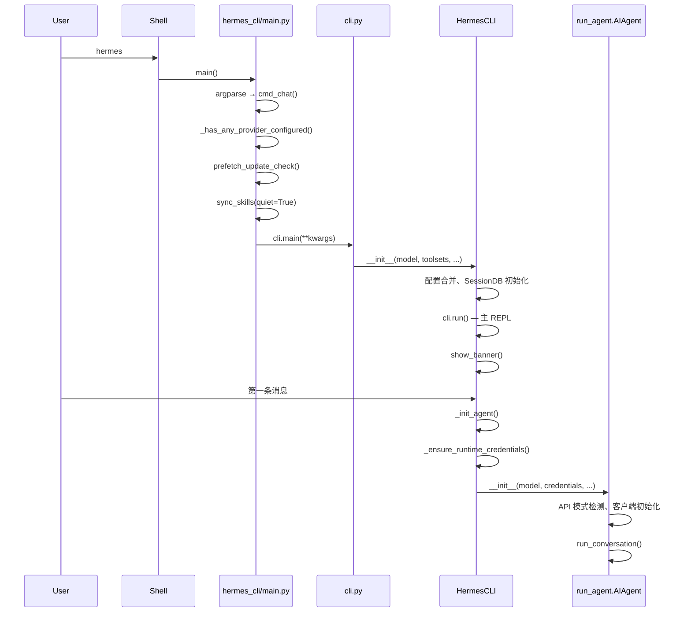

# Ch02 启动链路 Research Notes

> Task: T02-R
> Assignee: s-opus-02
> Status: DRAFT_DONE
> Date: 2026-04-15

## 1. 入口点定义

Hermes 在 `pyproject.toml` 中定义了两个入口点：

```toml
[project.scripts]
hermes = "hermes_cli.main:main"
hermes-agent = "run_agent:main"
```

- **`hermes`** → 完整交互式 CLI（日常使用）
- **`hermes-agent`** → 简化直接 agent 运行器（脚本/自动化用）

---

## 2. 链路一：交互式 CLI (`hermes` 命令)

### Phase 1 — 模块级初始化 (`cli.py` L522-564)

当 `cli.py` 被导入时，以下代码立即执行：

```python
CLI_CONFIG = load_cli_config()          # 加载 ~/.hermes/config.yaml 或 ./cli-config.yaml
setup_logging(mode="cli")               # 配置日志
print_config_warnings()                 # 配置问题警告
init_skin_from_config()                 # 初始化皮肤/主题引擎
set_tool_preview_max_len()              # 设置工具输出预览长度
neuter_async_httpx_del()                # 补丁 httpx 析构函数防止崩溃
```

**关键洞察**：这些副作用在模块导入时就执行，不等任何函数调用。

### Phase 2 — 入口分发 (`hermes_cli/main.py` L4494)

```python
def main():
    parser = argparse.ArgumentParser()
    # 子命令：chat, run, config, setup, gateway, sessions, logs, ...
    # 默认子命令是 chat → cmd_chat(args)
```

### Phase 3 — 启动前检查 (`cmd_chat`, L676-783)

1. 解析 `--continue` / `--resume` 的 session ID
2. 检查是否配置了任何 provider (`_has_any_provider_configured()`)
3. 未配置则提示运行 `hermes setup`
4. 启动后台更新检查 (`prefetch_update_check()`)
5. 同步内置技能 (`sync_skills(quiet=True)`)
6. 设置 YOLO 模式环境变量（如果请求）
7. 调用 `cli.main(**kwargs)`

### Phase 4 — `cli.main()` (L9813-10039)

```python
def main(self, ...):
    os.environ["HERMES_INTERACTIVE"] = "1"
    # 处理 gateway 模式（单独启动）
    # 设置 git worktree 隔离（如果请求）
    # 解析工具集（默认来自 _get_platform_tools()）
    # 解析技能
    # 创建 HermesCLI(model, toolsets, provider, ...) 实例
    # 注入技能和 worktree 上下文到 system prompt
    # 单查询模式 (-q): cli.chat(query) 后退出
    # 交互模式: cli.run()
```

### Phase 5 — `HermesCLI.__init__()` (L1577-1827)

关键初始化步骤：

| 步骤 | 说明 |
|------|------|
| Rich console 设置 | 终端渲染 |
| 配置合并 | CLI args > env vars > config file > defaults |
| 模型解析 | config.yaml 是权威来源（不是环境变量） |
| Provider 选择 | 延迟到 `_ensure_runtime_credentials()` |
| Max turns | CLI arg > config > env var > default (90) |
| Session ID 生成 | `YYYYMMDD_HHMMSS_<6hex>` 格式 |
| SQLite SessionDB | 会话持久化初始化 |
| 状态机 | clarify, approval, sudo, voice, spinner |
| 降级 provider 链 | 解析 fallback provider 配置 |
| 智能路由配置 | Smart model routing |

### Phase 6 — `cli.run()` (L8185-8385+)

主 REPL 循环：

1. TUI 推到终端底部
2. 显示 banner (`show_banner()`)
3. 恢复模式：加载并显示历史
4. 显示欢迎文本 + 随机提示
5. 初始化状态：队列、锁、语音模式、剪贴板
6. 注册回调：sudo, approval, secret capture
7. 确保 tirith 安全扫描器
8. 设置 `prompt_toolkit` 键绑定（Enter, Ctrl+C, 方向键）
9. 进入事件循环：prompt → process input → agent response → repeat

### Phase 7 — `_init_agent()` (L2801-2939)

**惰性初始化**——在第一条用户消息时才调用：

1. `_ensure_runtime_credentials()` → 通过 `resolve_runtime_provider()` 解析 provider
2. 处理密钥轮换、本地端点
3. 加载恢复的会话历史（从 SQLite）
4. 创建 `AIAgent(...)` — 传入 ~35+ 参数
5. 存储 agent 引用用于 atexit 清理

### Phase 8 — `AIAgent.__init__()` (`run_agent.py` L550-925+)

大规模初始化：

- **API 模式检测**：`chat_completions` / `codex_responses` / `anthropic_messages`
- **模型标准化**：非聚合器 provider 的模型名处理
- **GPT-5.x 自动升级**：切换到 Responses API
- **后台线程**：OpenRouter 模型元数据预热
- **回调注册**：10+ 种回调类型
- **迭代预算**：共享预算（与子 agent 共享）
- **Prompt 缓存**：Claude 模型的缓存配置
- **客户端初始化**：通过 provider router
- **日志设置**：`hermes_logging.setup_logging()`

---

## 3. 链路二：直接 Agent (`hermes-agent` 命令)

`run_agent.main()` (L10809-11024)，简化版：

1. 解析 CLI 参数（query, model, api_key, base_url, max_turns, toolsets）
2. 处理 `--list-tools`（如果请求）
3. 直接创建 `AIAgent(base_url, model, api_key, ...)`
4. 调用 `agent.run_conversation(user_query)`
5. 打印摘要（完成状态、API 调用数、消息数、最终响应）
6. 可选保存轨迹样本

---

## 4. 关键架构洞察

### 4.1 惰性 Agent 初始化

`AIAgent` 在第一条用户消息之前 **不会** 被创建。这允许 CLI 在不需要凭证的情况下显示 banner 和处理命令。

```
CLI 启动 → 显示 banner → 等待输入 → 第一条消息 → _init_agent() → 创建 AIAgent
```

### 4.2 凭证轮换

`_ensure_runtime_credentials()` 每次 agent 初始化时都重新解析，支持不重启的密钥轮换。

### 4.3 共享迭代预算

父 agent 和子 agent 共享一个 `IterationBudget`，防止跨委托链的失控工具循环。

### 4.4 三种 API 模式

系统根据 provider/model 检测动态选择：
- **OpenAI Chat Completions** — 默认
- **OpenAI Codex Responses** — GPT-5.x
- **Anthropic Messages** — Claude 模型

### 4.5 模块级副作用

`cli.py` 导入触发配置加载、日志设置和皮肤初始化——在任何函数调用之前。

---

## 5. 启动链路时序图



---

## 6. 关键文件索引

| 文件 | 关键行号 | 内容 |
|------|----------|------|
| `pyproject.toml` | scripts 段 | 入口点定义 |
| `hermes_cli/main.py` | L676-783 | cmd_chat() 启动前检查 |
| `hermes_cli/main.py` | L4494-4544 | main() 入口分发 |
| `cli.py` | L192-564 | 模块级初始化 |
| `cli.py` | L1577-1827 | HermesCLI.__init__() |
| `cli.py` | L2801-2939 | _init_agent() 惰性初始化 |
| `cli.py` | L8185-8385 | cli.run() 主 REPL |
| `cli.py` | L9813-10039 | cli.main() 启动协调 |
| `run_agent.py` | L550-925 | AIAgent.__init__() |
| `run_agent.py` | L10809-11024 | hermes-agent 直接入口 |

---

## 7. 设计模式

1. **延迟初始化（Lazy Init）**：Agent 到真正需要时才创建
2. **配置瀑布（Config Cascade）**：CLI args > env > config file > defaults
3. **模块级 Bootstrap**：导入即初始化关键子系统
4. **策略模式（Strategy）**：三种 API 模式根据 provider 动态切换
5. **观察者模式（Observer）**：10+ 回调类型用于跨组件通信
