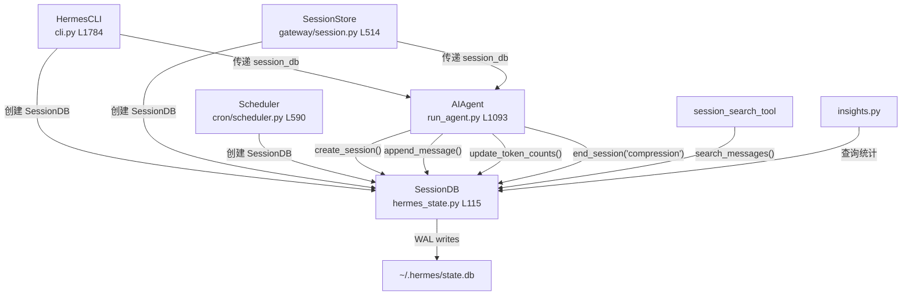
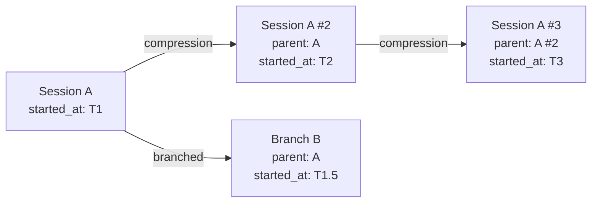

# Ch04 状态持久化 Research Notes

> **Task:** T04-R  
> **源码文件:** `hermes_state.py` (1238 行)  
> **关联文件:** `hermes_constants.py`, `run_agent.py`, `cli.py`, `gateway/session.py`, `tools/session_search_tool.py`, `agent/insights.py`, `tests/test_hermes_state.py`  
> **Assignee:** s-opus-04  
> **Date:** 2026-04-15

---

## 引导问题

Hermes Agent 如何在多进程（CLI + 网关 + worktree agent）共享同一个 SQLite 数据库的场景下，实现高并发写入、全文搜索和会话链路追踪？

---

## 1. 文件概览

`hermes_state.py` 是 Hermes 的 **核心持久化层**，封装了一个名为 `SessionDB` 的类（L115-1238），负责：

1. **Session 生命周期管理** — 创建、结束、重新打开、删除、剪枝
2. **消息存储** — 追加消息、加载历史、OpenAI 格式转换
3. **FTS5 全文搜索** — 跨所有 session 的消息搜索
4. **Session 标题系统** — 命名、去重、谱系编号
5. **Token 和费用统计** — 增量/绝对两种更新模式
6. **并发写入安全** — WAL 模式 + 应用层随机抖动重试

---

## 2. 数据库 Schema 设计

### 2.1 核心表（L36-91）

**`schema_version` 表** — 单行版本号（当前 `SCHEMA_VERSION = 6`，L34）

**`sessions` 表** — 会话元数据（L41-69）

```sql
CREATE TABLE IF NOT EXISTS sessions (
    id TEXT PRIMARY KEY,                    -- 格式: YYYYMMDD_HHMMSS_<6位uuid>
    source TEXT NOT NULL,                   -- 来源标识: 'cli', 'telegram', 'discord', etc.
    user_id TEXT,                           -- 用户 ID（gateway 场景）
    model TEXT,                             -- 模型名如 'anthropic/claude-opus-4.6'
    model_config TEXT,                      -- JSON: max_iterations, reasoning_config 等
    system_prompt TEXT,                     -- 完整 system prompt 快照
    parent_session_id TEXT,                 -- 父 session ID（压缩分裂/分支）
    started_at REAL NOT NULL,              -- Unix 时间戳
    ended_at REAL,                         -- 结束时间
    end_reason TEXT,                       -- 结束原因: 'user_exit', 'compression', 'branched'
    message_count INTEGER DEFAULT 0,        -- 消息计数器
    tool_call_count INTEGER DEFAULT 0,      -- 工具调用计数器
    -- Token 统计（v5 新增）
    input_tokens INTEGER DEFAULT 0,
    output_tokens INTEGER DEFAULT 0,
    cache_read_tokens INTEGER DEFAULT 0,
    cache_write_tokens INTEGER DEFAULT 0,
    reasoning_tokens INTEGER DEFAULT 0,
    -- 费用追踪（v5 新增）
    billing_provider TEXT,
    billing_base_url TEXT,
    billing_mode TEXT,
    estimated_cost_usd REAL,
    actual_cost_usd REAL,
    cost_status TEXT,
    cost_source TEXT,
    pricing_version TEXT,
    -- 标题（v3 新增）
    title TEXT,
    FOREIGN KEY (parent_session_id) REFERENCES sessions(id)
);
```

**`messages` 表** — 消息存储（L71-85）

```sql
CREATE TABLE IF NOT EXISTS messages (
    id INTEGER PRIMARY KEY AUTOINCREMENT,
    session_id TEXT NOT NULL REFERENCES sessions(id),
    role TEXT NOT NULL,                     -- 'user', 'assistant', 'tool', 'system'
    content TEXT,                           -- 消息正文
    tool_call_id TEXT,                      -- 工具调用 ID
    tool_calls TEXT,                        -- JSON: [{name, arguments}]
    tool_name TEXT,                         -- 工具名
    timestamp REAL NOT NULL,               -- Unix 时间戳
    token_count INTEGER,
    finish_reason TEXT,                    -- v2 新增
    reasoning TEXT,                        -- v6 新增: 推理文本
    reasoning_details TEXT,                -- v6 新增: 结构化推理详情(JSON)
    codex_reasoning_items TEXT             -- v6 新增: Codex 推理项(JSON)
);
```

### 2.2 索引设计（L87-90）

```sql
CREATE INDEX idx_sessions_source ON sessions(source);          -- 按来源过滤
CREATE INDEX idx_sessions_parent ON sessions(parent_session_id); -- 追踪谱系链
CREATE INDEX idx_sessions_started ON sessions(started_at DESC); -- 时间倒序列表
CREATE INDEX idx_messages_session ON messages(session_id, timestamp); -- 按 session 加载消息
```

此外还有一个**条件唯一索引**（L283-284, L336-339）：
```sql
CREATE UNIQUE INDEX idx_sessions_title_unique ON sessions(title) WHERE title IS NOT NULL
```
→ 允许多个 session 没有标题（NULL），但非 NULL 标题必须全局唯一。

### 2.3 FTS5 全文搜索（L93-112）

```sql
CREATE VIRTUAL TABLE messages_fts USING fts5(
    content,
    content=messages,        -- 外部内容表（content-sync 模式）
    content_rowid=id
);
```

使用 **content-sync 模式**：FTS 索引不存储原始内容，而是通过 `content=messages` 指向原始 `messages` 表。这省内存，但要求通过**触发器**保持同步：

- `messages_fts_insert` — INSERT 后同步 (L100-102)
- `messages_fts_delete` — DELETE 后同步 (L104-106)  
- `messages_fts_update` — UPDATE 后先删再加 (L108-111)

---

## 3. Schema 迁移系统（L252-349）

采用 **线性版本号 + ALTER TABLE** 策略，当前版本 6。

| 版本 | 变更 | 行号 |
|------|------|------|
| v1→v2 | messages 表增加 `finish_reason` 列 | L265-271 |
| v2→v3 | sessions 表增加 `title` 列 | L272-278 |
| v3→v4 | sessions 表增加 `title` 唯一索引（WHERE NOT NULL） | L279-288 |
| v4→v5 | sessions 表增加 11 个列（cache tokens + billing 字段） | L289-312 |
| v5→v6 | messages 表增加 3 个 reasoning 列 | L313-331 |

**设计要点：**
- 每个 `ALTER TABLE` 包裹在 `try/except sqlite3.OperationalError: pass` 中 → 幂等执行，列已存在不报错
- 迁移完成后更新 `schema_version` 表
- FTS5 虚拟表创建放在迁移之后单独处理（L343-347），因为 `CREATE VIRTUAL TABLE ... IF NOT EXISTS` 在 `executescript` 中不可靠

---

## 4. 并发写入架构（核心亮点）

### 4.1 WAL 模式配置（L157）

```python
self._conn.execute("PRAGMA journal_mode=WAL")
```

WAL (Write-Ahead Logging) 允许 **多读者 + 单写者并发**，是 SQLite 在多进程场景下的最佳实践。

### 4.2 应用层随机抖动重试（L123-214）

这是本文件最精妙的设计。传统做法是设置 SQLite 的 `busy_timeout` 让数据库自己等锁，但 Hermes 选择了不同的方案：

**类常量（L132-136）：**
```python
_WRITE_MAX_RETRIES = 15
_WRITE_RETRY_MIN_S = 0.020   # 20ms
_WRITE_RETRY_MAX_S = 0.150   # 150ms
_CHECKPOINT_EVERY_N_WRITES = 50
```

**`_execute_write()` 方法（L164-214）：**

```python
def _execute_write(self, fn: Callable[[sqlite3.Connection], T]) -> T:
    last_err = None
    for attempt in range(self._WRITE_MAX_RETRIES):
        try:
            with self._lock:                          # Python 线程锁
                self._conn.execute("BEGIN IMMEDIATE")  # 立即获取 WAL 写锁
                try:
                    result = fn(self._conn)
                    self._conn.commit()
                except BaseException:
                    self._conn.rollback()
                    raise
            # 成功后周期性 WAL checkpoint
            self._write_count += 1
            if self._write_count % self._CHECKPOINT_EVERY_N_WRITES == 0:
                self._try_wal_checkpoint()
            return result
        except sqlite3.OperationalError as exc:
            if "locked" in str(exc).lower() or "busy" in str(exc).lower():
                last_err = exc
                if attempt < self._WRITE_MAX_RETRIES - 1:
                    jitter = random.uniform(0.020, 0.150)  # 随机退避
                    time.sleep(jitter)
                    continue
            raise
```

**为什么不用 SQLite 内置的 `busy_handler`？**

代码注释（L123-131）解释得很清楚：

> SQLite's built-in busy handler uses a deterministic sleep schedule that causes **convoy effects** under high concurrency.

**Convoy effect（护航效应）**：当多个进程都在固定时间点重试时，它们会同时醒来争锁，导致所有人一起失败、一起睡眠，形成周期性的锁竞争浪潮。

Hermes 的解决方案：
1. **SQLite timeout 设为 1 秒**（L150）— 短超时，快速失败
2. **应用层用 `random.uniform(20ms, 150ms)` 做随机退避** — 自然错开竞争者
3. **最多重试 15 次** — 总最大等待 ~2.25 秒

### 4.3 双层锁结构

1. **Python `threading.Lock`** (`self._lock`, L142) — 保护同进程内的线程安全
2. **SQLite `BEGIN IMMEDIATE`** — 保护跨进程的写锁（WAL 级别）

**`BEGIN IMMEDIATE` vs `BEGIN`：**
- `BEGIN` (deferred) 在首次写操作时才获取锁，可能导致 commit 时才发现冲突
- `BEGIN IMMEDIATE` 在事务开始就获取写锁，**让冲突尽早暴露**

### 4.4 WAL Checkpoint（L216-235, L136）

```python
_CHECKPOINT_EVERY_N_WRITES = 50

def _try_wal_checkpoint(self):
    """Best-effort PASSIVE WAL checkpoint. Never blocks, never raises."""
    try:
        with self._lock:
            result = self._conn.execute("PRAGMA wal_checkpoint(PASSIVE)").fetchone()
    except Exception:
        pass  # Best effort
```

每写入 50 次触发一次 **PASSIVE checkpoint**：
- `PASSIVE` = 只回写其他连接不再需要的 WAL 帧，**绝不阻塞**
- 防止 WAL 文件无限增长
- `close()` 时也会尝试 checkpoint（L246）

### 4.5 连接配置（L144-156）

```python
self._conn = sqlite3.connect(
    str(self.db_path),
    check_same_thread=False,    # 允许跨线程使用（配合 self._lock）
    timeout=1.0,                # 短超时，快速失败
    isolation_level=None,       # 关闭 Python 自动事务管理
)
self._conn.row_factory = sqlite3.Row  # 结果以字典风格访问
self._conn.execute("PRAGMA foreign_keys=ON")  # 启用外键约束
```

**`isolation_level=None` 的妙处：**
Python 的 `sqlite3` 默认会在 DML 之前自动插入 `BEGIN`，与 `_execute_write()` 的显式 `BEGIN IMMEDIATE` 冲突。设为 `None` 关闭自动事务，让 Hermes 完全掌控事务边界。

---

## 5. Session 生命周期

### 5.1 创建（L355-383）

`create_session()` 使用 `INSERT OR IGNORE`：
- 幂等操作 — 重复创建不会报错
- 传入 `session_id` 格式由调用方生成：`YYYYMMDD_HHMMSS_<6hex>`

### 5.2 确保存在（L502-521）

`ensure_session()` — 专为 `_flush_messages_to_session_db` 设计的容错入口。如果初始 `create_session()` 因锁竞争失败，后续写消息时先确保 session 行存在。

### 5.3 结束和重新打开（L385-401）

```python
def end_session(self, session_id, end_reason):  # 标记 ended_at + end_reason
def reopen_session(self, session_id):            # 清除 ended_at + end_reason
```

### 5.4 Session 解析与前缀匹配（L532-557）

`resolve_session_id()` 支持 **前缀匹配**：
1. 先精确查找
2. 若不存在，用 `LIKE '{escaped}%'` 前缀匹配
3. 仅当匹配结果**恰好 1 个**时返回（消除歧义）

注意对 `%`, `_`, `\` 的 SQL LIKE 转义处理（L543-548）。

---

## 6. Session 标题系统（L559-715）

### 6.1 标题清洗（L562-604）

`sanitize_title()` 是一个 `@staticmethod`，执行多层清理：
1. 移除 ASCII 控制字符（保留 tab/newline/CR 以便后续归并）
2. 移除 Unicode 零宽字符、方向覆盖字符
3. 折叠连续空白 → 单空格
4. 强制 `MAX_TITLE_LENGTH = 100` 上限
5. 空白 → None

### 6.2 标题唯一性保证（L606-633）

`set_session_title()` 在写事务内先查询是否已有同名标题：
```sql
SELECT id FROM sessions WHERE title = ? AND id != ?
```
→ 如果冲突则 raise `ValueError`

### 6.3 谱系编号（L682-715）

`get_next_title_in_lineage()` 实现 **"my session" → "my session #2" → "my session #3"** 的自动编号：

1. 先 strip 已有 `#N` 后缀找到 base
2. 查询所有 `title = base` 或 `title LIKE 'base #%'` 的 session
3. 找到最大编号 → +1

### 6.4 按标题解析（L653-680）

`resolve_session_by_title()` 的优先级：
1. 精确匹配存在 + 编号变体也存在 → 返回**最新编号**（最近的延续）
2. 仅精确匹配 → 返回精确匹配
3. 仅编号变体 → 返回最新编号

---

## 7. 消息存储与加载

### 7.1 追加消息（L791-864）

`append_message()` 在单个写事务中完成：
1. 序列化 `tool_calls`, `reasoning_details`, `codex_reasoning_items` 为 JSON
2. INSERT 消息行
3. UPDATE session 的 `message_count` (+1) 和 `tool_call_count` (如有 tool_calls 则 +N)

**FTS 同步通过触发器自动完成** — 无需在代码中手动写入 FTS 表。

### 7.2 加载消息（L866-884）

`get_messages()` — 按 `(timestamp, id)` 排序加载所有消息，反序列化 `tool_calls` JSON。

### 7.3 OpenAI 格式转换（L886-931）

`get_messages_as_conversation()` — 网关恢复会话历史时使用：
- 只取 `role, content, tool_call_id, tool_calls, tool_name` 
- **v6 新增**：对 assistant 消息恢复 `reasoning`, `reasoning_details`, `codex_reasoning_items`
- 注释说明原因（L912-914）：providers that replay reasoning (OpenRouter, OpenAI, Nous) 需要连贯的推理上下文

---

## 8. Token 和费用统计（L412-500）

`update_token_counts()` 支持两种模式：

- **增量模式** (`absolute=False`, 默认) — CLI 路径，每次 API 调用后发送 delta
- **绝对模式** (`absolute=True`) — Gateway 路径，agent 已累积总计，直接覆盖

**费用字段的 COALESCE 逻辑：**
- `estimated_cost_usd` — 始终累加/覆盖
- `actual_cost_usd` — NULL 时不覆盖（供应商可能还没返回实际费用）
- `billing_provider/base_url/mode` — 仅回填（COALESCE 先取已有值）
- `model` — 仅回填（首次可能未知，后续 API 返回后补填）

---

## 9. FTS5 搜索实现（L937-1091）

### 9.1 查询清洗（L937-988）

`_sanitize_fts5_query()` 是一个精心设计的 `@staticmethod`，解决 FTS5 查询注入问题：

1. **保护合法引号短语** — 提取 `"exact phrase"` 并用占位符替换
2. **移除 FTS5 特殊字符** — `+ { } ( ) " ^`
3. **折叠连续 `*`** — 并移除行首 `*`（FTS5 要求前缀前至少一个字符）
4. **清除悬挂布尔运算符** — 如 `"hello AND"` → `"hello"`
5. **引用含点/连字符的术语** — `chat-send` → `"chat-send"`（防止 FTS5 tokenizer 拆分）
6. **恢复保护的引号短语**

### 9.2 消息搜索（L990-1091）

`search_messages()` 的查询结构：

```sql
SELECT m.id, m.session_id, m.role,
       snippet(messages_fts, 0, '>>>', '<<<', '...', 40) AS snippet,
       m.content, m.timestamp, m.tool_name,
       s.source, s.model, s.started_at
FROM messages_fts
JOIN messages m ON m.id = messages_fts.rowid
JOIN sessions s ON s.id = m.session_id
WHERE messages_fts MATCH ? [AND s.source IN (...)] [AND m.role IN (...)]
ORDER BY rank          -- FTS5 BM25 排名
LIMIT ? OFFSET ?
```

**设计要点：**
- `snippet()` 函数在匹配位置生成 `>>>highlight<<<` 标记，最多 40 个 token
- 支持按 `source`, `role` 过滤
- 每个匹配结果附加**上下文**（前后各 1 条消息，L1068-1085）
- 上下文查询在 lock 外逐条执行，避免长时间持锁
- 最终 **删除 full content**（L1088-1089），只保留 snippet → 节省 token

---

## 10. Session 列表（L717-785）

`list_sessions_rich()` 使用**关联子查询**替代 N+2 查询：

```sql
SELECT s.*,
    COALESCE(
        (SELECT SUBSTR(REPLACE(REPLACE(m.content, X'0A', ' '), X'0D', ' '), 1, 63)
         FROM messages m
         WHERE m.session_id = s.id AND m.role = 'user' AND m.content IS NOT NULL
         ORDER BY m.timestamp, m.id LIMIT 1),
        ''
    ) AS _preview_raw,
    COALESCE(
        (SELECT MAX(m2.timestamp) FROM messages m2 WHERE m2.session_id = s.id),
        s.started_at
    ) AS last_active
FROM sessions s
[WHERE s.parent_session_id IS NULL AND ...]
ORDER BY s.started_at DESC
LIMIT ? OFFSET ?
```

**要点：**
- 默认**排除子 session**（`parent_session_id IS NULL`），保持列表干净
- preview = 第一条 user 消息的前 60 字符
- 换行符替换为空格（`REPLACE(m.content, X'0A', ' ')`）

---

## 11. 导出和清理（L1139-1238）

### 11.1 导出

- `export_session()` — 单个 session + 所有消息（L1143-1149）
- `export_all()` — 批量导出，最多 100,000 条（L1151-1161）

### 11.2 删除

`delete_session()` (L1175-1197)：
- 不级联删除子 session — 改为**孤儿化**（`parent_session_id = NULL`）
- 先删消息，再删 session

### 11.3 剪枝

`prune_sessions()` (L1199-1238)：
- 只删除已结束（`ended_at IS NOT NULL`）且超过 N 天的 session
- 同样先孤儿化子 session

---

## 12. Session 分裂与链接机制

### 12.1 压缩触发分裂（`run_agent.py` L6825-6851）

当上下文压缩器触发时：
1. 获取旧 session 标题
2. `end_session(old_id, "compression")`
3. 生成新 session ID
4. `create_session(new_id, parent_session_id=old_id)`
5. 自动编号标题：`"my chat" → "my chat #2"`
6. 更新 system prompt
7. 重置 `_last_flushed_db_idx = 0`

### 12.2 分支操作（`cli.py` L4260-4300）

用户通过 `/branch` 命令创建新 session：
1. `end_session(current_id, "branched")`
2. `create_session(new_id, parent_session_id=current_id)`
3. 复制当前会话历史到新 session

### 12.3 消息刷写（`run_agent.py` L2327-2373）

`_flush_messages_to_session_db()`:
- 用 `_last_flushed_db_idx` 追踪已写入的消息下标 → 防止重复写入（修复 #860）
- 先调用 `ensure_session()` 确保行存在
- 跳过 `conversation_history`（已加载的历史消息）

---

## 13. 调用者分布

| 调用者 | 文件 | 用途 |
|--------|------|------|
| `HermesCLI.__init__` | `cli.py` L1784 | CLI 启动时创建 SessionDB 实例 |
| `AIAgent.__init__` | `run_agent.py` L1093 | Agent 接收外部传入的 SessionDB |
| `SessionStore.__init__` | `gateway/session.py` L514 | 网关启动时创建 SessionDB 实例 |
| `scheduler` | `cron/scheduler.py` L590 | Cron 调度保存 session |
| `mirror` | `gateway/mirror.py` L121 | 消息镜像读取 |
| `mcp_serve` | `mcp_serve.py` L74 | MCP 服务端读取 session 历史 |
| `insights` | `agent/insights.py` L103 | 用量统计分析 |
| `session_search_tool` | `tools/session_search_tool.py` | FTS5 搜索 + 总结 |

**关键架构决策：** SessionDB 实例由 CLI/Gateway 创建，通过参数传递给 AIAgent。这避免了全局单例，支持测试时注入 mock。

---

## 14. 设计取舍

### 14.1 单文件 SQLite vs 外部数据库

- ✅ **零依赖** — 无需 Redis/PostgreSQL
- ✅ **单文件部署** — `~/.hermes/state.db` 一个文件搞定
- ⚠️ 写并发上限（WAL 模式下 ~千次/秒）对 Agent 场景绰绰有余

### 14.2 FTS5 content-sync 模式 vs 独立 FTS

- ✅ 不重复存储内容 → 省空间
- ⚠️ 需要触发器保持同步 — 但 Hermes 所有写入都通过 `append_message()` 单一入口

### 14.3 应用层重试 vs SQLite busy_handler

- ✅ 随机抖动打破 convoy effect
- ✅ 总等待时间可控（~2.25s max vs busy_handler 可能 30s）
- ⚠️ 多一层代码复杂度

### 14.4 孤儿化 vs 级联删除

- ✅ 子 session 始终可独立访问
- ✅ 不会因删除父 session 丢失有价值的子对话

### 14.5 增量 vs 绝对 token 更新

- CLI 每次 API 调用后发送 delta → 增量模式
- Gateway 的 agent 跨多轮保持状态 → 绝对模式
- 两种模式共用同一方法，通过 `absolute` 参数切换

---

## 15. 可迁移设计模式

### 15.1 随机抖动写入重试（Anti-Convoy Pattern）

```python
for attempt in range(max_retries):
    try:
        with lock:
            conn.execute("BEGIN IMMEDIATE")
            result = fn(conn)
            conn.commit()
        return result
    except OperationalError as e:
        if "locked" in str(e):
            time.sleep(random.uniform(min_s, max_s))
            continue
        raise
```

适用于：任何多进程共享 SQLite 的场景。

### 15.2 外部内容 FTS5 + 触发器同步

```sql
CREATE VIRTUAL TABLE t_fts USING fts5(col, content=t, content_rowid=id);
-- 配合 INSERT/DELETE/UPDATE 触发器
```

适用于：需要对大表做全文搜索但不想重复存储数据的场景。

### 15.3 Schema 迁移的幂等 ALTER TABLE

```python
for col, col_type in new_columns:
    try:
        cursor.execute(f'ALTER TABLE t ADD COLUMN "{col}" {col_type}')
    except OperationalError:
        pass  # 列已存在
```

适用于：嵌入式数据库不支持 `ALTER TABLE ... IF NOT EXISTS` 语法的场景。

---

## 16. Mermaid 草稿

### 数据流



### Session 分裂链



---

## 17. 最小运行验证

以下代码可在 Hermes 环境中验证 SessionDB 核心功能：

```python
from pathlib import Path
from hermes_state import SessionDB

# 使用临时数据库
db = SessionDB(db_path=Path("/tmp/test_hermes_state.db"))

# 1. 创建 session
sid = db.create_session("test-001", source="cli", model="test/model")
print(f"Created session: {sid}")

# 2. 追加消息
mid = db.append_message(sid, role="user", content="Hello, Hermes!")
print(f"Message ID: {mid}")

# 3. 验证 FTS5 搜索
results = db.search_messages("Hermes")
print(f"Search results: {len(results)}")
for r in results:
    print(f"  Session: {r['session_id']}, Snippet: {r['snippet']}")

# 4. 验证 session 分裂
db.end_session(sid, "compression")
sid2 = db.create_session("test-002", source="cli", parent_session_id=sid)
child = db.get_session(sid2)
print(f"Child parent: {child['parent_session_id']}")

# 5. 验证列表排除子 session
sessions = db.list_sessions_rich()
print(f"Top-level sessions: {len(sessions)}")

db.close()
```

---

## 18. 关键行号索引

| 概念 | 行号 |
|------|------|
| SCHEMA_VERSION | L34 |
| SCHEMA_SQL (sessions + messages 表) | L36-91 |
| FTS_SQL (虚拟表 + 触发器) | L93-112 |
| SessionDB 类定义 | L115 |
| 写入重试常量 | L132-136 |
| `__init__` (连接配置) | L138-160 |
| `_execute_write` (核心写入) | L164-214 |
| `_try_wal_checkpoint` | L216-235 |
| `close` | L237-250 |
| `_init_schema` (迁移) | L252-349 |
| `create_session` | L355-383 |
| `end_session` | L385-392 |
| `reopen_session` | L394-401 |
| `update_token_counts` | L412-500 |
| `ensure_session` | L502-521 |
| `get_session` | L523-530 |
| `resolve_session_id` | L532-557 |
| `sanitize_title` | L562-604 |
| `set_session_title` | L606-633 |
| `resolve_session_by_title` | L653-680 |
| `get_next_title_in_lineage` | L682-715 |
| `list_sessions_rich` | L717-785 |
| `append_message` | L791-864 |
| `get_messages` | L866-884 |
| `get_messages_as_conversation` | L886-931 |
| `_sanitize_fts5_query` | L937-988 |
| `search_messages` | L990-1091 |
| `search_sessions` | L1093-1111 |
| `session_count` | L1117-1126 |
| `message_count` | L1128-1137 |
| `export_session` | L1143-1149 |
| `export_all` | L1151-1161 |
| `clear_messages` | L1163-1173 |
| `delete_session` | L1175-1197 |
| `prune_sessions` | L1199-1238 |
