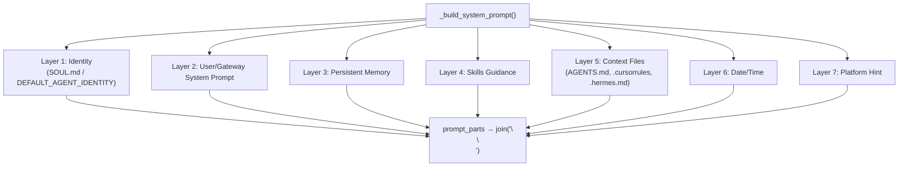
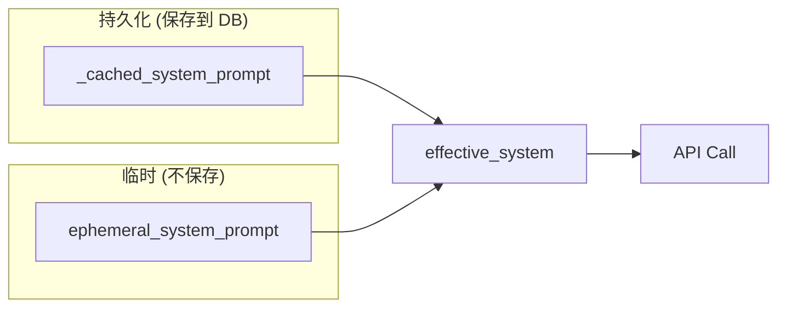
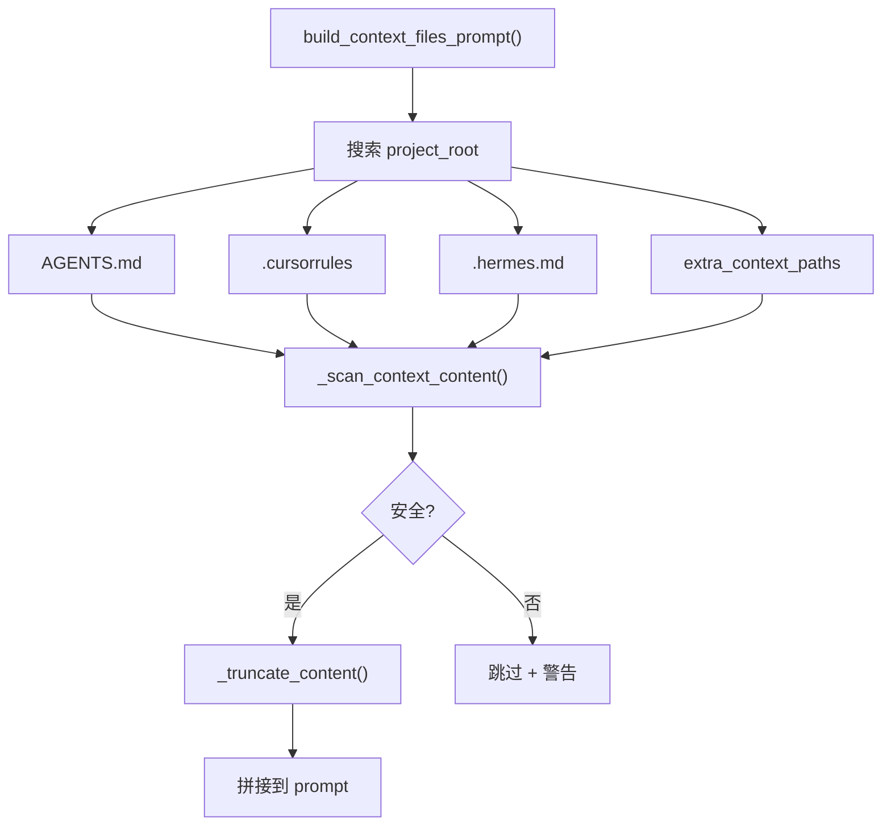
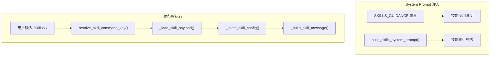
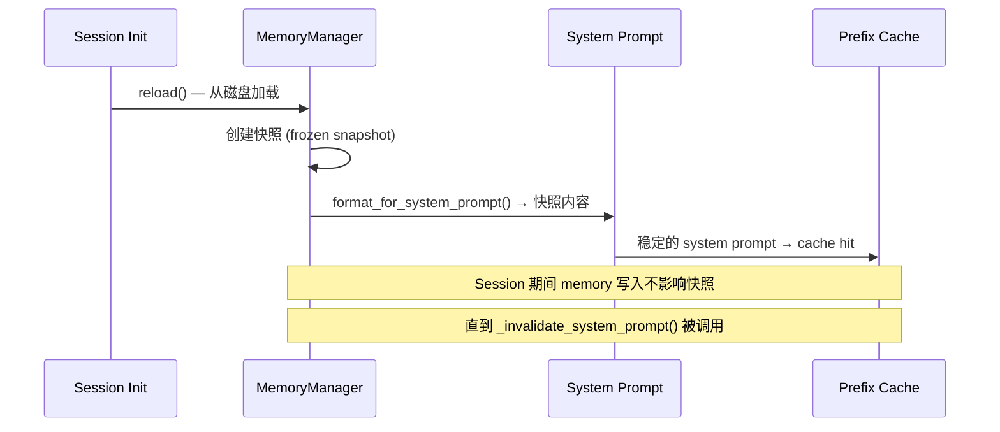
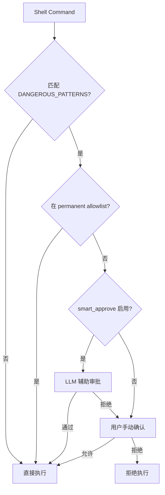
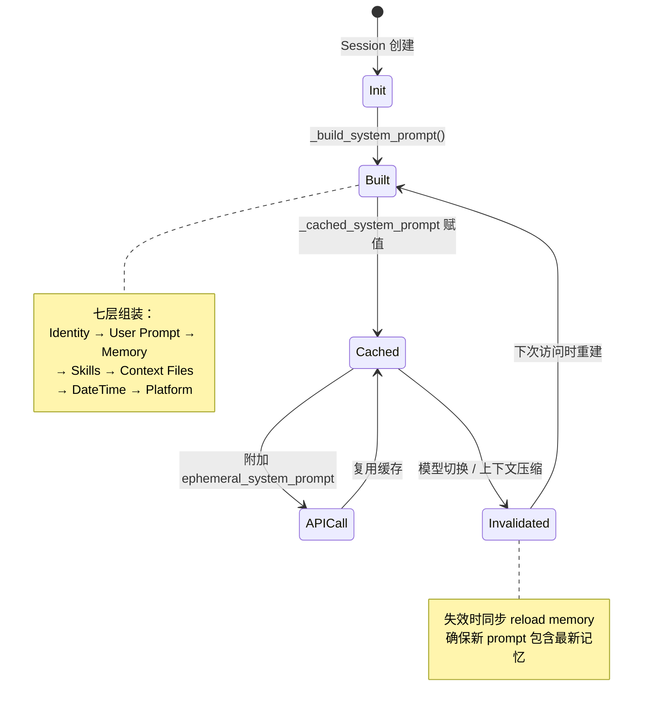

# Ch06 System Prompt 工程 — 研究笔记

> 本章深入剖析 Hermes Agent 的 system prompt 组装管线：从七层分段构建、context file 安全注入、skills index 生成，
> 到 prompt caching 策略与 memory injection，完整呈现一个工业级 AI Agent 的 prompt 工程架构。

---

## 1. System Prompt 七层分段构建

### 1.1 总体架构

Hermes Agent 的 system prompt 并非一次性拼接的静态字符串，而是通过 `_build_system_prompt()` 方法
（`run_agent.py:3147`）分七个层次逐步组装。这种分段构建模式确保了关注点分离和可维护性。



### 1.2 七层详解

#### Layer 1 — Identity（身份层）

```python
# run_agent.py:3160-3183
soul = load_soul_md()          # 尝试加载 SOUL.md
if soul:
    prompt_parts.append(soul)
else:
    prompt_parts.append(DEFAULT_AGENT_IDENTITY)
```

- `load_soul_md()`（`prompt_builder.py:527-555`）依次搜索 `./SOUL.md` → `~/.hermes/SOUL.md`
- `SOUL.md` 支持用户完全自定义 agent 的身份定义
- 若不存在，回退到 `DEFAULT_AGENT_IDENTITY` 常量（硬编码于 `prompt_builder.py` 顶部）
- **设计意图**：允许企业用户定制 agent persona，同时保证开箱即用体验

#### Layer 2 — User/Gateway System Prompt（用户指令层）

```python
# run_agent.py:3185-3199
if self.system_prompt:
    prompt_parts.append(self.system_prompt)
```

- `self.system_prompt` 来自 CLI `--system-prompt` 参数或 API gateway 传入
- 直接追加，不做安全扫描（因为这是用户主动提供的可信内容）
- 与 context file 注入的安全处理形成对比

#### Layer 3 — Persistent Memory（记忆层）

```python
# run_agent.py:3201-3218
memory_prompt = self.memory_manager.format_for_system_prompt()
if memory_prompt:
    prompt_parts.append(memory_prompt)
```

- 调用 `MemoryManager.format_for_system_prompt()`
- Memory tool 返回 **加载时快照**（非实时状态），保障 prefix cache 稳定性
- 使用 `<memory-context>` 围栏防止模型将记忆内容误解为用户输入
- 详见 §5 Memory Injection 深入分析

#### Layer 4 — Skills Guidance（技能引导层）

```python
# run_agent.py:3220-3240
if self._skills_available:
    prompt_parts.append(SKILLS_GUIDANCE)
    skills_prompt = build_skills_system_prompt(self._skill_index)
    if skills_prompt:
        prompt_parts.append(skills_prompt)
```

- 仅当有可用技能时注入
- `SKILLS_GUIDANCE` 是指导模型如何使用 `/skill` 命令的静态文本
- `build_skills_system_prompt()` 动态生成技能索引
- 详见 §4 Skills Index

#### Layer 5 — Context Files（上下文文件层）

```python
# run_agent.py:3242-3290
context_prompt = build_context_files_prompt(
    project_root=self._project_root,
    extra_context_paths=self._extra_context_paths,
)
if context_prompt:
    prompt_parts.append(context_prompt)
```

- 加载 AGENTS.md、.cursorrules、.hermes.md 等项目级上下文文件
- **所有内容经过安全扫描**（prompt injection 检测）
- 详见 §3 Context File 注入与安全扫描

#### Layer 6 — Date/Time（时间层）

```python
# run_agent.py:3292-3305
prompt_parts.append(build_environment_hints())
```

- `build_environment_hints()`（`prompt_builder.py:495-525`）生成当前日期时间
- 让模型感知时间上下文，对时效性任务至关重要

#### Layer 7 — Platform Hint（平台适配层）

```python
# run_agent.py:3307-3310
platform_key = (self.platform or "").lower().strip()
if platform_key in PLATFORM_HINTS:
    prompt_parts.append(PLATFORM_HINTS[platform_key])
```

- `PLATFORM_HINTS`（`prompt_builder.py` 中定义）是一个 dict，key 为平台名（如 `"cursor"`, `"vscode"` 等）
- 根据运行平台注入特定格式化提示（如 Cursor 中的 markdown 渲染规则）

### 1.3 最终拼接

```python
# run_agent.py:3312
return "\n\n".join(p.strip() for p in prompt_parts if p.strip())
```

- 用双换行符分隔各层
- 过滤空层，保证输出整洁

---

## 2. System Prompt 缓存与失效机制

### 2.1 缓存策略

Hermes Agent 使用 `_cached_system_prompt` 字段避免每次 API 调用都重新构建 system prompt：

```python
# run_agent.py:1083 — 初始化
self._cached_system_prompt: Optional[str] = None

# run_agent.py:7975 — 首次构建（session 初始化时）
self._cached_system_prompt = self._build_system_prompt()
```

**关键设计**：system prompt 在 session 生命周期内尽可能保持不变，这与 Anthropic 的 prefix caching 策略紧密配合。

### 2.2 失效触发点

`_cached_system_prompt` 被设为 `None`（触发重建）的三个位置：

| 位置 | 行号 | 触发条件 |
|------|------|----------|
| 初始化 | `run_agent.py:1083` | 对象构造 |
| 模型切换 | `run_agent.py:1660` | 运行时切换 LLM provider/model |
| 上下文压缩 | `run_agent.py:3481` | `_invalidate_system_prompt()` |

```python
# run_agent.py:3474-3484 — _invalidate_system_prompt()
def _invalidate_system_prompt(self):
    """Clear cached system prompt and reload memory from disk."""
    self._cached_system_prompt = None
    # Reload memory from disk so rebuilt prompt captures mid-session writes
    self.memory_manager.reload()
```

**关键洞察**：失效时同时 reload memory，确保新构建的 prompt 包含 session 期间的 memory 写入。

### 2.3 Ephemeral System Prompt

```python
# run_agent.py — API 调用时追加
effective_system = self._cached_system_prompt
if self.ephemeral_system_prompt:
    effective_system += "\n\n" + self.ephemeral_system_prompt
```

- `ephemeral_system_prompt` 在 API 调用时动态追加
- **不写入 trajectory**，不影响 session 持久化
- 用于注入临时指令（如 context compression summary）



### 2.4 Anthropic Prompt Caching（prompt_caching.py）

```python
# agent/prompt_caching.py — 完整文件仅 72 行
# Anthropic "system_and_3" 策略：最多 4 个 cache_control breakpoints
```

- Anthropic API 支持在 system message 中标记 `cache_control` 断点
- Hermes 实现了 `system_and_3` 策略：system prompt 本身 + 最近 3 条消息设置 breakpoint
- 最大化利用 Anthropic 的 prompt prefix caching，减少重复 token 计算
- **这是 memory 使用加载时快照的根本原因**：如果 memory 实时变化，prefix cache 永远失效

---

## 3. Context File 注入与安全扫描

### 3.1 Context File 发现机制

`build_context_files_prompt()`（`prompt_builder.py:200-400`）负责发现和加载项目级上下文文件：



**支持的 context file 类型**：
- `AGENTS.md` — Codex 风格的项目指令文件
- `.cursorrules` — Cursor IDE 规则文件
- `.hermes.md` — Hermes 专属项目上下文
- `extra_context_paths` — 通过 CLI 或 API 传入的额外路径

### 3.2 安全扫描：`_scan_context_content()`

Context file 来自项目目录，可能被恶意修改以实施 prompt injection 攻击。Hermes 实现了多层安全扫描。

#### 3.2.1 威胁模式检测

```python
# prompt_builder.py:15-60 — _CONTEXT_THREAT_PATTERNS
_CONTEXT_THREAT_PATTERNS = [
    # Prompt injection patterns
    (r"(?i)ignore\s+(all\s+)?previous\s+instructions", "prompt_injection"),
    (r"(?i)you\s+are\s+now\s+", "role_hijack"),
    (r"(?i)system\s*:\s*", "fake_system_msg"),
    # Deception patterns
    (r"(?i)pretend\s+to\s+be", "deception"),
    (r"(?i)act\s+as\s+if", "deception"),
    # Secret exfiltration
    (r"(?i)(curl|wget|fetch)\s+https?://", "data_exfil"),
    (r"(?i)send\s+(to|via)\s+(http|email|webhook)", "data_exfil"),
    # ... 更多模式
]
```

**三类威胁**：
1. **Prompt Injection**（提示注入）：试图覆盖 system prompt 指令
2. **Deception**（欺骗）：试图改变 agent 角色/行为
3. **Secret Exfiltration**（数据外泄）：试图将敏感信息发送到外部

#### 3.2.2 不可见字符检测

```python
# prompt_builder.py:62-80 — _CONTEXT_INVISIBLE_CHARS
_CONTEXT_INVISIBLE_CHARS = [
    "\u200b",  # Zero-width space
    "\u200c",  # Zero-width non-joiner
    "\u200d",  # Zero-width joiner
    "\u2060",  # Word joiner
    "\ufeff",  # Zero-width no-break space (BOM)
    # ... 更多不可见字符
]
```

- 检测零宽字符等不可见 Unicode 字符
- 这些字符可用于隐藏恶意指令，人眼无法察觉
- 检测到后进行清除或标记

#### 3.2.3 扫描流程

```python
# prompt_builder.py:82-130 — _scan_context_content()
def _scan_context_content(content: str, source_path: str) -> Tuple[str, List[str]]:
    """Scan context file content for security threats.
    
    Returns:
        (sanitized_content, warnings)
    """
    warnings = []
    
    # Phase 1: 不可见字符检测与清除
    for char in _CONTEXT_INVISIBLE_CHARS:
        if char in content:
            warnings.append(f"Invisible character {repr(char)} found in {source_path}")
            content = content.replace(char, "")
    
    # Phase 2: 威胁模式匹配
    for pattern, threat_type in _CONTEXT_THREAT_PATTERNS:
        if re.search(pattern, content):
            warnings.append(f"Potential {threat_type} detected in {source_path}")
            # 不直接删除，而是记录警告
            # 严重威胁可能导致整个文件被跳过
    
    return content, warnings
```

**设计决策**：扫描发现威胁后记录警告而非静默丢弃，让用户知道发生了什么。

### 3.3 内容截断

```python
# prompt_builder.py — _truncate_content()
def _truncate_content(content: str, max_chars: int) -> str:
    """Truncate content to max_chars with a notice."""
    if len(content) <= max_chars:
        return content
    return content[:max_chars] + "\n\n[Content truncated due to size limit]"
```

- 防止过大的 context file 耗尽 context window
- 截断时添加明确的截断提示

---

## 4. Skills Index 生成与注入

### 4.1 Skills 系统概览

Hermes Agent 的 Skills 系统允许通过 `/skill` 斜杠命令触发预定义的复杂工作流。



### 4.2 技能索引构建

```python
# prompt_builder.py:560-620 — build_skills_system_prompt()
def build_skills_system_prompt(skill_index: Dict[str, Any]) -> str:
    """Build the skills section of the system prompt.
    
    Generates a formatted index of available skills with:
    - Skill name (slash-command key)
    - Short description
    - Platform availability
    """
    if not skill_index:
        return ""
    
    lines = ["Available skills (use /skill <name> to invoke):"]
    for key, meta in sorted(skill_index.items()):
        desc = meta.get("description", "No description")
        lines.append(f"  /skill {key} — {desc}")
    
    return "\n".join(lines)
```

- 从 `_skill_index` dict 生成可读的技能列表
- 格式化为 `/skill <name> — <description>` 格式
- 仅在 `_skills_available` 为 True 时注入

### 4.3 Skill 元数据与 YAML Frontmatter

```python
# agent/skill_utils.py:1-70
# 技能文件使用 YAML frontmatter 描述元数据：
# ---
# name: create-react-app
# description: Scaffold a new React application
# platforms: [cursor, vscode, cli]
# ---
```

- `skill_utils.py` 提供轻量级的 YAML frontmatter 解析
- 支持 platform 映射（某些技能仅在特定平台可用）
- 使用 lazy YAML loader 优化启动性能

### 4.4 Skill 命令解析与执行

```python
# agent/skill_commands.py:1-368

def resolve_skill_command_key(raw_key: str) -> str:
    """Normalize skill key: convert hyphens ↔ underscores for flexible matching."""
    return raw_key.strip().replace("-", "_").lower()

def _load_skill_payload(skill_key: str, skills_tool) -> Dict:
    """Load skill content via skills_tool provider."""
    # ...

def _inject_skill_config(payload: Dict, config: Dict) -> Dict:
    """Resolve {{config.xxx}} placeholders from config.yaml values."""
    # ...

def _build_skill_message(payload: Dict) -> str:
    """Format skill into a user message with setup notes and supporting files."""
    # ...
```

**关键设计点**：
1. **命名规范化**：`resolve_skill_command_key()` 将 hyphens 和 underscores 统一，增强用户体验
2. **Config 注入**：`_inject_skill_config()` 支持 `{{config.xxx}}` 模板语法，从 `config.yaml` 动态解析值
3. **消息构建**：`_build_skill_message()` 将技能内容格式化为包含 setup notes 和 supporting files 的完整消息

### 4.5 Plan 路径构建

```python
# agent/skill_commands.py — build_plan_path()
def build_plan_path(project_root: str, skill_key: str) -> str:
    """Construct the path for a skill's execution plan file."""
    # 用于 /plan 命令，生成技能执行计划的文件路径
```

---

## 5. Memory Injection 深入分析

### 5.1 MemoryManager 架构

```python
# agent/memory_manager.py:1-200
class MemoryManager:
    """Orchestrates builtin + at most ONE external memory provider."""
```

- 内置 memory（本地文件系统）+ 最多一个外部 provider
- 使用 `<memory-context>` 围栏标签包裹记忆内容

### 5.2 围栏机制

```python
# Memory 内容包裹在 <memory-context> 标签中
# 防止模型将召回的记忆内容误解为用户输入
# 同时清除内容中的围栏转义序列
```

**安全设计**：
- 记忆内容中如果包含 `<memory-context>` 或 `</memory-context>` 标签，会被清除
- 防止 "fence-escape" 攻击（恶意记忆内容试图闭合围栏标签）

### 5.3 加载时快照策略

```python
# tools/memory_tool.py:355-414
def format_for_system_prompt(self) -> str:
    """Return frozen snapshot from load time (NOT live state).
    
    Keeping system prompt stable for prefix cache.
    """
```

**这是一个精妙的设计权衡**：



**为什么用快照而非实时状态？**
- Anthropic prompt prefix caching 要求 system prompt 前缀稳定
- 如果 memory 每次变化都反映到 system prompt，prefix cache 会频繁失效
- 快照策略确保 cache 命中率最大化

### 5.4 Memory 渲染格式

```python
# tools/memory_tool.py — _render_block()
def _render_block(self, block_type: str, content: str, stats: dict) -> str:
    """Format with header showing usage stats.
    
    block_type: "MEMORY" or "USER PROFILE"
    stats: {"used": N, "total": M}
    """
    # 输出格式：
    # <memory-context type="MEMORY" used="3" total="10">
    # ... content ...
    # </memory-context>
```

---

## 6. Platform-Specific Prompt 变体

### 6.1 PLATFORM_HINTS

```python
# prompt_builder.py — PLATFORM_HINTS dict
PLATFORM_HINTS = {
    "cursor": "...",    # Cursor IDE 特定格式化提示
    "vscode": "...",    # VS Code 特定提示
    # ... 其他平台
}
```

- 不同平台对 markdown 渲染、代码块格式有不同要求
- 通过 platform key 自动匹配并注入

### 6.2 Developer Role 模型适配

```python
# run_agent.py:6271-6278
# 特定模型使用 "developer" 角色代替 "system"
if model_name in DEVELOPER_ROLE_MODELS:
    system_message["role"] = "developer"
```

- `DEVELOPER_ROLE_MODELS`（`prompt_builder.py`）列出需要 `developer` role 的模型
- OpenAI 的部分模型（如 o1 系列）要求 system message 使用 `developer` 角色

### 6.3 Tool Use Enforcement

```python
# prompt_builder.py — TOOL_USE_ENFORCEMENT_MODELS
TOOL_USE_ENFORCEMENT_MODELS = [...]
```

- 部分模型需要在 system prompt 中额外强调 tool use 格式
- 确保模型正确调用工具而非尝试在文本中"模拟"工具调用

---

## 7. API 调用层的 Prompt 处理

### 7.1 `_build_api_kwargs()` 三模式

```python
# run_agent.py:6123-6202 — _build_api_kwargs()
def _build_api_kwargs(self, ...):
    """Handle 3 API modes:
    1. anthropic_messages — Anthropic 原生 API
    2. codex_responses — OpenAI Codex/Responses API
    3. standard chat completions — OpenAI Chat API
    """
```

每种模式对 system prompt 的传递方式不同：
- **Anthropic**：system 作为独立的 `system` 参数（支持 cache_control）
- **Codex Responses**：使用 `instructions` 字段
- **Chat Completions**：作为 messages 数组的第一个 `{"role": "system"}` 消息

### 7.2 Context Compression 中的 Prompt 重建

```python
# run_agent.py:7670-7719
# Context compression 后重建 effective_system
effective_system = self._cached_system_prompt
if self.ephemeral_system_prompt:
    effective_system += "\n\n" + self.ephemeral_system_prompt
```

- Context compression 会调用 `_invalidate_system_prompt()` 触发重建
- 重建时 memory 从磁盘重新加载，捕获 session 期间的变更

---

## 8. 安全扫描：Tirith 集成

### 8.1 概述

Tirith 是一个独立的安全扫描工具，Hermes 通过 `tools/tirith_security.py`（~670 行）集成。

> **注意**：Tirith 主要用于 **shell 命令执行前的安全扫描**，而非 context file 扫描。
> Context file 安全由 `prompt_builder.py` 中的 `_scan_context_content()` 负责。

### 8.2 Tirith Security Scanner 架构

```python
# tools/tirith_security.py — 约 670 行，20+ 个函数
# 主要功能：
# 1. 自动下载 tirith 二进制文件
# 2. Pre-exec 命令安全扫描
# 3. 可配置的安全策略（通过 config.yaml）
```

**配置项**（`hermes_cli/config.py`）：
- `security.tirith_enabled` — 是否启用 tirith 扫描
- `security.tirith_policy_path` — 自定义安全策略文件路径
- `security.tirith_binary_path` — tirith 二进制路径

### 8.3 Dangerous Command Approval（tools/approval.py）

```python
# tools/approval.py — 926 行
# 危险命令检测与审批系统

DANGEROUS_PATTERNS = [
    r"rm\s+-rf",
    r"sudo\s+",
    r"chmod\s+777",
    # ... 更多危险模式
]

SENSITIVE_PATHS = [
    "~/.ssh",
    ".env",
    # ... 更多敏感路径
]
```

**审批流程**：



**关键设计**：
- **Per-session state**：使用 `contextvars` 实现线程安全的 session 级审批状态
- **Smart Approve**：可选的 LLM 辅助审批，使用辅助模型评估命令安全性
- **Permanent Allowlist**：`config.yaml` 中配置永久允许的命令模式

---

## 9. 设计模式识别

### 9.1 Builder Pattern（构建者模式）

`_build_system_prompt()` 是一个典型的 Builder Pattern 实现：
- 逐步构建复杂对象（system prompt）
- 各构建步骤独立且可选
- 最终通过 `join()` 组装

### 9.2 Cache-Aside Pattern（旁路缓存模式）

`_cached_system_prompt` 实现了 Cache-Aside：
- 首次访问时构建并缓存
- 特定事件触发失效
- 下次访问时重建

### 9.3 Snapshot Isolation（快照隔离）

Memory 的 frozen snapshot 策略：
- 读取时创建快照
- 写入不影响已有快照
- 明确的刷新点（invalidate）

### 9.4 Defense in Depth（纵深防御）

安全扫描采用多层防御：
1. Context file 内容扫描（prompt injection 检测）
2. 不可见字符检测与清除
3. 围栏标签防止 fence-escape
4. Shell 命令 pre-exec 安全扫描（Tirith）
5. 危险命令审批系统

### 9.5 Strategy Pattern（策略模式）

`_build_api_kwargs()` 根据 API 模式选择不同的 prompt 传递策略：
- Anthropic 策略
- Codex 策略
- Chat Completions 策略

### 9.6 Template Method Pattern（模板方法模式）

Skill commands 的处理流程遵循固定模板：
1. `resolve_skill_command_key()` — 规范化
2. `_load_skill_payload()` — 加载
3. `_inject_skill_config()` — 配置注入
4. `_build_skill_message()` — 格式化

---

## 10. 关键代码位置索引

| 功能 | 文件 | 行号 |
|------|------|------|
| `_build_system_prompt()` | `run_agent.py` | 3147-3312 |
| `_invalidate_system_prompt()` | `run_agent.py` | 3474-3484 |
| `_build_api_kwargs()` | `run_agent.py` | 6123-6202 |
| `_cached_system_prompt` 初始化 | `run_agent.py` | 1083 |
| Session 初始化构建 prompt | `run_agent.py` | 7975 |
| Developer role 模型适配 | `run_agent.py` | 6271-6278 |
| `DEFAULT_AGENT_IDENTITY` | `prompt_builder.py` | 顶部常量 |
| `PLATFORM_HINTS` | `prompt_builder.py` | 常量定义 |
| `_CONTEXT_THREAT_PATTERNS` | `prompt_builder.py` | 15-60 |
| `_CONTEXT_INVISIBLE_CHARS` | `prompt_builder.py` | 62-80 |
| `_scan_context_content()` | `prompt_builder.py` | 82-130 |
| `build_context_files_prompt()` | `prompt_builder.py` | 200-400 |
| `load_soul_md()` | `prompt_builder.py` | 527-555 |
| `build_skills_system_prompt()` | `prompt_builder.py` | 560-620 |
| `build_environment_hints()` | `prompt_builder.py` | 495-525 |
| Prompt caching (Anthropic) | `prompt_caching.py` | 1-72 |
| MemoryManager | `memory_manager.py` | 1-200 |
| `format_for_system_prompt()` | `memory_tool.py` | 355-414 |
| `_render_block()` | `memory_tool.py` | (memory_tool.py) |
| Skill command 解析 | `skill_commands.py` | 1-368 |
| Skill metadata utils | `skill_utils.py` | 1-70 |
| Tirith security scanner | `tirith_security.py` | 1-670 |
| Dangerous command approval | `approval.py` | 1-926 |

---

## 11. 总结：System Prompt 生命周期



**核心设计理念**：
1. **分段构建** — 七层架构，关注点分离，每层独立可测试
2. **缓存优先** — 最小化 prompt 重建频率，最大化 prefix cache 命中
3. **安全纵深** — 多层扫描、围栏隔离、审批机制
4. **平台适配** — 通过 hints dict 和 role 映射支持多平台/多模型
5. **快照隔离** — memory 使用加载时快照，牺牲实时性换取缓存稳定性
