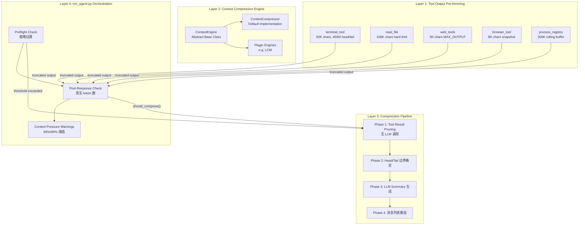
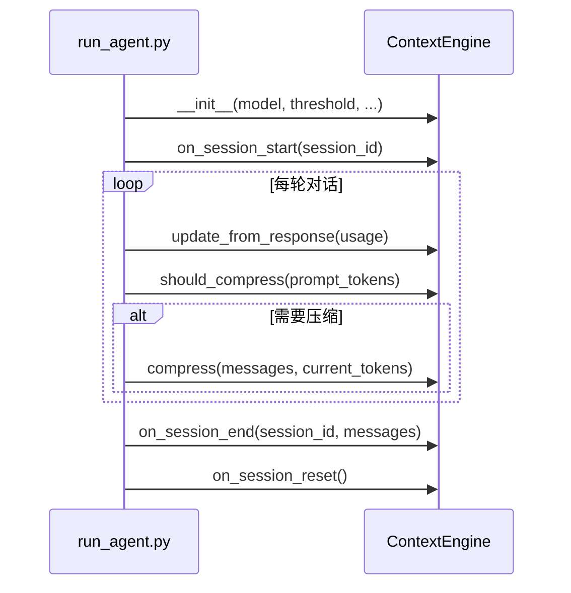
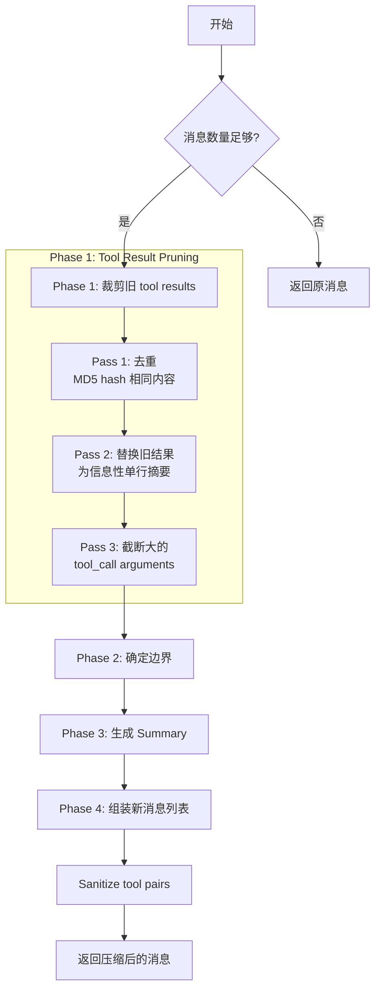
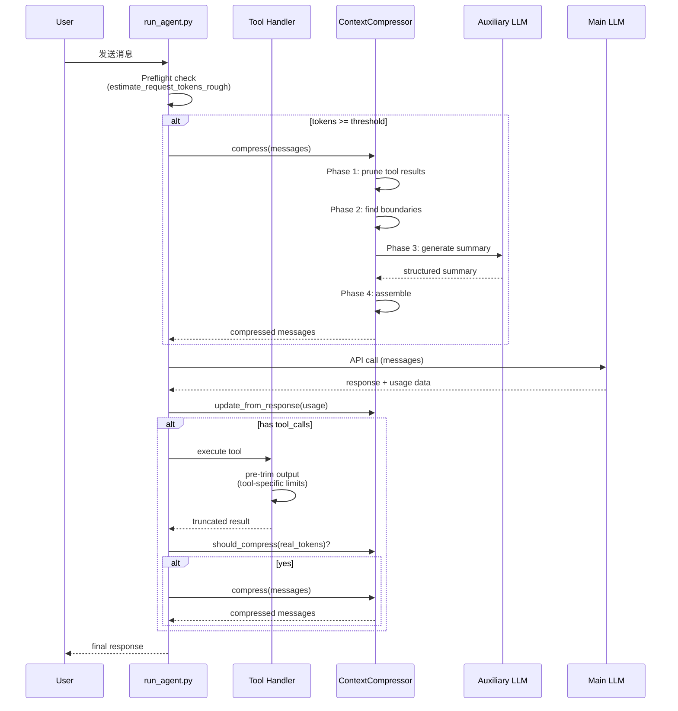

# Ch07 上下文管理 (Context Management)

Hermes Agent 的上下文管理系统是一个多层防御架构，从 tool output 级别的预裁剪，到消息级别的 pruning，再到基于 LLM 的 iterative summarization，构成了完整的上下文预算管理体系。

## 1. 系统架构概览

### 1.1 整体设计哲学

Hermes Agent 采用**三道防线**管理上下文窗口：

1. **Tool Output 预裁剪 (Pre-trimming)**：各工具在返回结果时，就地截断超大输出，防止单次 tool call 塞满上下文。
2. **Preflight 压缩检查**：在发送 API 请求之前，用粗略 token 估算检查是否超过阈值，提前触发压缩。
3. **Post-response 压缩**：API 返回真实 token 使用量后，用精确数据决定是否需要压缩上下文。

### 1.2 核心架构图



## 2. Context Engine 抽象层

### 2.1 ContextEngine 基类

`agent/context_engine.py` 定义了可插拔的上下文引擎接口。这是 Strategy Pattern 的经典应用。

```python
# agent/context_engine.py:32-90
class ContextEngine(ABC):
    """Base class all context engines must implement."""

    # Token state (read by run_agent.py for display/logging)
    last_prompt_tokens: int = 0
    last_completion_tokens: int = 0
    last_total_tokens: int = 0
    threshold_tokens: int = 0
    context_length: int = 0
    compression_count: int = 0

    # Compaction parameters
    threshold_percent: float = 0.75
    protect_first_n: int = 3
    protect_last_n: int = 6

    @abstractmethod
    def should_compress(self, prompt_tokens: int = None) -> bool: ...

    @abstractmethod
    def compress(self, messages, current_tokens=None) -> List[Dict]: ...
```

**Lifecycle（生命周期）**：



关键设计决策：
- 引擎选择通过 `config.yaml` 的 `context.engine` 配置，默认 `"compressor"`
- `run_agent.py:1334-1367` 实现引擎发现和加载逻辑
- Plugin engines 可以通过 `plugins/context_engine/<name>/` 目录注册

### 2.2 引擎配置加载

```python
# run_agent.py:1250-1401 (关键配置初始化)
_compression_cfg = _agent_cfg.get("compression", {})
compression_threshold = float(_compression_cfg.get("threshold", 0.50))    # 默认 50%
compression_enabled = str(_compression_cfg.get("enabled", True))
compression_target_ratio = float(_compression_cfg.get("target_ratio", 0.20))  # tail 保护 20%
compression_protect_last = int(_compression_cfg.get("protect_last_n", 20))    # 保护最后 20 条消息
```

## 3. Token 估算与 Model Metadata

### 3.1 粗略 Token 估算

`agent/model_metadata.py:1064-1102` 提供三个层次的 token 估算：

```python
# agent/model_metadata.py:1064-1073
def estimate_tokens_rough(text: str) -> int:
    """~4 chars/token, ceiling division 防止短文本估为 0"""
    if not text:
        return 0
    return (len(text) + 3) // 4

# agent/model_metadata.py:1076-1079
def estimate_messages_tokens_rough(messages: List[Dict]) -> int:
    """整个消息列表的 token 估算"""
    total_chars = sum(len(str(msg)) for msg in messages)
    return (total_chars + 3) // 4

# agent/model_metadata.py:1082-1102
def estimate_request_tokens_rough(messages, *, system_prompt="", tools=None) -> int:
    """完整请求估算，包括 system prompt + tools schemas
    关键：50+ tools 的 schema 可以额外增加 20-30K tokens！"""
    total_chars = 0
    if system_prompt: total_chars += len(system_prompt)
    if messages:      total_chars += sum(len(str(msg)) for msg in messages)
    if tools:         total_chars += len(str(tools))    # ← 这一行很关键
    return (total_chars + 3) // 4
```

**设计要点**：
- 使用 ceiling division `(len + 3) // 4` 确保短文本不会被估为 0 tokens
- `estimate_request_tokens_rough` 特别考虑了 tool schemas 的 token 开销，这在有 50+ 工具时非常显著（20-30K tokens）

### 3.2 Model Context Length 解析链

`get_model_context_length()` 实现了一个 10 级优先级的解析链：

```python
# agent/model_metadata.py:934-1061 (Resolution Order)
"""
0. Explicit config override (model.context_length 或 custom_providers)
1. Persistent cache (之前通过 probing 发现的)
2. Active endpoint metadata (/models，仅对自定义 endpoint)
3. Local server query (localhost endpoints)
4. Anthropic /v1/models API (API-key only, 不含 OAuth)
5. Provider-aware lookups (models.dev registry)
6. Nous suffix-match via OpenRouter cache
7. OpenRouter live API metadata
8. Hardcoded defaults (宽泛的模型族模式)
9. Default fallback (128K)
"""
```


**Hardcoded 默认值示例** (`model_metadata.py:99-174`)：

| 模型族 | Context Length |
|--------|--------------|
| claude-opus-4.6 / claude-sonnet-4.6 | 1,000,000 |
| gpt-5.4 | 1,050,000 |
| gpt-5 (base/mini/codex) | 400,000 |
| gemini | 1,048,576 |
| deepseek | 128,000 |
| llama | 131,072 |
| qwen3-coder-plus | 1,000,000 |

**Context Probe 机制** (`model_metadata.py:79-85`)：

当模型 context length 未知时，使用降阶探测：
```python
CONTEXT_PROBE_TIERS = [128_000, 64_000, 32_000, 16_000, 8_000]
```

`run_agent.py:9260-9310` 还处理了 Anthropic 的 long-context tier 降级（1M → 200K）。

### 3.3 MINIMUM_CONTEXT_LENGTH

```python
# agent/model_metadata.py:93
MINIMUM_CONTEXT_LENGTH = 64_000
```

Context window 低于此值的模型无法有效运行 Hermes Agent 的 tool-calling workflow。threshold_tokens 计算时以此为下限：

```python
# agent/context_compressor.py:265-268
self.threshold_tokens = max(
    int(self.context_length * threshold_percent),
    MINIMUM_CONTEXT_LENGTH,
)
```

## 4. Head/Tail 保护策略

### 4.1 概念

压缩时，消息列表被分为三个区域：

```
┌─────────────────────────────────────────────┐
│  HEAD (protected)  │  MIDDLE (summarize)  │  TAIL (protected)  │
│  protect_first_n=3 │  ← 这些被摘要      │  tail_token_budget │
│  system + 初始交换  │                      │  最近的对话轮      │
└─────────────────────────────────────────────┘
```

### 4.2 Head 保护

```python
# agent/context_compressor.py:968-969
compress_start = self.protect_first_n  # 默认 3
compress_start = self._align_boundary_forward(messages, compress_start)
```

`protect_first_n=3` 保护：
1. system prompt
2. 第一条 user message（通常包含初始任务定义）
3. 第一条 assistant response

`_align_boundary_forward` 确保不会从 tool result 中间开始压缩（向前滑动直到非 tool 消息）。

### 4.3 Tail 保护 — Token Budget 方式

这是 v3 的关键改进：**不再使用固定消息数，而是基于 token 预算保护尾部**。

```python
# agent/context_compressor.py:865-921
def _find_tail_cut_by_tokens(self, messages, head_end, token_budget=None):
    """从消息末尾向前走，累积 tokens 直到超过预算"""
    if token_budget is None:
        token_budget = self.tail_token_budget

    # tail_token_budget = threshold_tokens * summary_target_ratio
    # 例如：context=200K, threshold=50%=100K, ratio=20% → tail=20K tokens

    n = len(messages)
    min_tail = min(3, n - head_end - 1)  # 至少保留 3 条
    soft_ceiling = int(token_budget * 1.5)  # 允许 1.5x 超出避免切割大消息
    accumulated = 0
    cut_idx = n

    for i in range(n - 1, head_end - 1, -1):
        msg = messages[i]
        content = msg.get("content") or ""
        msg_tokens = len(content) // _CHARS_PER_TOKEN + 10
        # 也计算 tool_call arguments
        for tc in msg.get("tool_calls") or []:
            if isinstance(tc, dict):
                args = tc.get("function", {}).get("arguments", "")
                msg_tokens += len(args) // _CHARS_PER_TOKEN

        if accumulated + msg_tokens > soft_ceiling and (n - i) >= min_tail:
            break
        accumulated += msg_tokens
        cut_idx = i

    # 对齐避免切割 tool group
    cut_idx = self._align_boundary_backward(messages, cut_idx)
    return max(cut_idx, head_end + 1)
```

**Budget 计算** (`context_compressor.py:271-276`)：

```python
# tail_token_budget = threshold_tokens * summary_target_ratio
target_tokens = int(self.threshold_tokens * self.summary_target_ratio)
self.tail_token_budget = target_tokens
# 例如: 200K context, 50% threshold = 100K, 20% ratio → tail = 20K tokens
```

### 4.4 边界对齐

两个关键的边界对齐方法防止 tool_call/result 组被切割：

```python
# agent/context_compressor.py:827-859
def _align_boundary_forward(self, messages, idx):
    """向前推到非 tool 消息（避免从 tool result 中间开始）"""
    while idx < len(messages) and messages[idx].get("role") == "tool":
        idx += 1
    return idx

def _align_boundary_backward(self, messages, idx):
    """向后拉，保持 assistant + tool_results 组的完整性"""
    check = idx - 1
    while check >= 0 and messages[check].get("role") == "tool":
        check -= 1
    if check >= 0 and messages[check].get("role") == "assistant" \
       and messages[check].get("tool_calls"):
        idx = check  # 把整个组拉进 summarized 区
    return idx
```

## 5. Tool Output 预裁剪

### 5.1 各工具的裁剪策略

| 工具 | 文件位置 | 限制 | 裁剪策略 |
|------|---------|------|---------|
| `terminal` | `tools/terminal_tool.py:1480-1490` | 50,000 chars | **Head/Tail**: 40% head + 60% tail |
| `read_file` | `tools/file_tools.py:28` | 100,000 chars | 硬截断 + 建议用 offset/limit |
| `web_extract` | `tools/web_tools.py:508` | 5,000 chars | LLM-assisted 提取 + 硬截断 |
| `browser_snapshot` | `tools/browser_tool.py:1242` | 8,000 chars | 行边界截断（保持 a11y tree 元素完整） |
| `process_registry` | `tools/process_registry.py:57` | 200,000 chars | Rolling buffer |
| `web_search` | `tools/web_tools.py:566-569` | 5,000 chars | 硬截断 + 提示 |

### 5.2 Terminal Tool — Head/Tail 截断（最具代表性）

```python
# tools/terminal_tool.py:1480-1490
MAX_OUTPUT_CHARS = 50000
if len(output) > MAX_OUTPUT_CHARS:
    head_chars = int(MAX_OUTPUT_CHARS * 0.4)   # 40% head (error messages often appear early)
    tail_chars = MAX_OUTPUT_CHARS - head_chars   # 60% tail (most recent/relevant output)
    omitted = len(output) - head_chars - tail_chars
    truncated_notice = (
        f"\n\n... [OUTPUT TRUNCATED - {omitted} chars omitted "
        f"out of {len(output)} total] ...\n\n"
    )
    output = output[:head_chars] + truncated_notice + output[-tail_chars:]
```

**设计原理**：
- **40% head**：错误消息通常出现在输出开头（编译错误、import 失败等）
- **60% tail**：最近的输出通常最相关（测试结果、最终状态）
- 中间插入截断通知，告知模型有多少内容被省略

### 5.3 Read File — 安全上限

```python
# tools/file_tools.py:20-28
# 100K chars ≈ 25–35K tokens across typical tokenisers
# 超过此限的文件是 context-window hazard
_DEFAULT_MAX_READ_CHARS = 100_000
```

关键点：
- 可通过 `config.yaml` 的 `file_read_max_chars` 配置
- 超出时拒绝读取，建议使用 `offset` + `limit` 参数
- 还有 dedup 机制：相同 `(path, offset, limit)` + 未修改的文件会返回缓存提示

### 5.4 Browser Snapshot — 结构感知截断

```python
# tools/browser_tool.py:1242-1264
def _truncate_snapshot(snapshot_text: str, max_chars: int = 8000) -> str:
    """Structure-aware truncation for snapshots."""
    if len(snapshot_text) <= max_chars:
        return snapshot_text
    lines = snapshot_text.split('\n')
    result = []
    chars = 0
    for line in lines:
        if chars + len(line) + 1 > max_chars - 80:  # 留 80 chars 给截断通知
            break
        result.append(line)
        chars += len(line) + 1
    # ... 添加截断通知
```

**特别之处**：在行边界截断，确保 accessibility tree 的元素不会被从中间切断。

## 6. 压缩流水线详解

### 6.1 Phase 1: Tool Result Pruning（无 LLM 调用）



#### Pass 1: 去重

```python
# agent/context_compressor.py:402-422
# 用 MD5 hash 检测相同的 tool output
content_hashes = {}
for i in range(len(result) - 1, -1, -1):  # 从后向前遍历
    msg = result[i]
    if msg.get("role") != "tool": continue
    if len(content) < 200: continue  # 短内容不去重
    h = hashlib.md5(content.encode()).hexdigest()[:12]
    if h in content_hashes:
        # 旧的重复 → 替换为引用
        result[i] = {**msg, "content": "[Duplicate tool output — same content as a more recent call]"}
    else:
        content_hashes[h] = (i, msg.get("tool_call_id", "?"))
```

#### Pass 2: 信息性单行摘要

不再使用通用的 `[Old tool output cleared]` 占位符，而是生成具体的工具执行摘要：

```python
# agent/context_compressor.py:63-182
def _summarize_tool_result(tool_name, tool_args, tool_content):
    """示例输出:
    [terminal] ran `npm test` -> exit 0, 47 lines output
    [read_file] read config.py from line 1 (1,200 chars)
    [search_files] content search for 'compress' in agent/ -> 12 matches
    [patch] replace in config.py (340 chars result)
    [web_search] query='python asyncio' (2,500 chars result)
    """
```

对 20+ 种工具都有特定的摘要格式，最后有 generic fallback。

#### Pass 3: 截断 tool_call arguments

```python
# agent/context_compressor.py:446-463
for i in range(prune_boundary):
    msg = result[i]
    if msg.get("role") != "assistant" or not msg.get("tool_calls"):
        continue
    for tc in msg["tool_calls"]:
        args = tc.get("function", {}).get("arguments", "")
        if len(args) > 500:
            tc["function"]["arguments"] = args[:200] + "...[truncated]"
```

### 6.2 Phase 2: 边界确定

见 Section 4 (Head/Tail 保护策略)。

### 6.3 Phase 3: LLM Summary 生成

#### Serialization for Summary

```python
# agent/context_compressor.py:482-540
# 每条消息的截断限制：
_CONTENT_MAX = 6000    # 总字符上限
_CONTENT_HEAD = 4000   # 保留头部 4K chars
_CONTENT_TAIL = 1500   # 保留尾部 1.5K chars
_TOOL_ARGS_MAX = 1500  # tool call 参数上限
_TOOL_ARGS_HEAD = 1200 # 参数头部保留

# 截断格式:
content[:_CONTENT_HEAD] + "\n...[truncated]...\n" + content[-_CONTENT_TAIL:]
```

这又是一层 head/tail 保护，但这次是为了 summary model 的输入而非主模型。

#### Summary Budget 计算

```python
# agent/context_compressor.py:471-480
def _compute_summary_budget(self, turns_to_summarize):
    content_tokens = estimate_messages_tokens_rough(turns_to_summarize)
    budget = int(content_tokens * _SUMMARY_RATIO)  # _SUMMARY_RATIO = 0.20
    return max(_MIN_SUMMARY_TOKENS, min(budget, self.max_summary_tokens))
    # max_summary_tokens = min(context_length * 0.05, _SUMMARY_TOKENS_CEILING)
```

Budget 随被压缩内容量线性增长，但有上下限。

#### Structured Summary Template

```python
# agent/context_compressor.py:584-633
# 模板包含以下 sections:
# ## Goal
# ## Constraints & Preferences
# ## Completed Actions        ← 编号列表，包含工具和结果
# ## Active State             ← 当前工作目录、修改的文件、测试状态
# ## In Progress
# ## Blocked
# ## Key Decisions
# ## Resolved Questions       ← 已回答的问题（避免重复回答）
# ## Pending User Asks        ← 未回答的问题
# ## Relevant Files
# ## Remaining Work           ← 用 "Remaining" 而非 "Next Steps" 避免被当作指令
# ## Critical Context         ← 具体值、错误消息、配置细节
```

**关键设计原则**：
- Summary prefix 包含 `[CONTEXT COMPACTION — REFERENCE ONLY]`，明确告知模型这是**参考信息而非活跃指令**
- "Remaining Work" 替代 "Next Steps"，避免模型将其解读为需要执行的指令
- "Resolved Questions" section 防止模型重复回答已解决的问题

#### Summarizer Preamble

```python
# agent/context_compressor.py:574-581
_summarizer_preamble = (
    "You are a summarization agent creating a context checkpoint. "
    "Your output will be injected as reference material for a DIFFERENT "
    "assistant that continues the conversation. "
    "Do NOT respond to any questions or requests in the conversation — "
    "only output the structured summary. "
    "Do NOT include any preamble, greeting, or prefix."
)
```

灵感来源：
- OpenCode 的 "do not respond to any questions" 指令
- Codex 的 "another language model" framing（创造 separation）

### 6.4 Iterative Summary（迭代更新）

当 `_previous_summary` 存在时，不再从头生成 summary，而是**增量更新**：

```python
# agent/context_compressor.py:635-649
if self._previous_summary:
    prompt = f"""{_summarizer_preamble}

You are updating a context compaction summary. A previous compaction 
produced the summary below. New conversation turns have occurred since 
then and need to be incorporated.

PREVIOUS SUMMARY:
{self._previous_summary}

NEW TURNS TO INCORPORATE:
{content_to_summarize}

Update the summary ... PRESERVE all existing information that is still 
relevant. ADD new completed actions to the numbered list (continue 
numbering). Move items from "In Progress" to "Completed Actions" when 
done. Move answered questions to "Resolved Questions". ...
"""
```

**更新规则**：
- PRESERVE：保留仍然相关的已有信息
- ADD：新完成的操作追加到编号列表（续编号）
- MOVE：In Progress → Completed Actions（完成时）
- MOVE：Pending → Resolved Questions（回答时）
- REMOVE：仅移除明确过时的信息

### 6.5 Focus Topic（焦点主题）

受 Claude Code 的 `/compact <focus>` 启发：

```python
# agent/context_compressor.py:663-669
if focus_topic:
    prompt += f"""
FOCUS TOPIC: "{focus_topic}"
The user has requested that this compaction PRIORITISE preserving all 
information related to the focus topic above. For content related to 
"{focus_topic}", include full detail — exact values, file paths, 
command outputs, error messages, and decisions. For content NOT related 
to the focus topic, summarise more aggressively (brief one-liners or 
omit if truly irrelevant). The focus topic sections should receive 
roughly 60-70% of the summary token budget.
"""
```

## 7. 消息列表完整性保护

### 7.1 Tool Pair Sanitization

压缩后必须修复 orphaned tool_call / tool_result 对：

```python
# agent/context_compressor.py:767-825
def _sanitize_tool_pairs(self, messages):
    """两种故障模式:
    1. tool result 引用了已被移除的 call_id → 删除 orphaned result
    2. assistant tool_calls 的 results 被移除 → 插入 stub result
    """
    # 找出所有存活的 call_ids 和 result_ids
    surviving_call_ids = {tc.id for msg in messages 
                          if msg.role == "assistant" 
                          for tc in msg.tool_calls}
    result_call_ids = {msg.tool_call_id for msg in messages 
                       if msg.role == "tool"}

    # 1. 移除 orphaned results (call 已不在)
    orphaned_results = result_call_ids - surviving_call_ids
    messages = [m for m in messages if not (m.role == "tool" and m.tool_call_id in orphaned_results)]

    # 2. 为缺失的 results 添加 stub
    missing_results = surviving_call_ids - result_call_ids
    for msg in messages:
        if msg.role == "assistant":
            for tc in msg.tool_calls:
                if tc.id in missing_results:
                    # 插入 stub
                    patched.append({
                        "role": "tool",
                        "content": "[Result from earlier conversation — see context summary above]",
                        "tool_call_id": tc.id,
                    })
```

### 7.2 Summary 角色选择（避免连续同 role）

```python
# agent/context_compressor.py:1030-1063
# 选择 summary 消息的 role，避免与 head 尾部和 tail 头部相邻同 role
last_head_role = messages[compress_start - 1].get("role", "user")
first_tail_role = messages[compress_end].get("role", "user")

if last_head_role in ("assistant", "tool"):
    summary_role = "user"
else:
    summary_role = "assistant"

# 如果与 tail 冲突，尝试翻转
if summary_role == first_tail_role:
    flipped = "assistant" if summary_role == "user" else "user"
    if flipped != last_head_role:
        summary_role = flipped
    else:
        # 两种都冲突 → 合并进 tail 第一条消息
        _merge_summary_into_tail = True
```

合并时使用明确的分隔符：
```
summary_text
--- END OF CONTEXT SUMMARY — respond to the message below, not the summary above ---
original_tail_message
```

## 8. 压缩触发机制

### 8.1 Preflight 压缩（Pre-API-call）

```python
# run_agent.py:8000-8065
# 在进入 tool loop 之前检查
_preflight_tokens = estimate_request_tokens_rough(
    messages,
    system_prompt=active_system_prompt or "",
    tools=self.tools or None,  # ← 包含 tool schemas!
)

if _preflight_tokens >= self.context_compressor.threshold_tokens:
    # 可能需要多轮压缩（大 session + 小 context window）
    for _pass in range(3):
        messages, active_system_prompt = self._compress_context(...)
        if len(messages) >= _orig_len:
            break  # 无法进一步压缩
        # 重新估算
        _preflight_tokens = estimate_request_tokens_rough(...)
        if _preflight_tokens < threshold:
            break
```

### 8.2 Post-response 压缩（Post-API-call）

```python
# run_agent.py:10190-10254
# 使用 API 返回的真实 token 数
_compressor = self.context_compressor
if _compressor.last_prompt_tokens > 0:
    _real_tokens = _compressor.last_prompt_tokens + _compressor.last_completion_tokens
else:
    # Fallback: stale/missing usage → 用粗略估算
    # 避免 should_compress(0) 永远不触发 (#2153)
    _real_tokens = estimate_messages_tokens_rough(messages)

if self.compression_enabled and _compressor.should_compress(_real_tokens):
    messages, active_system_prompt = self._compress_context(...)
```

### 8.3 Context Pressure Warnings

```python
# run_agent.py:10212-10242
# 分层预警，纯用户侧通知（不注入消息流）
# 85%: 🟠 orange warning
# 95%: 🔴 critical warning
_compaction_progress = _real_tokens / _compressor.threshold_tokens

if _compaction_progress >= 0.95:
    _warn_tier = 0.95
elif _compaction_progress >= 0.85:
    _warn_tier = 0.85
```

### 8.4 Anti-Thrashing 保护

```python
# agent/context_compressor.py:307-327
def should_compress(self, prompt_tokens=None):
    tokens = prompt_tokens if prompt_tokens is not None else self.last_prompt_tokens
    if tokens < self.threshold_tokens:
        return False
    # Anti-thrashing: 如果最近 2 次压缩每次节省 < 10%，跳过
    if self._ineffective_compression_count >= 2:
        logger.warning("Compression skipped — last %d compressions saved <10%% each.")
        return False
    return True
```

```python
# agent/context_compressor.py:1073-1079
# 压缩后评估有效性
savings_pct = (saved_estimate / display_tokens * 100) if display_tokens > 0 else 0
self._last_compression_savings_pct = savings_pct
if savings_pct < 10:
    self._ineffective_compression_count += 1
else:
    self._ineffective_compression_count = 0  # 有效压缩重置计数
```

## 9. Context 预算分配

### 9.1 默认预算模型

以一个 200K context 模型为例：

```
Context Length:     200,000 tokens
Threshold (50%):   100,000 tokens  ← 超过此值触发压缩
Target Ratio (20%): 20,000 tokens  ← tail 保护预算

After compression:
  Head (3 msgs):    ~2,000 tokens  (system + initial exchange)
  Summary:          ~5,000 tokens  (scaled, max 5% of context = 10K)
  Tail:            ~20,000 tokens  (recent conversation)
  ─────────────────────────────
  Total:           ~27,000 tokens  → 大量空间给新对话
```

### 9.2 Summary Budget 公式

```
summary_budget = max(
    _MIN_SUMMARY_TOKENS,          # 下限 (具体值见源码)
    min(
        content_tokens * 0.20,    # 被压缩内容的 20%
        min(context_length * 0.05, _SUMMARY_TOKENS_CEILING)  # 上限
    )
)

# max_tokens 参数 = summary_budget * 1.3  (30% 缓冲)
```

## 10. Error Handling 与 Resilience

### 10.1 Summary 失败处理

```python
# agent/context_compressor.py:1015-1027
# LLM summary 失败时插入静态 fallback
if not summary:
    n_dropped = compress_end - compress_start
    summary = (
        f"{SUMMARY_PREFIX}\n"
        f"Summary generation was unavailable. {n_dropped} conversation turns were "
        f"removed to free context space but could not be summarized. ..."
    )
```

### 10.2 Summary Model 降级

```python
# agent/context_compressor.py:719-733
# 如果 summary model 不可用（404, 503），回退到主模型
if _is_model_not_found and self.summary_model and self.summary_model != self.model:
    self.summary_model = ""  # empty = use main model
    return self._generate_summary(messages, summary_budget)  # 立即重试
```

### 10.3 Cooldown 机制

```python
# 无 provider: 600 秒 cooldown
# 暂时性错误 (timeout, rate limit): 60 秒 cooldown
self._summary_failure_cooldown_until = time.monotonic() + cooldown
```

### 10.4 Compression Model 可行性预检

```python
# run_agent.py:1800-1898
def _check_compression_model_feasibility(self):
    """Session 启动时检查 auxiliary compression model 的 context window 
    是否小于主模型的 compression threshold"""
    # 如果 aux_context < threshold:
    #   "⚠ Compression model (xxx) context is N tokens, but the main 
    #    model's compression threshold is M tokens."
    #   提供修复建议：
    #   1. 使用更大的 compression model
    #   2. 降低 compression threshold
```

## 11. 设计模式总结

### 11.1 Strategy Pattern
`ContextEngine` 基类 + `ContextCompressor` 默认实现 + Plugin engines — 允许运行时切换压缩策略。

### 11.2 Chain of Responsibility
`get_model_context_length()` 的 10 级解析链 — 每一级尝试解析，失败则传递给下一级。

### 11.3 Template Method
`compress()` 的四阶段流水线：prune → boundary → summarize → assemble。子类可以 override 任意阶段。

### 11.4 Observer Pattern
`update_from_response()` 被 `run_agent.py` 在每次 API 调用后调用，更新 token 跟踪状态。

### 11.5 Defensive Programming
- 每个 tool 独立做 output 截断（最前线防御）
- 压缩后 `_sanitize_tool_pairs` 修复孤立的 tool_call/result
- Anti-thrashing 防止无限压缩循环
- Summary 失败有 fallback + cooldown
- Preflight + post-response 双重检查

### 11.6 Head/Tail 保留模式（受文件截断启发）
这个模式在多个层次重复出现：
- **Terminal tool**: 40% head / 60% tail
- **Context compression**: protect_first_n (head) + token-budget tail
- **Summary serialization**: _CONTENT_HEAD=4K / _CONTENT_TAIL=1.5K

始终保留"开头的结构信息"和"结尾的最新信息"，牺牲中间的低价值内容。

## 12. 关键常量速查表

| 常量 | 值 | 文件:行 | 说明 |
|------|---|---------|------|
| `threshold_percent` | 0.50 | `context_compressor.py:233` | 触发压缩的 context 使用率 |
| `protect_first_n` | 3 | `context_compressor.py:234` | 头部保护消息数 |
| `protect_last_n` | 20 | `context_compressor.py:235` | 尾部保护消息数（fallback） |
| `summary_target_ratio` | 0.20 | `context_compressor.py:236` | Tail token budget 占 threshold 的比例 |
| `_SUMMARY_RATIO` | 0.20 | `context_compressor.py:51` | Summary 占被压缩内容的比例 |
| `_CHARS_PER_TOKEN` | 4 | `context_compressor.py:59` | 粗略 token 估算因子 |
| `MINIMUM_CONTEXT_LENGTH` | 64,000 | `model_metadata.py:93` | Hermes 要求的最小 context |
| `DEFAULT_FALLBACK_CONTEXT` | 128,000 | `model_metadata.py:88` | 未知模型的默认 context |
| `_CONTENT_MAX` | 6,000 | `context_compressor.py:485` | Summary 输入每条消息上限 |
| `_CONTENT_HEAD` | 4,000 | `context_compressor.py:486` | Summary 输入保留头部 |
| `_CONTENT_TAIL` | 1,500 | `context_compressor.py:487` | Summary 输入保留尾部 |
| `_TOOL_ARGS_MAX` | 1,500 | `context_compressor.py:488` | Summary 输入 tool 参数上限 |
| Terminal `MAX_OUTPUT_CHARS` | 50,000 | `terminal_tool.py:1481` | Terminal 输出上限 |
| File `_DEFAULT_MAX_READ_CHARS` | 100,000 | `file_tools.py:28` | 文件读取上限 |
| Web `MAX_OUTPUT_SIZE` | 5,000 | `web_tools.py:508` | Web 内容输出上限 |
| Browser snapshot | 8,000 | `browser_tool.py:1242` | 浏览器快照上限 |
| Process `MAX_OUTPUT_CHARS` | 200,000 | `process_registry.py:57` | 进程输出 rolling buffer |
| `_SUMMARY_FAILURE_COOLDOWN` | 600 | `context_compressor.py:60` | Summary 失败冷却（秒） |

## 13. 数据流全景


