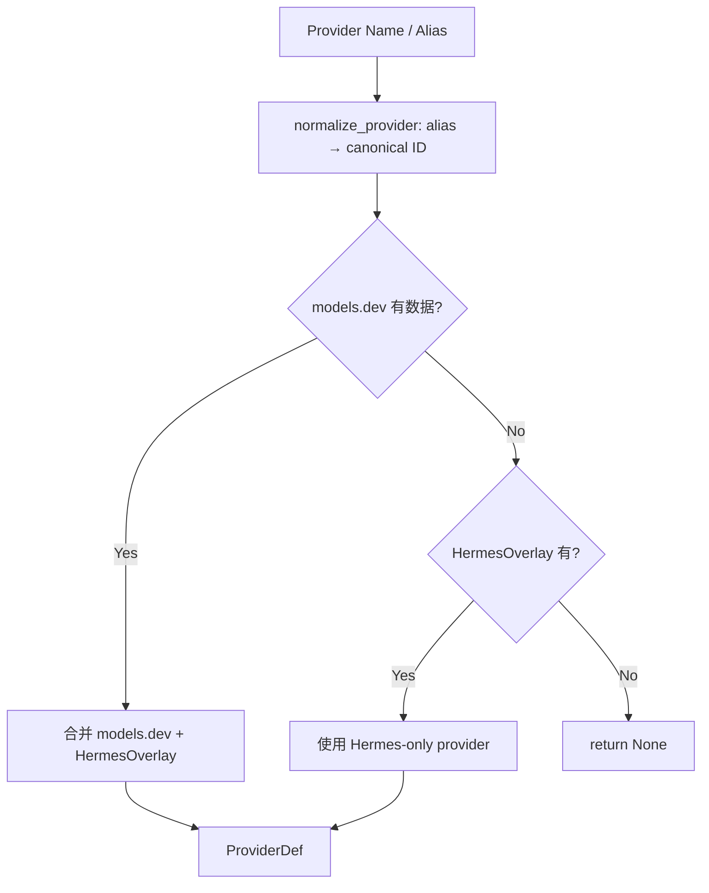
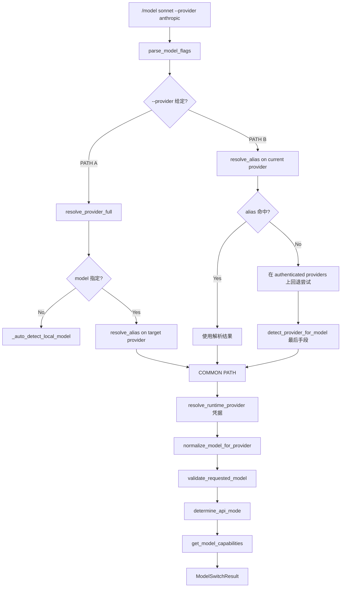
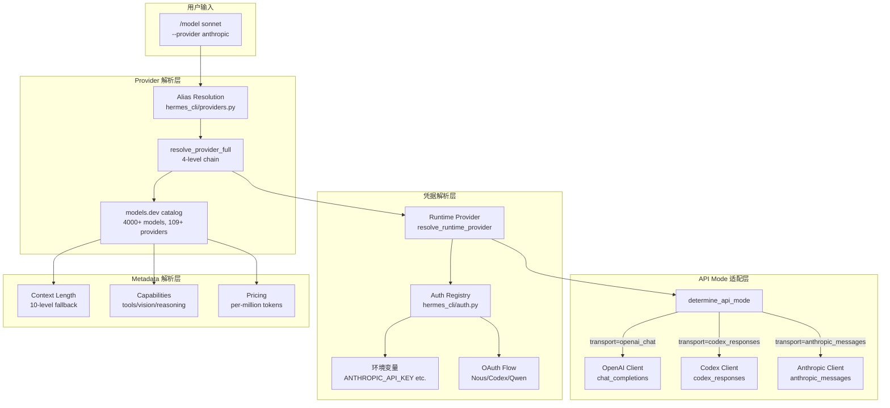
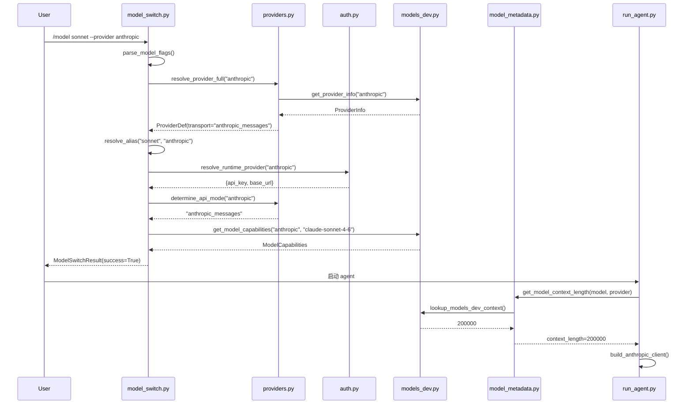

# Ch08 多模型适配（Multi-Model Adaptation）研究笔记

## 1. 三种 API 模式及其检测机制

Hermes Agent 支持三种 wire protocol（传输协议），统一抽象为 `api_mode`：

| API Mode | 协议 | 代表性 Provider |
|---|---|---|
| `chat_completions` | OpenAI Chat Completions API | OpenRouter, DeepSeek, Gemini, 大多数 provider |
| `codex_responses` | OpenAI Codex Responses API | openai-codex, copilot-acp |
| `anthropic_messages` | Anthropic Messages API | anthropic (原生), minimax, minimax-cn |

### 1.1 API Mode 检测优先级链

在 `run_agent.py:679-695` 实现，检测优先级从高到低：

```python
# run_agent.py:679-695 (精简)
# 1. 显式 api_mode 参数（最高优先级）
# 2. Provider 名称 → transport 映射
# 3. Base URL 模式匹配
# 4. Model 前缀检测 (anthropic/ 或 claude-)
# 5. URL 以 /anthropic 结尾
# 6. 默认: chat_completions
```

### 1.2 Transport → API Mode 映射表

在 `hermes_cli/providers.py:270-274` 定义：

```python
# hermes_cli/providers.py:270-274
TRANSPORT_TO_API_MODE: Dict[str, str] = {
    "openai_chat": "chat_completions",
    "anthropic_messages": "anthropic_messages",
    "codex_responses": "codex_responses",
}
```

### 1.3 GPT-5.x 自动升级

`run_agent.py:714-724` 特殊逻辑：当模型为 GPT-5.x 系列或直连 OpenAI API 时，自动将 `chat_completions` 升级为 `codex_responses`：

```python
# run_agent.py:714-724 (精简)
# GPT-5.x 模型或直连 api.openai.com → 升级到 codex_responses
if api_mode == "chat_completions" and (
    model.startswith("gpt-5") or "api.openai.com" in base_url
):
    api_mode = "codex_responses"
```

### 1.4 `determine_api_mode()` 完整逻辑

在 `hermes_cli/providers.py:379-399` 实现：

```python
# hermes_cli/providers.py:379-399
def determine_api_mode(provider: str, base_url: str = "") -> str:
    """Resolution order:
      1. Known provider → transport → TRANSPORT_TO_API_MODE
      2. URL heuristics for unknown / custom providers
      3. Default: 'chat_completions'
    """
    pdef = get_provider(provider)
    if pdef is not None:
        return TRANSPORT_TO_API_MODE.get(pdef.transport, "chat_completions")
    # URL-based heuristics
    if base_url:
        url_lower = base_url.rstrip("/").lower()
        if url_lower.endswith("/anthropic") or "api.anthropic.com" in url_lower:
            return "anthropic_messages"
        if "api.openai.com" in url_lower:
            return "codex_responses"
    return "chat_completions"
```

## 2. OpenAI 兼容层（Chat Completions）

### 2.1 Client 初始化

`run_agent.py:896-991` 中，非 Anthropic 模式统一使用 OpenAI client：

```python
# run_agent.py:896-955 (精简)
if api_key and base_url:
    # 显式凭据 → 直接构建 client
    client_kwargs = {"api_key": api_key, "base_url": base_url}
    # Provider-specific headers
    if "openrouter" in effective_base:
        client_kwargs["default_headers"] = {
            "HTTP-Referer": "https://hermes-agent.nousresearch.com",
            "X-OpenRouter-Title": "Hermes Agent",
        }
    elif "api.githubcopilot.com" in effective_base:
        client_kwargs["default_headers"] = copilot_default_headers()
    elif "api.kimi.com" in effective_base:
        client_kwargs["default_headers"] = {"User-Agent": "KimiCLI/1.30.0"}
else:
    # 无显式凭据 → 使用 centralized provider router
    from agent.auxiliary_client import resolve_provider_client
    _routed_client, _ = resolve_provider_client(
        self.provider or "auto", model=self.model, raw_codex=True)
```

### 2.2 Provider-Specific Headers

不同 provider 需要定制 HTTP header：

| Provider | 自定义 Header | 目的 |
|---|---|---|
| OpenRouter | `HTTP-Referer`, `X-OpenRouter-Title`, `X-OpenRouter-Categories` | 追踪与分类 |
| GitHub Copilot | `copilot_default_headers()` | 认证与 API 兼容 |
| Kimi | `User-Agent: KimiCLI/1.30.0` | 伪装 Kimi CLI |
| Qwen Portal | `_qwen_portal_headers()` | OAuth 关联 |
| Claude via OpenRouter | `x-anthropic-beta: fine-grained-tool-streaming-2025-05-14` | 防止长 tool call 超时 |

### 2.3 Fine-Grained Tool Streaming

`run_agent.py:958-974`：当通过 OpenRouter 使用 Claude 时，自动注入 beta header 启用逐 token 流式输出 tool call 参数，防止 Anthropic 缓冲整个 tool call 导致连接超时：

```python
# run_agent.py:964-974
if "openrouter" in _effective_base and "claude" in (self.model or "").lower():
    _FINE_GRAINED = "fine-grained-tool-streaming-2025-05-14"
    headers["x-anthropic-beta"] = _FINE_GRAINED
```

## 3. Anthropic 原生适配

### 3.1 专用 Client 构建

`run_agent.py:876-891` 展示 Anthropic 模式的特殊处理：

```python
# run_agent.py:876-891
if self.api_mode == "anthropic_messages":
    from agent.anthropic_adapter import build_anthropic_client, resolve_anthropic_token
    # 仅原生 Anthropic provider 使用 ANTHROPIC_TOKEN 回退
    # 其他 anthropic_messages providers (MiniMax, Alibaba) 使用自有 API key
    _is_native_anthropic = self.provider == "anthropic"
    effective_key = (api_key or resolve_anthropic_token() or "") if _is_native_anthropic else (api_key or "")
    self._anthropic_client = build_anthropic_client(effective_key, base_url)
    self.client = None  # 不需要 OpenAI client
```

**关键设计决策**：安全隔离 — 非原生 Anthropic provider（如 MiniMax）不会回退到 `ANTHROPIC_TOKEN`，防止泄露 Anthropic 凭据到第三方端点（修复 #1739, #minimax-401）。

### 3.2 Token 解析优先级

`agent/anthropic_adapter.py:525-566`：

```
ANTHROPIC_TOKEN → CLAUDE_CODE_OAUTH_TOKEN → Claude Code 凭据文件（自动刷新）→ ANTHROPIC_API_KEY
```

### 3.3 消息格式转换

`agent/anthropic_adapter.py:904-1100` 中的 `convert_messages_to_anthropic()` 完成 OpenAI → Anthropic 格式转换：

- **System prompt 分离**：Anthropic API 要求 system 单独传入，不在 messages 中
- **Cache control 保留**：保留 `cache_control` 标记用于 prompt caching
- **Thinking block 处理**：第三方端点剥离 thinking signature
- **连续同角色消息合并**：Anthropic 不允许连续相同 role 的消息
- **Tool call → tool_use 转换**：将 OpenAI 的 `tool_calls` 转为 Anthropic 的 `tool_use` block

## 4. Model Metadata 注册表

### 4.1 三层数据源架构

系统使用三层数据源，按优先级合并：

```
┌─────────────────────────────────────────────┐
│ 1. models.dev 社区数据库                      │
│    - 4000+ 模型，109+ provider               │
│    - context window, cost, capabilities      │
│    - 60min 刷新                               │
├─────────────────────────────────────────────┤
│ 2. OpenRouter Live API                       │
│    - /api/v1/models endpoint                 │
│    - 1hr in-memory cache                     │
│    - pricing, context_length, max_tokens     │
├─────────────────────────────────────────────┤
│ 3. 内置 hardcoded defaults                    │
│    - DEFAULT_CONTEXT_LENGTHS dict            │
│    - 仅 broad model family patterns          │
│    - 最后 fallback (128K)                     │
└─────────────────────────────────────────────┘
```

### 4.2 models.dev 数据结构

`agent/models_dev.py:46-123` 定义了 `ModelInfo` 数据类：

```python
# agent/models_dev.py:46-104
@dataclass
class ModelInfo:
    id: str
    name: str
    family: str
    provider_id: str
    # Capabilities
    reasoning: bool = False
    tool_call: bool = False
    attachment: bool = False       # vision
    temperature: bool = False
    structured_output: bool = False
    open_weights: bool = False
    # Modalities
    input_modalities: Tuple[str, ...] = ()
    output_modalities: Tuple[str, ...] = ()
    # Limits
    context_window: int = 0
    max_output: int = 0
    # Cost (per million tokens, USD)
    cost_input: float = 0.0
    cost_output: float = 0.0
```

### 4.3 models.dev 缓存策略

```python
# agent/models_dev.py:206-247
# Resolution order:
#   1. Bundled snapshot (离线优先)
#   2. Disk cache (~/.hermes/models_dev_cache.json)
#   3. Network fetch (https://models.dev/api.json)
#   4. Background refresh every 60 minutes
```

### 4.4 Context Length 解析链（10 级回退）

`agent/model_metadata.py:934-1061` 定义了 10 级上下文长度解析：

```python
# agent/model_metadata.py:941-953
"""Resolution order:
0. Explicit config override (model.context_length)
1. Persistent cache (previously discovered via probing)
2. Active endpoint metadata (/models for custom endpoints)
3. Local server query (for local endpoints)
4. Anthropic /v1/models API (API-key users only)
5. OpenRouter live API metadata
6. Nous suffix-match via OpenRouter cache
7. models.dev registry lookup (provider-aware)
8. Thin hardcoded defaults (broad family patterns)
9. Default fallback (128K)
"""
```

### 4.5 Context Length Probe Tiers

当模型未知时，使用降级探测：

```python
# agent/model_metadata.py:79-85
CONTEXT_PROBE_TIERS = [128_000, 64_000, 32_000, 16_000, 8_000]
MINIMUM_CONTEXT_LENGTH = 64_000  # 模型最低要求
```

### 4.6 Provider-Aware Context Resolution

相同模型在不同 provider 可能有不同的 context limit，例如 `claude-opus-4.6` 在 Anthropic 原生 = 1M，但在 GitHub Copilot = 128K。因此解析链是 **provider-aware** 的：

```python
# agent/model_metadata.py:1020-1035
effective_provider = provider
if not effective_provider or effective_provider in ("openrouter", "custom"):
    if base_url:
        inferred = _infer_provider_from_url(base_url)
        if inferred:
            effective_provider = inferred
```

### 4.7 URL → Provider 推断

`agent/model_metadata.py:218-242` 维护一个 URL → provider 映射表：

```python
# agent/model_metadata.py:218-242
_URL_TO_PROVIDER: Dict[str, str] = {
    "api.openai.com": "openai",
    "api.anthropic.com": "anthropic",
    "api.z.ai": "zai",
    "api.moonshot.ai": "kimi-coding",
    "dashscope.aliyuncs.com": "alibaba",
    "openrouter.ai": "openrouter",
    "generativelanguage.googleapis.com": "gemini",
    "api.deepseek.com": "deepseek",
    "api.x.ai": "xai",
    # ... 共 20+ 条映射
}
```

## 5. Smart Routing / Provider 解析链

### 5.1 Provider 定义三层合并

`hermes_cli/providers.py:289-352` 中 `get_provider()` 的合并逻辑：

```
models.dev catalog → Hermes Overlays → User Config
```



### 5.2 HermesOverlay 设计

`hermes_cli/providers.py:32-42` 定义了 models.dev 缺少的 Hermes 特有元数据：

```python
# hermes_cli/providers.py:32-42
@dataclass(frozen=True)
class HermesOverlay:
    transport: str = "openai_chat"        # openai_chat | anthropic_messages | codex_responses
    is_aggregator: bool = False
    auth_type: str = "api_key"            # api_key | oauth_device_code | oauth_external | external_process
    extra_env_vars: Tuple[str, ...] = ()  # models.dev 不追踪的环境变量
    base_url_override: str = ""           # 覆盖 models.dev URL
    base_url_env_var: str = ""            # 用户自定义 base URL 的环境变量
```

### 5.3 完整 Provider 解析链

`hermes_cli/providers.py:497-553` 中 `resolve_provider_full()` 的 4 级解析：

```python
# hermes_cli/providers.py:497-553
def resolve_provider_full(name, user_providers, custom_providers):
    """Resolution chain:
    1. Built-in (models.dev + overlays)
    2. User-defined providers from config (providers:)
    3. Saved custom providers from config (custom_providers:)
    4. Direct models.dev lookup (for unknown aliases)
    """
```

### 5.4 Provider Alias 系统

`hermes_cli/providers.py:170-252` 定义了 90+ alias 映射：

```python
ALIASES: Dict[str, str] = {
    "claude": "anthropic",
    "glm": "zai", "z-ai": "zai",
    "kimi": "kimi-for-coding",
    "copilot": "github-copilot",
    "qwen": "alibaba",
    "grok": "xai",
    # ... 90+ entries
}
```

### 5.5 Aggregator vs Direct Provider

```python
# Aggregator providers: openrouter, vercel, opencode, opencode-go, kilo, huggingface
# 模型 ID 格式: "vendor/model-name" (如 "anthropic/claude-opus-4-6")

# Direct providers: anthropic, deepseek, zai, kimi, minimax, ...
# 模型 ID 格式: "model-name" (如 "claude-opus-4-6")
```

## 6. Provider 凭据解析

### 6.1 四种认证类型

`hermes_cli/auth.py:90` 定义了四种认证方式：

| Auth Type | 描述 | 代表 Provider |
|---|---|---|
| `api_key` | 环境变量 API key | OpenRouter, DeepSeek, Anthropic, Gemini |
| `oauth_device_code` | OAuth 设备授权码流程 | Nous Portal |
| `oauth_external` | 外部 OAuth（浏览器流程） | OpenAI Codex, Qwen OAuth |
| `external_process` | 外部进程认证 | GitHub Copilot ACP |

### 6.2 Provider Registry（Auth 层）

`hermes_cli/auth.py:102-251` 定义了 20+ provider 的认证配置：

```python
# hermes_cli/auth.py:102-250
PROVIDER_REGISTRY: Dict[str, ProviderConfig] = {
    "nous": ProviderConfig(auth_type="oauth_device_code", ...),
    "openai-codex": ProviderConfig(auth_type="oauth_external", ...),
    "anthropic": ProviderConfig(
        auth_type="api_key",
        api_key_env_vars=("ANTHROPIC_API_KEY", "ANTHROPIC_TOKEN", "CLAUDE_CODE_OAUTH_TOKEN"),
    ),
    "deepseek": ProviderConfig(
        auth_type="api_key",
        api_key_env_vars=("DEEPSEEK_API_KEY",),
        base_url_env_var="DEEPSEEK_BASE_URL",
    ),
    # ... 20+ providers
}
```

### 6.3 凭据解析优先级

对于 API key 类 provider：
```
1. 显式传入的 api_key 参数
2. Provider 特定环境变量（按 api_key_env_vars 顺序）
3. base_url_env_var 环境变量（用于自定义端点）
4. 最后 fallback: OPENROUTER_API_KEY → OpenRouter
```

### 6.4 Auth Store 持久化

认证状态持久化在 `~/.hermes/auth.json`：
- 文件锁保护（`fcntl` / `msvcrt`）跨进程安全
- OAuth token 自动刷新（带 skew 提前量）
- 支持 Nous Portal agent key 生成与刷新

## 7. 运行时模型切换

### 7.1 Model Switch Pipeline

`hermes_cli/model_switch.py:406-749` 定义了完整的切换流水线：



### 7.2 Model Alias 系统

`hermes_cli/model_switch.py:105-154` 定义了短名称别名表：

```python
# hermes_cli/model_switch.py:105-154
MODEL_ALIASES: dict[str, ModelIdentity] = {
    "sonnet":   ModelIdentity("anthropic", "claude-sonnet"),
    "opus":     ModelIdentity("anthropic", "claude-opus"),
    "gpt5":     ModelIdentity("openai", "gpt-5"),
    "gemini":   ModelIdentity("google", "gemini"),
    "deepseek": ModelIdentity("deepseek", "deepseek-chat"),
    "grok":     ModelIdentity("x-ai", "grok"),
    "qwen":     ModelIdentity("qwen", "qwen"),
    "minimax":  ModelIdentity("minimax", "minimax"),
    "kimi":     ModelIdentity("moonshotai", "kimi"),
    "glm":      ModelIdentity("z-ai", "glm"),
    "mimo":     ModelIdentity("xiaomi", "mimo"),
    "trinity":  ModelIdentity("arcee-ai", "trinity"),
    # ... 共 20+ aliases
}
```

### 7.3 Direct Alias（精确映射）

```python
# hermes_cli/model_switch.py:165-176
class DirectAlias(NamedTuple):
    model: str       # 精确模型 ID
    provider: str    # 精确 provider
    base_url: str    # 精确 base URL

# 可通过 config.yaml model_aliases: 扩展
```

### 7.4 ModelSwitchResult

```python
# hermes_cli/model_switch.py:226-243
@dataclass
class ModelSwitchResult:
    success: bool
    new_model: str = ""
    target_provider: str = ""
    provider_changed: bool = False
    api_key: str = ""
    base_url: str = ""
    api_mode: str = ""           # 切换后的 wire protocol
    error_message: str = ""
    warning_message: str = ""
    provider_label: str = ""
    resolved_via_alias: str = ""
    capabilities: Optional[ModelCapabilities] = None
    model_info: Optional[ModelInfo] = None
    is_global: bool = False
```

### 7.5 Fallback Chain

`run_agent.py:993-1009` 支持多 provider fallback：

```python
# run_agent.py:997-1006
# 支持两种格式:
# 1. 列表: [{"provider": "deepseek", "model": "deepseek-chat"}, ...]
# 2. 单个: {"provider": "deepseek", "model": "deepseek-chat"}
self._fallback_chain = [f for f in fallback_model if isinstance(f, dict)]
```

## 8. 本地服务器检测

### 8.1 本地端点识别

`agent/model_metadata.py:267-303` — 支持多种本地部署方式：

```python
# agent/model_metadata.py:196-202
_LOCAL_HOSTS = ("localhost", "127.0.0.1", "::1", "0.0.0.0")
_CONTAINER_LOCAL_SUFFIXES = (
    ".docker.internal",
    ".containers.internal",
    ".lima.internal",
)
# 还检测 RFC-1918 private ranges (10.x, 172.16-31.x, 192.168.x)
```

### 8.2 本地服务器类型探测

`agent/model_metadata.py:306-362` — 通过 endpoint probing 识别服务器类型：

```python
# 探测顺序:
# 1. /api/v1/models → "lm-studio"
# 2. /api/tags (验证 "models" key) → "ollama"
# 3. /v1/props (或 /props) → "llamacpp"
# 4. /version → "vllm"
```

## 9. Provider 前缀处理

### 9.1 Provider Prefix 剥离

`agent/model_metadata.py:24-67` — 智能处理 `provider:model` vs `model:tag` 歧义：

```python
# agent/model_metadata.py:50-67
def _strip_provider_prefix(model: str) -> str:
    """Strip recognised provider prefix from model string.
    
    "local:my-model"    → "my-model"      (provider prefix → strip)
    "qwen3.5:27b"       → "qwen3.5:27b"   (Ollama tag → preserve)
    "deepseek:latest"   → "deepseek:latest" (Ollama tag → preserve)
    """
```

规则：只剥离 `_PROVIDER_PREFIXES` frozenset 中的前缀，且后缀不能匹配 Ollama tag pattern（`7b`, `latest`, `q4_0` 等）。

## 10. 架构图：多模型适配全景



## 11. 设计模式总结

### 11.1 Strategy Pattern（策略模式）

三种 API mode 对应三种 client 初始化策略：
- `chat_completions` → OpenAI Client
- `codex_responses` → OpenAI Client with Codex wrapper
- `anthropic_messages` → Anthropic Client

通过 `transport` 字段选择策略，运行时 dispatch。

### 11.2 Chain of Responsibility（责任链模式）

**Context Length 解析链**（10 级）和 **Provider 解析链**（4 级）都是典型的责任链模式 — 每一层尝试处理请求，失败则传递给下一层。

### 11.3 Registry Pattern（注册表模式）

多层 registry 共存：
- `PROVIDER_REGISTRY` (auth.py) — 认证配置注册表
- `HERMES_OVERLAYS` (providers.py) — transport overlay 注册表
- `ALIASES` (providers.py) — Provider 别名注册表
- `MODEL_ALIASES` (model_switch.py) — 模型别名注册表
- `DEFAULT_CONTEXT_LENGTHS` (model_metadata.py) — 上下文长度注册表
- `_URL_TO_PROVIDER` (model_metadata.py) — URL→Provider 推断表

### 11.4 Adapter Pattern（适配器模式）

`agent/anthropic_adapter.py` 是经典适配器 — 将内部统一的 OpenAI 格式消息转换为 Anthropic 格式，处理系统提示分离、thinking block、role 合并等差异。

### 11.5 Layered Merge Pattern（分层合并模式）

Provider 定义采用三层合并：
```
models.dev (base) + HermesOverlay (overlay) + UserConfig (override)
```
每一层可以覆盖或补充上一层的数据，最终合并成 `ProviderDef`。

### 11.6 Fallback Chain Pattern（回退链模式）

贯穿整个系统：
- 凭据回退：provider 特定 key → 通用 key → OpenRouter fallback
- Provider 回退：explicit → config → models.dev → direct lookup
- Context length 回退：10 级链式回退
- Model switch：当前 provider → authenticated providers → OpenRouter/Nous

### 11.7 Security by Design（安全设计）

凭据隔离（`run_agent.py:881`）：非原生 Anthropic provider 不会回退到 `ANTHROPIC_TOKEN`，防止凭据泄漏到第三方端点。这是在生产 bug (#1739, #minimax-401) 后加入的安全修复。

## 12. 关键文件索引

| 文件 | 行数 | 核心职责 |
|---|---|---|
| `run_agent.py` | 11,024 | API mode 检测(679-695)、client 初始化(868-991)、fallback chain(993-1009) |
| `agent/model_metadata.py` | 1,102 | Context length 10-level 解析(934-1061)、URL→Provider 推断(218-242)、local server 检测(306-362) |
| `agent/models_dev.py` | 585 | models.dev 集成、ModelInfo/ProviderInfo dataclass、capability 查询 |
| `agent/anthropic_adapter.py` | 1,411 | Anthropic client 构建、token 解析、消息格式转换 |
| `hermes_cli/providers.py` | 553 | HermesOverlay、ProviderDef、ALIASES(90+)、TRANSPORT_TO_API_MODE、determine_api_mode |
| `hermes_cli/auth.py` | 3,275 | PROVIDER_REGISTRY(20+ providers)、OAuth flows、auth.json 持久化 |
| `hermes_cli/model_switch.py` | 1,090 | switch_model pipeline、MODEL_ALIASES、DirectAlias、resolve_alias |
| `hermes_cli/models.py` | 1,969 | OPENROUTER_MODELS catalog、_PROVIDER_MODELS、detect_provider_for_model |

## 13. Provider Prefix 智能识别

`agent/model_metadata.py:24-41` 定义了一个 frozenset 包含 50+ 已知 provider 前缀，与 Ollama tag pattern 区分：

```python
_PROVIDER_PREFIXES: frozenset[str] = frozenset({
    "openrouter", "nous", "openai-codex", "copilot", "copilot-acp",
    "gemini", "zai", "kimi-coding", "anthropic", "deepseek",
    "custom", "local",
    # 别名
    "google", "github", "claude", "deep-seek",
    "xai", "x-ai", "grok",
    # ... 共 50+ 条
})

_OLLAMA_TAG_PATTERN = re.compile(
    r"^(\d+\.?\d*b|latest|stable|q\d|fp?\d|instruct|chat|coder|vision|text)",
    re.IGNORECASE,
)
```

## 14. 数据流总结


