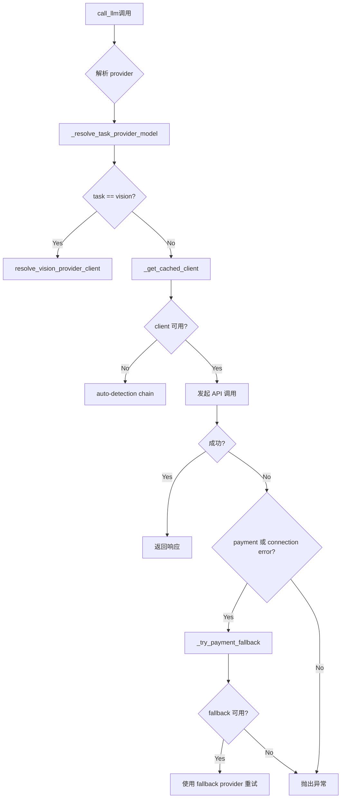
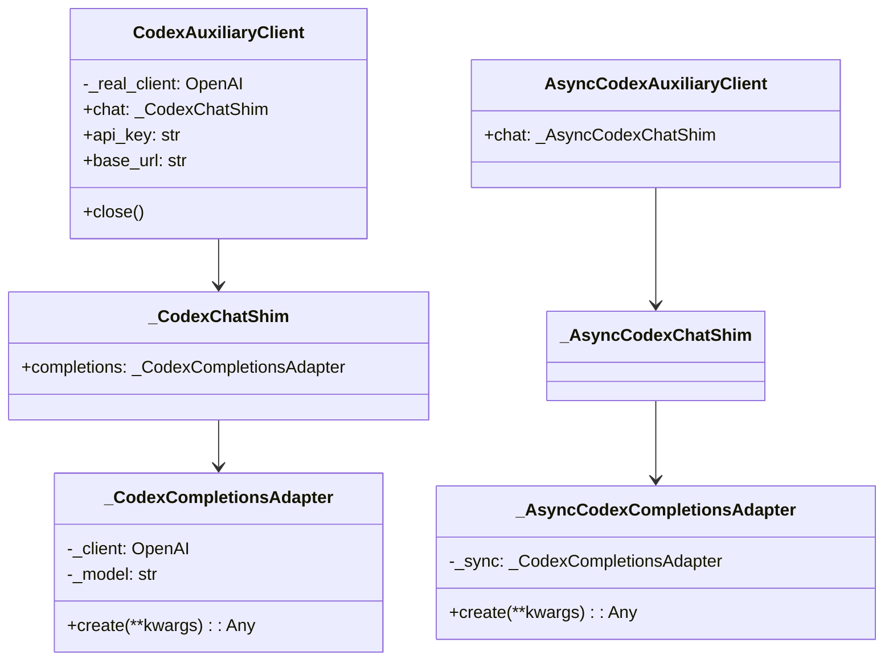
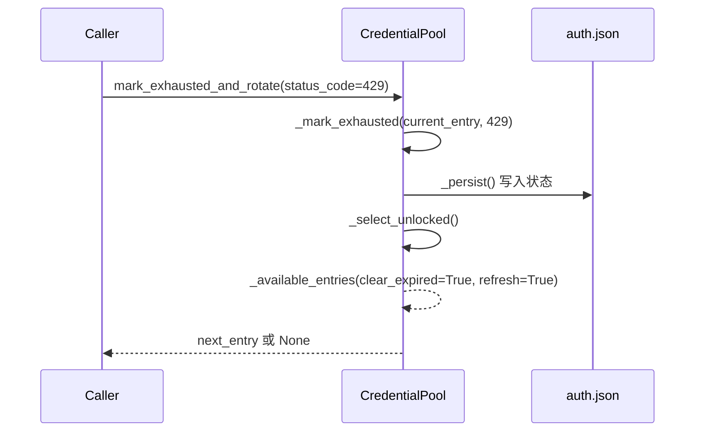
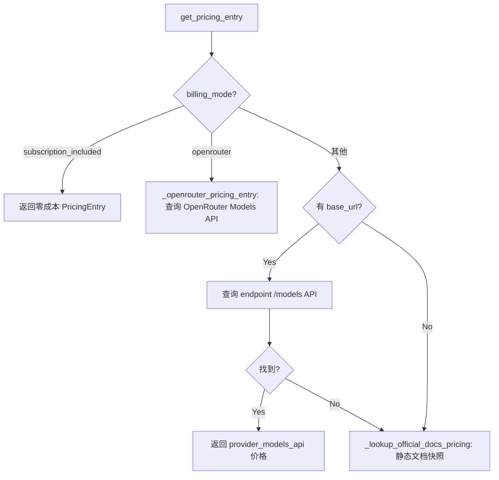
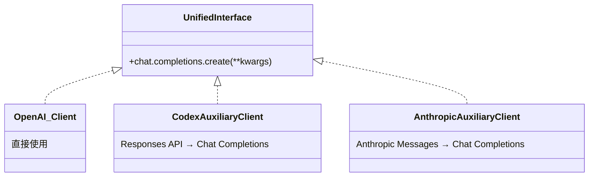

# Ch09 辅助客户端与成本控制 — 研究笔记

## 1. Auxiliary LLM Client 架构与 Provider Chain

### 1.1 设计目标

`auxiliary_client.py` 是 Hermes Agent 中所有**辅助 LLM 调用**的统一入口。辅助任务包括：
- **上下文压缩** (context compression)
- **会话搜索** (session search)
- **网页内容提取** (web extraction)
- **视觉分析** (vision analysis)
- **浏览器视觉** (browser vision)
- **技能商店** (skills hub)
- **记忆刷写** (flush memories)
- **MCP 工具调用**

设计核心理念：**每个消费者都使用相同的 fallback 逻辑**，避免重复实现 provider 探测。

### 1.2 文本任务 Provider 解析链 (Auto Mode)

```
agent/auxiliary_client.py:7-15
Resolution order for text tasks (auto mode):
  1. OpenRouter  (OPENROUTER_API_KEY)
  2. Nous Portal (~/.hermes/auth.json active provider)
  3. Custom endpoint (config.yaml model.base_url + OPENAI_API_KEY)
  4. Codex OAuth (Responses API via chatgpt.com with gpt-5.3-codex)
  5. Native Anthropic
  6. Direct API-key providers (z.ai/GLM, Kimi/Moonshot, MiniMax, MiniMax-CN)
  7. None
```

### 1.3 视觉任务 Provider 解析链 (Auto Mode)

```
agent/auxiliary_client.py:17-24
Resolution order for vision/multimodal tasks (auto mode):
  1. Selected main provider (if supported vision backend)
  2. OpenRouter
  3. Nous Portal
  4. Codex OAuth (gpt-5.3-codex supports vision via Responses API)
  5. Native Anthropic
  6. Custom endpoint (for local vision models: Qwen-VL, LLaVA, Pixtral)
  7. None
```

### 1.4 Auto-Detection 双阶段策略

`_resolve_auto()` (line 1126) 执行两阶段解析：

**阶段 1** — 如果用户的 main provider 不是聚合器(非 OpenRouter/Nous)，直接使用 main provider + main model。这样 Alibaba、DeepSeek、ZAI 等用户不需要额外配置 OpenRouter key。

**阶段 2** — 按标准 chain 逐一尝试：`_try_openrouter()` → `_try_nous()` → `_try_custom_endpoint()` → `_try_codex()` → `_resolve_api_key_provider()`

```python
# agent/auxiliary_client.py:1018-1030
def _get_provider_chain() -> List[tuple]:
    return [
        ("openrouter", _try_openrouter),
        ("nous", _try_nous),
        ("local/custom", _try_custom_endpoint),
        ("openai-codex", _try_codex),
        ("api-key", _resolve_api_key_provider),
    ]
```

### 1.5 Payment/Credit Exhaustion Fallback

当 provider 返回 HTTP 402 或信用耗尽错误时，`call_llm()` 自动尝试 chain 中的下一个 provider：

```python
# agent/auxiliary_client.py:1033-1050
def _is_payment_error(exc: Exception) -> bool:
    status = getattr(exc, "status_code", None)
    if status == 402:
        return True
    err_lower = str(exc).lower()
    if status in (402, 429, None):
        if any(kw in err_lower for kw in ("credits", "insufficient funds",
                                           "can only afford", "billing",
                                           "payment required")):
            return True
    return False
```

连接错误也触发 fallback (`_is_connection_error`)，涵盖 DNS 失败、连接拒绝、TLS 错误、超时等。



## 2. Codex 适配器模式 (Responses API → Chat Completions)

### 2.1 问题

Codex OAuth token 只能访问 Responses API (chatgpt.com/backend-api/codex)，但所有辅助消费者使用 `client.chat.completions.create()` 接口。

### 2.2 Adapter 层级结构



### 2.3 Content Format 转换

`_convert_content_for_responses()` (line 213) 将 Chat Completions 格式转换为 Responses API 格式：

| Chat Completions         | Responses API        |
|--------------------------|---------------------|
| `{"type": "text", ...}`  | `{"type": "input_text", ...}` |
| `{"type": "image_url", "image_url": {"url": "..."}}` | `{"type": "input_image", "image_url": "..."}` |

### 2.4 流式响应收集与 Backfill

`_CodexCompletionsAdapter.create()` (line 269) 使用 streaming 收集响应，处理 Codex 后端可能返回空 `response.output` 的问题：

```python
# agent/auxiliary_client.py:329-365
with self._client.responses.stream(**resp_kwargs) as stream:
    for _event in stream:
        _etype = getattr(_event, "type", "")
        if _etype == "response.output_item.done":
            collected_output_items.append(...)
        elif "output_text.delta" in _etype:
            collected_text_deltas.append(...)
    final = stream.get_final_response()
# Backfill empty output from collected stream events
if isinstance(_output, list) and not _output:
    if collected_output_items:
        final.output = list(collected_output_items)
```

### 2.5 Usage 统一化

Codex Responses API 返回 `input_tokens/output_tokens`，适配器转换为 Chat Completions 格式的 `prompt_tokens/completion_tokens`：

```python
# agent/auxiliary_client.py:393-399
usage = SimpleNamespace(
    prompt_tokens=getattr(resp_usage, "input_tokens", 0),
    completion_tokens=getattr(resp_usage, "output_tokens", 0),
    total_tokens=getattr(resp_usage, "total_tokens", 0),
)
```

## 3. Anthropic 适配器模式

### 3.1 _AnthropicCompletionsAdapter

`_AnthropicCompletionsAdapter` (line 480) 将 Anthropic Messages API 包装为 OpenAI Chat Completions 接口：

```python
# agent/auxiliary_client.py:488-543
def create(self, **kwargs) -> Any:
    from agent.anthropic_adapter import build_anthropic_kwargs, normalize_anthropic_response
    anthropic_kwargs = build_anthropic_kwargs(
        model=model, messages=messages, tools=tools,
        max_tokens=max_tokens, reasoning_config=None,
        tool_choice=normalized_tool_choice, is_oauth=self._is_oauth,
    )
    response = self._client.messages.create(**anthropic_kwargs)
    assistant_message, finish_reason = normalize_anthropic_response(response)
    # 包装为 SimpleNamespace 模拟 OpenAI response
```

### 3.2 OAuth 支持

AnthropicAuxiliaryClient 支持 API key 和 OAuth token 两种认证：
- `is_oauth` 参数传递给 `build_anthropic_kwargs` 影响请求格式
- OAuth 来源包括 Claude Code credentials (`~/.claude/.credentials.json`)

## 4. 凭证池管理与 Key 轮转策略

### 4.1 PooledCredential 数据模型

```python
# agent/credential_pool.py:91-115
@dataclass
class PooledCredential:
    provider: str
    id: str
    label: str
    auth_type: str           # "oauth" | "api_key"
    priority: int
    source: str              # "manual" | "device_code" | "claude_code"
    access_token: str
    refresh_token: Optional[str]
    last_status: Optional[str]       # "ok" | "exhausted"
    last_status_at: Optional[float]
    last_error_code: Optional[int]   # HTTP status code
    last_error_reason: Optional[str]
    last_error_message: Optional[str]
    last_error_reset_at: Optional[float]
    base_url: Optional[str]
    request_count: int = 0
    extra: Dict[str, Any] = None     # 额外字段 round-trip
```

### 4.2 四种选择策略

```python
# agent/credential_pool.py:60-69
STRATEGY_FILL_FIRST = "fill_first"    # 默认：优先使用最高优先级
STRATEGY_ROUND_ROBIN = "round_robin"  # 轮转：每次选择后降低优先级
STRATEGY_RANDOM = "random"            # 随机选择
STRATEGY_LEAST_USED = "least_used"    # 最少使用优先
```

选择算法 `_select_unlocked()` (line 830)：

```python
# agent/credential_pool.py:830-858
def _select_unlocked(self) -> Optional[PooledCredential]:
    available = self._available_entries(clear_expired=True, refresh=True)
    if not available:
        return None
    if self._strategy == STRATEGY_RANDOM:
        return random.choice(available)
    if self._strategy == STRATEGY_LEAST_USED:
        return min(available, key=lambda e: e.request_count)
    if self._strategy == STRATEGY_ROUND_ROBIN:
        entry = available[0]
        # 将已选条目移到末尾，重新编号优先级
        rotated = [c for c in self._entries if c.id != entry.id]
        rotated.append(replace(entry, priority=len(self._entries) - 1))
        self._entries = [replace(c, priority=idx) for idx, c in enumerate(rotated)]
        self._persist()
        return entry
    # FILL_FIRST: 直接返回第一个可用
    return available[0]
```

### 4.3 Exhaustion 与 Cooldown 机制

- 429 (Rate Limited) 和 402 (Billing) 错误触发 cooldown — 默认 **1 小时**
- Provider 提供的 `reset_at` timestamp 可覆盖默认 cooldown
- 支持解析多种 reset 格式：epoch seconds、epoch milliseconds、ISO-8601

```python
# agent/credential_pool.py:72-76
EXHAUSTED_TTL_429_SECONDS = 60 * 60      # 1 hour
EXHAUSTED_TTL_DEFAULT_SECONDS = 60 * 60  # 1 hour
```

### 4.4 Mark Exhausted & Rotate

`mark_exhausted_and_rotate()` (line 867) — 标记当前凭证为 exhausted，持久化状态，然后选择下一个可用凭证：



### 4.5 Lease 并发控制

`acquire_lease()` / `release_lease()` (lines 890-928) 实现软并发限制：

- 默认每个凭证最大并发数：`DEFAULT_MAX_CONCURRENT_PER_CREDENTIAL`
- 选择逻辑：优先选择活跃 lease 最少的凭证
- 超出 cap 时不阻塞，仍返回最少 lease 的凭证

### 4.6 OAuth Token 刷新

`_refresh_entry()` (line 554) 支持三种 OAuth provider 的 token 刷新：

1. **Anthropic** — 通过 `refresh_anthropic_oauth_pure()`，支持从 `~/.claude/.credentials.json` 同步
2. **OpenAI Codex** — 通过 `refresh_codex_oauth_pure()`，支持从 `~/.codex/auth.json` 同步
3. **Nous** — 通过 `refresh_nous_oauth_from_state()`，包括 agent key mint

刷新后同步回 auth store 防止多进程竞争：
```python
# agent/credential_pool.py:732-748
self._sync_device_code_entry_to_auth_store(updated)
if self.provider == "openai-codex":
    _write_codex_cli_tokens(updated.access_token, updated.refresh_token, ...)
```

## 5. 定价引擎实现

### 5.1 数据模型

```python
# agent/usage_pricing.py:28-76
@dataclass(frozen=True)
class CanonicalUsage:
    input_tokens: int = 0
    output_tokens: int = 0
    cache_read_tokens: int = 0
    cache_write_tokens: int = 0
    reasoning_tokens: int = 0
    request_count: int = 1

@dataclass(frozen=True)
class BillingRoute:
    provider: str           # "anthropic", "openai", "openrouter", etc.
    model: str
    base_url: str = ""
    billing_mode: str = "unknown"  # "subscription_included", "official_docs_snapshot", etc.

@dataclass(frozen=True)
class PricingEntry:
    input_cost_per_million: Optional[Decimal]
    output_cost_per_million: Optional[Decimal]
    cache_read_cost_per_million: Optional[Decimal]
    cache_write_cost_per_million: Optional[Decimal]
    request_cost: Optional[Decimal]
    source: CostSource       # "provider_models_api", "official_docs_snapshot", etc.

@dataclass(frozen=True)
class CostResult:
    amount_usd: Optional[Decimal]
    status: CostStatus        # "actual", "estimated", "included", "unknown"
    source: CostSource
    label: str
```

### 5.2 定价查找策略

`get_pricing_entry()` (line 390) 使用三层定价查找：



### 5.3 Official Docs Snapshot

`_OFFICIAL_DOCS_PRICING` (line 83) 硬编码了主要模型的定价：
- Anthropic: claude-opus-4, claude-sonnet-4, claude-3.5-sonnet, claude-3-opus
- OpenAI: gpt-4o, gpt-4o-mini, gpt-4.1, gpt-4.1-mini, gpt-4.1-nano, o3, o3-mini
- DeepSeek: deepseek-chat, deepseek-reasoner
- Google: gemini-2.5-pro, gemini-2.5-flash, gemini-2.0-flash

### 5.4 Usage 标准化 (normalize_usage)

`normalize_usage()` (line 420) 处理三种 API 格式的 token 计数差异：

| API 格式 | Input | Output | Cache Read | Cache Write |
|----------|-------|--------|------------|-------------|
| **Anthropic Messages** | `input_tokens` | `output_tokens` | `cache_read_input_tokens` | `cache_creation_input_tokens` |
| **Codex Responses** | `input_tokens - cached` | `output_tokens` | `input_tokens_details.cached_tokens` | `input_tokens_details.cache_creation_tokens` |
| **OpenAI Chat Completions** | `prompt_tokens - cached` | `completion_tokens` | `prompt_tokens_details.cached_tokens` | `prompt_tokens_details.cache_write_tokens` |

关键细节：Codex 和 OpenAI 的 `input_tokens`/`prompt_tokens` **包含** cache tokens，需要减去。

### 5.5 成本计算

`estimate_usage_cost()` (line 481) 使用 Decimal 精度计算：
```
cost = (input * input_rate + output * output_rate + 
        cache_read * cache_read_rate + cache_write * cache_write_rate) / 1,000,000
        + request_count * request_cost
```

特殊路由：
- `subscription_included` (如 OpenAI Codex) → 零成本
- 无 pricing entry → `CostResult(status="unknown")`

## 6. Rate Limit 追踪与 Backoff 策略

### 6.1 Rate Limit Header 解析

`rate_limit_tracker.py` 解析 12 种标准 `x-ratelimit-*` header：

```python
# agent/rate_limit_tracker.py:30-37
@dataclass
class RateLimitBucket:
    limit: int = 0          # 配额上限
    remaining: int = 0      # 剩余配额
    reset_seconds: float    # 重置倒计时
    captured_at: float      # 捕获时间戳

@dataclass
class RateLimitState:
    requests_min: RateLimitBucket   # RPM
    requests_hour: RateLimitBucket  # RPH
    tokens_min: RateLimitBucket     # TPM
    tokens_hour: RateLimitBucket    # TPH
```

### 6.2 使用率告警

当任何 bucket 使用率 ≥ 80% 时，显示告警：

```python
# agent/rate_limit_tracker.py:209-217
for label, bucket in [...]:
    if bucket.limit > 0 and bucket.usage_pct >= 80:
        warnings.append(f"⚠ {label} at {bucket.usage_pct:.0f}% — resets in {reset}")
```

### 6.3 格式化输出

- `format_rate_limit_display()` — 完整终端显示，含 ASCII 进度条
- `format_rate_limit_compact()` — 单行紧凑格式，用于状态栏/gateway

```
Provider Rate Limits (captured just now):
  Requests/min   [████████░░░░░░░░░░░░] 40.0%  4/10 used  (6 left, resets in 32s)
```

### 6.4 Jittered Backoff

`retry_utils.py` 实现去相关抖动指数退避：

```python
# agent/retry_utils.py (完整文件，57行)
def jittered_backoff(
    attempt: int,
    base_delay: float = 5.0,
    max_delay: float = 120.0,
    jitter_ratio: float = 0.5,
) -> float:
```

特点：
- 使用 **monotonic counter + time** 作为 seed，避免多线程 thundering herd
- 计算：`delay = base * 2^attempt`，然后添加 `[-jitter_ratio, +jitter_ratio]` 抖动
- 范围：`[base_delay, max_delay]`，默认 5s ~ 120s

## 7. Error Classifier — 错误分类器

### 7.1 FailoverReason 枚举

```python
# agent/error_classifier.py 枚举值
class FailoverReason(enum.Enum):
    auth                  # 401/403 认证失败
    billing               # 402 付费/配额耗尽
    rate_limit            # 429 速率限制
    overloaded            # 503/529 过载
    server_error          # 500/502 服务器错误
    timeout               # 连接超时
    context_overflow      # 上下文超限
    payload_too_large     # 413 负载过大
    model_not_found       # 404 模型不存在
    format_error          # 400 格式错误
    thinking_signature    # Anthropic thinking 签名无效
    long_context_tier     # Anthropic 长上下文权限
    unknown               # 未知错误
```

### 7.2 ClassifiedError 恢复建议

```python
@dataclass
class ClassifiedError:
    reason: FailoverReason
    status_code: Optional[int]
    message: str
    retryable: bool = False
    should_compress: bool = False          # 建议压缩上下文
    should_rotate_credential: bool = False  # 建议轮转凭证
    should_fallback: bool = False           # 建议 fallback 到其他 provider
```

### 7.3 分类管线

七步分类管线 (line 287-406)：
1. **Provider-specific patterns** — Anthropic thinking signature, long context tier
2. **HTTP status code** — 401/402/403/404/413/429/400/500/502/503
3. **Error code** — API-specific error codes
4. **Message pattern matching** — billing/quota/context patterns
5. **Server disconnect + large session** — context overflow heuristic
6. **Transport/timeout** — connection errors
7. **Fallback: unknown**

## 8. 主对话循环中的成本追踪

### 8.1 Session 级 Token 累计

`AIAgent.__init__()` 初始化 session 级计数器：

```python
# run_agent.py:1446-1553
self.session_prompt_tokens = 0
self.session_completion_tokens = 0
self.session_total_tokens = 0
self.session_api_calls = 0
self.session_input_tokens = 0
self.session_output_tokens = 0
self.session_cache_read_tokens = 0
self.session_cache_write_tokens = 0
self.session_reasoning_tokens = 0
```

### 8.2 每次 API 调用后的处理

每次 API 调用成功后 (run_agent.py:8841-8930)：

1. **标准化 usage** — `normalize_usage(response.usage, provider=..., api_mode=...)`
2. **累加 session 计数器** — prompt/completion/total/input/output/cache_read/cache_write/reasoning
3. **成本估算** — `estimate_usage_cost(model, canonical_usage, provider=..., base_url=...)`
4. **持久化到 SessionDB** — `update_token_counts()` 写入 SQLite，支持 `/insights` 分析
5. **Cache hit 日志** — 显示 cache read/write 统计

```python
# run_agent.py:8890-8901
cost_result = estimate_usage_cost(
    self.model, canonical_usage,
    provider=self.provider, base_url=self.base_url,
    api_key=getattr(self, "api_key", ""),
)
if cost_result.amount_usd is not None:
    self.session_estimated_cost_usd += float(cost_result.amount_usd)
self.session_cost_status = cost_result.status
self.session_cost_source = cost_result.source
```

## 9. Auxiliary vs Main Conversation 调用差异

| 维度 | Main Conversation (run_agent.py) | Auxiliary (auxiliary_client.py) |
|------|----------------------------------|-------------------------------|
| **入口** | `client.chat.completions.create()` 直接调用 | `call_llm()` / `async_call_llm()` 统一入口 |
| **Provider 解析** | 启动时配置，运行时固定 | 每次调用动态解析，支持 per-task override |
| **错误处理** | 完整 retry 循环 + error_classifier | payment/connection fallback chain |
| **Token 追踪** | session 级累计，写入 SessionDB | 不追踪（由调用者处理） |
| **Client 缓存** | 一次创建，复用 | `_get_cached_client()` thread-safe 缓存 |
| **Streaming** | 支持 streaming response | 非 streaming（除 Codex adapter 内部） |
| **Tool calling** | 完整工具循环 | 有限工具支持（如 flush_memories） |
| **Config** | `config.yaml model.*` | `config.yaml auxiliary.*` per-task |

## 10. Session Insights Engine

### 10.1 InsightsEngine

`insights.py` 中的 `InsightsEngine` 类分析历史 session 数据：
- Token 消耗统计（input/output/cache/reasoning）
- 成本估算汇总
- 工具使用模式（频率 top-N）
- 活跃时间模式（按星期/小时）
- 模型/平台分布

### 10.2 成本估算集成

InsightsEngine 使用 `_estimate_cost()` 包装 `estimate_usage_cost()`，为历史 session 提供回溯成本估算。

## 11. 关键设计模式总结

### 11.1 Adapter Pattern

三个 API 适配器将不同 API 统一为 OpenAI Chat Completions 接口：



### 11.2 Chain of Responsibility

Provider 解析使用责任链模式 — 每个 `_try_*` 函数检查凭证可用性，失败时传递给下一个。

### 11.3 Strategy Pattern

CredentialPool 的四种选择策略（fill_first/round_robin/random/least_used）是策略模式的典型实现。

### 11.4 Observer / Cooldown Pattern

凭证 exhaustion 使用 TTL-based cooldown — 标记 exhausted 状态和时间戳，到期后自动恢复。支持 provider 提供的精确 reset 时间覆盖默认 TTL。

### 11.5 Facade Pattern

`call_llm()` 是所有辅助 LLM 调用的 Facade，隐藏 provider 解析、client 缓存、格式转换、fallback 等复杂性。

### 11.6 Type Normalization

`_normalize_aux_provider()` 和 `_PROVIDER_ALIASES` 将各种别名统一为规范 ID：
```python
# "google" → "gemini", "claude" → "anthropic", 
# "moonshot" → "kimi-coding", "z.ai" → "zai"
```

## 12. Provider-Specific 实现细节

### 12.1 Nous Portal

- 支持 Free-tier 检测 → 使用 `mimo-v2-omni` (vision) / `mimo-v2-pro` (text)
- Agent key mint 机制
- `NOUS_EXTRA_BODY = {"tags": ["product=hermes-agent"]}` 产品归因

### 12.2 OpenRouter

- 应用归因 headers: `HTTP-Referer`, `X-OpenRouter-Title`, `X-OpenRouter-Categories`
- 默认辅助模型: `google/gemini-3-flash-preview`
- 通过 Models API 获取实时定价

### 12.3 Codex

- 默认模型: `gpt-5.2-codex` (gpt-5.3-codex 被 ChatGPT-backed 账户拒绝)
- Base URL: `https://chatgpt.com/backend-api/codex`
- 不支持 `max_output_tokens` 和 `temperature` 参数
- Token 来源: pool → auth.json → `~/.codex/auth.json`

### 12.4 API-Key Providers

默认辅助模型映射 (`_API_KEY_PROVIDER_AUX_MODELS`)：
- Gemini: `gemini-3-flash-preview`
- Z.AI: `glm-4.5-flash`
- Kimi: `kimi-k2-turbo-preview`
- MiniMax: `MiniMax-M2.7`
- Anthropic: `claude-haiku-4-5-20251001`

## 13. 完整 Cost Tracking 数据流

```mermaid
flowchart LR
    A[API Response] -->|response.usage| B[normalize_usage]
    B -->|CanonicalUsage| C[estimate_usage_cost]
    C -->|CostResult| D[Session Accumulators]
    D --> E[session_estimated_cost_usd]
    D --> F[session_prompt_tokens]
    D --> G[session_cache_read_tokens]
    C --> H[SessionDB.update_token_counts]
    H --> I[SQLite 持久化]
    I --> J[InsightsEngine 分析]
    J --> K[/insights 命令输出]
```

## 14. 线程安全设计

- `CredentialPool._lock` — threading.Lock 保护选择/轮转操作
- `_auth_store_lock()` — 文件级锁保护 auth.json 读写
- `_get_cached_client()` — thread-safe client 缓存
- `retry_utils.jittered_backoff()` — monotonic counter 防止 thundering herd

## 15. 配置层级

```yaml
# config.yaml
auxiliary:
  vision:
    provider: auto          # 或 "openrouter", "nous", "anthropic", 等
    model: null             # 覆盖默认模型
    timeout: 60             # 请求超时
  compression:
    provider: auto
    model: null
  web_extract:
    provider: auto
  session_search:
    provider: auto
  flush_memories:
    provider: auto
  
credential_pool_strategies:
  openrouter: fill_first    # 凭证选择策略
  nous: round_robin
  anthropic: least_used
```
