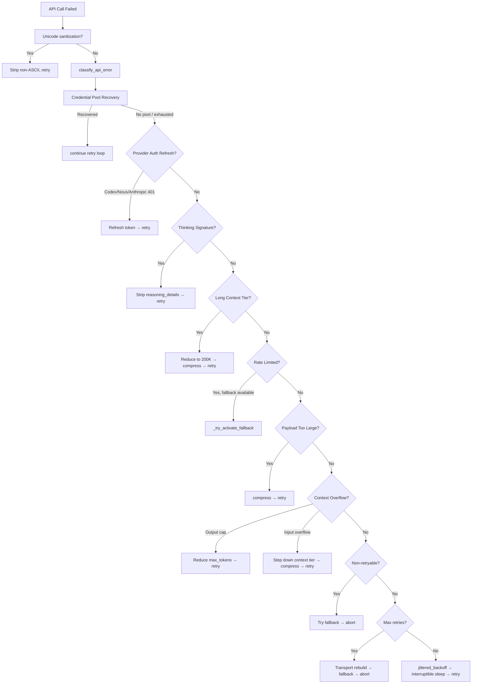
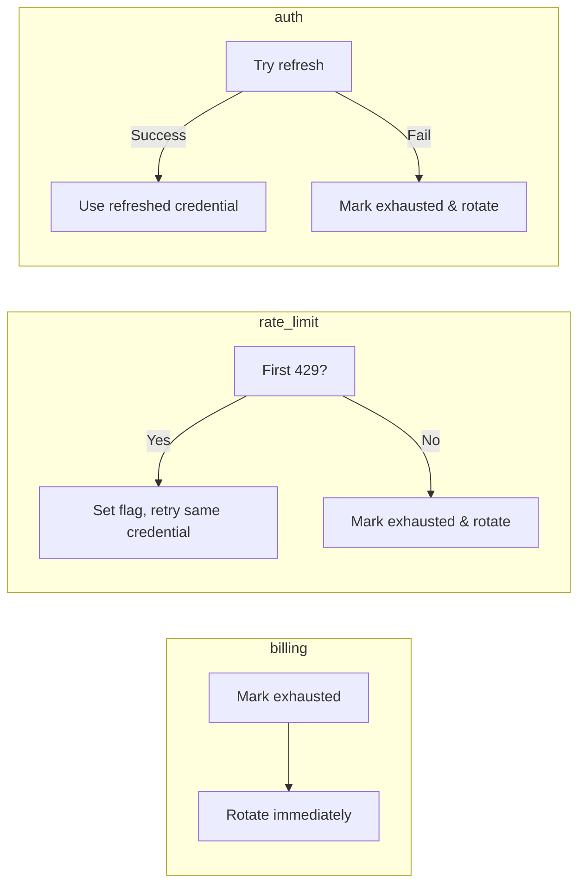
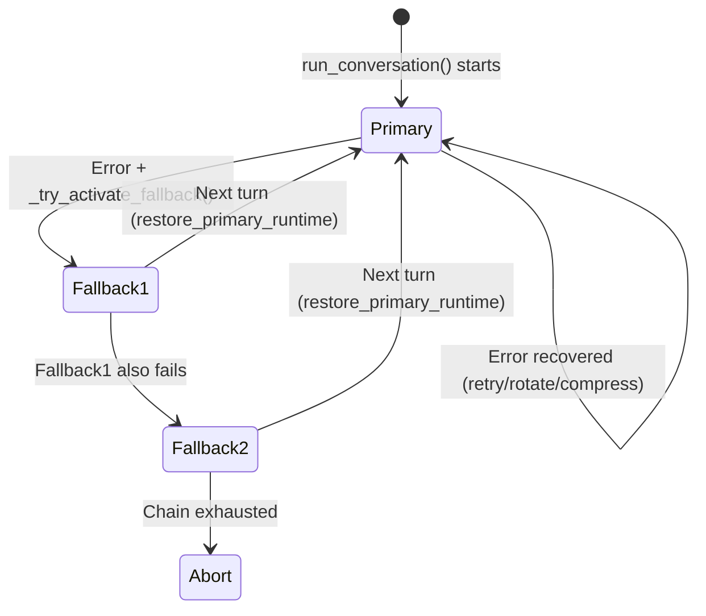
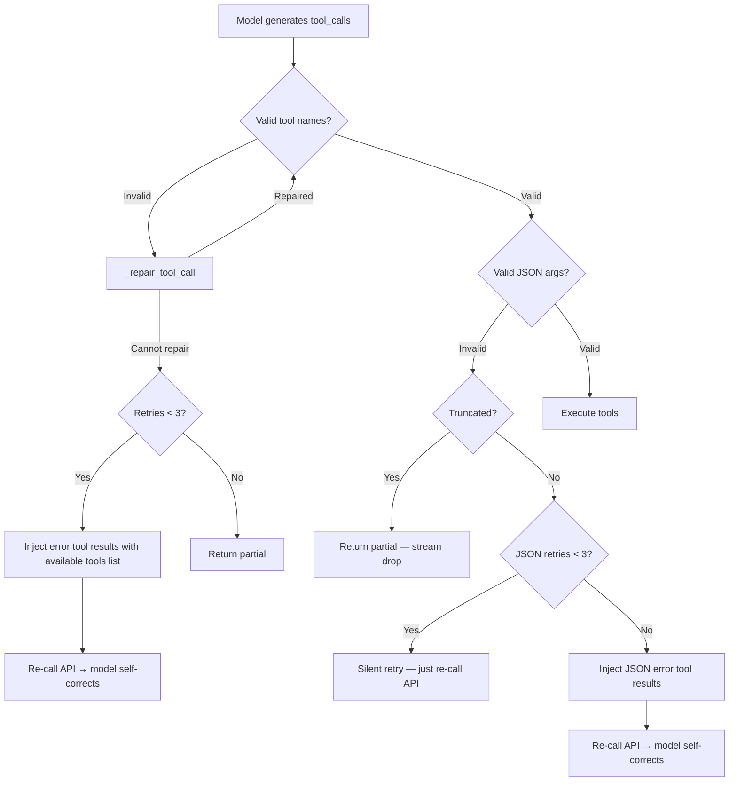

# Ch10 错误处理与韧性 — 研究笔记

## 全景概要

Hermes Agent 的错误处理架构呈**多层洋葱模型**：最内层是结构化的 error classifier，中间层是 credential pool rotation 和 transport recovery，外层是 model fallback chain，最外层是 context compression + 优雅降级。每一层都有明确的职责边界和 escalation 规则——只有在当前层无法恢复时，才会将控制权交给上一层。

---

## 1. 错误分类系统 (Error Classification System)

### 1.1 FailoverReason Enum

`agent/error_classifier.py:24-57` 定义了一个涵盖 14 种故障原因的枚举：

```python
class FailoverReason(enum.Enum):
    # Authentication / authorization
    auth = "auth"                        # 401/403 — refresh/rotate
    auth_permanent = "auth_permanent"    # Auth failed after refresh — abort

    # Billing / quota
    billing = "billing"                  # 402 or credit exhaustion — rotate immediately
    rate_limit = "rate_limit"            # 429 or quota throttling — backoff then rotate

    # Server-side
    overloaded = "overloaded"            # 503/529 — provider overloaded
    server_error = "server_error"        # 500/502 — internal server error

    # Transport
    timeout = "timeout"                  # Connection/read timeout — rebuild client

    # Context / payload
    context_overflow = "context_overflow"  # Context too large — compress
    payload_too_large = "payload_too_large"  # 413 — compress payload

    # Model
    model_not_found = "model_not_found"  # 404 / invalid model — fallback

    # Request format
    format_error = "format_error"        # 400 bad request — abort or strip

    # Provider-specific
    thinking_signature = "thinking_signature"  # Anthropic thinking block
    long_context_tier = "long_context_tier"    # Anthropic "extra usage" tier

    # Catch-all
    unknown = "unknown"                  # Unclassifiable — retry with backoff
```

**设计亮点**：将 14 种原因映射到 4 类恢复动作 (retry / rotate / fallback / compress)，而不是让调用方自己判断 status code。

### 1.2 ClassifiedError Dataclass

`agent/error_classifier.py:62-82` — 分类结果携带 **recovery action hints**：

```python
@dataclass
class ClassifiedError:
    reason: FailoverReason
    status_code: Optional[int] = None
    provider: Optional[str] = None
    model: Optional[str] = None
    message: str = ""
    error_context: Dict[str, Any] = field(default_factory=dict)

    # Recovery action hints
    retryable: bool = True
    should_compress: bool = False
    should_rotate_credential: bool = False
    should_fallback: bool = False

    @property
    def is_auth(self) -> bool:
        return self.reason in (FailoverReason.auth, FailoverReason.auth_permanent)
```

**设计模式**：**Command pattern 变体** — 分类器做决策，retry loop 只看 hints 执行动作。这避免了 retry loop 中大量的 `if status_code == ...` 分支。

### 1.3 分类流水线 (Classification Pipeline)

`classify_api_error()` (`error_classifier.py:233-406`) 实现 **7 级优先级流水线**：

| 优先级 | 阶段 | 说明 |
|--------|------|------|
| 1 | Provider-specific patterns | Anthropic thinking signature (400 + "signature" + "thinking")、long context tier (429 + "extra usage" + "long context") |
| 2 | HTTP status code | `_classify_by_status()` — 401/402/403/404/413/429/400/500/502/503/529 |
| 3 | Error code | `_classify_by_error_code()` — 从 body 提取结构化 error code |
| 4 | Message pattern matching | 无 status code 时的文本匹配 |
| 5 | Server disconnect + large session | disconnect + token > 60% context → context_overflow |
| 6 | Transport heuristics | error type 名在 `_TRANSPORT_ERROR_TYPES` 集合中 |
| 7 | Fallback: unknown | retryable=True |

**关键细节**：

- **OpenRouter metadata.raw 解析** (`error_classifier.py:274-307`)：OpenRouter 将上游错误包裹在 `{error: {metadata: {raw: "..."}}}` 中，分类器会解析内层 JSON，确保真实错误信息（如 "context length exceeded"）不被外层包装掩盖。
- **402 消歧义** (`_classify_402`)：通过 `_USAGE_LIMIT_TRANSIENT_SIGNALS`（如 "try again"、"resets at"）区分短暂 usage limit（映射为 rate_limit）和真正的 billing exhaustion。
- **400 多路复用** (`_classify_400`)：400 是最复杂的 status code — 可能是 context overflow、model not found、rate limit、billing、甚至 auth。通过 pattern matching 精细区分。
- **Disconnect heuristic** (`error_classifier.py:388-397`)：无 status code 的 server disconnect，如果 `approx_tokens > context_length * 0.6` 或 `> 120000` 或 `num_messages > 200`，推断为 context overflow 而非 transport error。

### 1.4 Pattern 表

错误消息匹配使用 8 组预定义 pattern 列表：

```python
_BILLING_PATTERNS       # 10 patterns: "insufficient credits", "payment required", ...
_RATE_LIMIT_PATTERNS    # 10 patterns: "rate limit", "too many requests", ...
_USAGE_LIMIT_PATTERNS   # 4 patterns: 需要消歧义
_USAGE_LIMIT_TRANSIENT_SIGNALS  # 7 patterns: "try again", "retry", ...
_CONTEXT_OVERFLOW_PATTERNS # 17 patterns: 包含 vLLM/Ollama/llama.cpp/中文
_MODEL_NOT_FOUND_PATTERNS  # 7 patterns
_AUTH_PATTERNS            # 8 patterns
_TRANSPORT_ERROR_TYPES    # 13 type names (frozenset for O(1) lookup)
```

---

## 2. Retry 策略 (Retry Strategies)

### 2.1 Jittered Backoff

`agent/retry_utils.py` (57 lines) — 实现 **decorrelated jittered exponential backoff**：

```python
def jittered_backoff(
    attempt: int,
    *,
    base_delay: float = 5.0,
    max_delay: float = 120.0,
    jitter_ratio: float = 0.5,
) -> float:
    delay = min(base_delay * (2 ** (attempt - 1)), max_delay)
    seed = (time.time_ns() ^ (tick * 0x9E3779B9)) & 0xFFFFFFFF
    rng = random.Random(seed)
    jitter = rng.uniform(0, jitter_ratio * delay)
    return delay + jitter
```

**设计要点**：
- 用 **进程级单调计数器 + 时间戳** 作为 seed，确保即使系统时钟精度低（如 Docker 容器），并发的 retry 也不会同步。
- `0x9E3779B9` 是黄金比例的 32 位定点值，用于 hash 分散。
- 默认参数：base_delay=5s, max_delay=120s — 第 1/2/3/4 次分别约 5/10/20/40s + jitter。

**实际调用** (`run_agent.py:9705`)：
```python
wait_time = _retry_after if _retry_after else jittered_backoff(
    retry_count, base_delay=2.0, max_delay=60.0
)
```
注意 run_agent 使用 `base_delay=2.0, max_delay=60.0`（比默认更激进）。

### 2.2 Retry-After Header 尊重

`run_agent.py:9694-9704` — 对 429 rate limit，优先使用服务端返回的 `Retry-After` header：

```python
_resp_headers = getattr(getattr(api_error, "response", None), "headers", None)
if _resp_headers and hasattr(_resp_headers, "get"):
    _ra_raw = _resp_headers.get("retry-after") or _resp_headers.get("Retry-After")
    if _ra_raw:
        _retry_after = min(int(_ra_raw), 120)  # Cap at 2 minutes
```

**安全措施**：`min(..., 120)` 防止服务端返回离谱的大值。

### 2.3 可中断 Sleep (Interruptible Sleep)

`run_agent.py:9720-9742` — sleep 不是一个大 `time.sleep(wait_time)`，而是 **200ms 增量循环**：

```python
sleep_end = time.time() + wait_time
while time.time() < sleep_end:
    if self._interrupt_requested:
        # ... 立即返回
    time.sleep(0.2)  # Check interrupt every 200ms
    # 每 30s touch activity，防止 gateway inactivity monitor 杀掉会话
    if _backoff_touch_counter % 150 == 0:
        self._touch_activity(...)
```

**设计意义**：
1. 用户 Ctrl+C 可在 200ms 内响应，不必等完整个 backoff 周期
2. Gateway 模式下定期 touch activity 保活，避免因 backoff 等待被误判为超时

---

## 3. 多层恢复链 (Multi-Layer Recovery Chain)

### 3.1 恢复优先级流程

错误处理遵循严格的优先级链，每一步成功后 `continue` 回到 retry loop 顶部：

```
API Error
  │
  ├─ 1. Unicode sanitization (UnicodeEncodeError → strip non-ASCII → retry)
  │
  ├─ 2. classify_api_error() → ClassifiedError
  │
  ├─ 3. Credential pool recovery (_recover_with_credential_pool)
  │     ├─ billing → mark exhausted, rotate immediately
  │     ├─ rate_limit → retry once on same credential, then rotate
  │     └─ auth → try refresh, then rotate
  │
  ├─ 4. Provider-specific auth refresh (Codex/Nous/Anthropic 401)
  │
  ├─ 5. Thinking block signature recovery (strip reasoning_details, one-shot)
  │
  ├─ 6. Long context tier gate (reduce context to 200K + compress)
  │
  ├─ 7. Eager rate-limit fallback (skip backoff, switch provider)
  │
  ├─ 8. Payload too large (413 → compress → retry)
  │
  ├─ 9. Context overflow (step-down probe tiers OR output cap reduction)
  │
  ├─ 10. Non-retryable client error → try fallback → abort
  │
  ├─ 11. Max retries exhausted → transport rebuild → fallback → abort
  │
  └─ 12. Backoff sleep → retry
```

### 3.2 Credential Pool Recovery

`run_agent.py:4709-4791` — `_recover_with_credential_pool()` 实现 **3 种策略**：

| FailoverReason | 策略 | 说明 |
|----------------|------|------|
| `billing` | 立即 rotate | `pool.mark_exhausted_and_rotate()` — 标记当前 credential 耗尽 |
| `rate_limit` | 先等再 rotate | 第一次设 `has_retried_429=True` 给一次重试机会；第二次才 rotate |
| `auth` | 先 refresh 再 rotate | `pool.try_refresh_current()` 尝试刷新 token；失败后 rotate |

**关键机制**：`_swap_credential(next_entry)` 原子性地替换 api_key、base_url 并重建 OpenAI client。

### 3.3 Transport Recovery

`run_agent.py:5826-5890` — `_try_recover_primary_transport()` 在 max_retries 耗尽后、fallback 之前：

```python
# 仅对 transport errors (ReadTimeout, ConnectError, ...)
# 排除 aggregator providers (OpenRouter, Nous)
# 关闭旧 client → 从 _primary_runtime snapshot 重建 → reset retry_count
```

**排除逻辑**：OpenRouter/Nous 等代理服务自带重试基础设施，重建 client 无用。

---

## 4. 模型回退链 (Model Fallback Chain)

### 4.1 _try_activate_fallback()

`run_agent.py:5608-5749` — **递归前进式**回退：

```python
def _try_activate_fallback(self) -> bool:
    if self._fallback_index >= len(self._fallback_chain):
        return False  # 链耗尽

    fb = self._fallback_chain[self._fallback_index]
    self._fallback_index += 1

    if not fb_provider or not fb_model:
        return self._try_activate_fallback()  # 跳过无效项，递归尝试下一个

    # 通过 resolve_provider_client 构建 client
    fb_client, _ = resolve_provider_client(fb_provider, model=fb_model, ...)
    if fb_client is None:
        return self._try_activate_fallback()  # provider 未配置，递归下一个

    # 原地替换运行时状态
    self.model = fb_model
    self.provider = fb_provider
    self.base_url = fb_base_url
    self.api_mode = fb_api_mode
    self._fallback_activated = True

    # 更新 context compressor 的 context_length
    fb_context_length = get_model_context_length(...)
    self.context_compressor.update_model(...)
```

**设计要点**：
- **递归跳过无效项**：空 provider/model、未配置的 provider、构建失败都会自动尝试下一个
- **Anthropic 特殊处理**：如果回退到 Anthropic，构建原生 Anthropic client 而不是 OpenAI 兼容 client
- **Context compressor 同步更新**：避免用旧模型的 200K context length 去调度 32K 模型
- **api_mode 自动检测**：根据 provider/URL/model 自动选择 chat_completions / anthropic_messages / codex_responses

### 4.2 Fallback 触发点

回退在 3 个场景触发：

1. **Rate limit + pool exhausted** (`run_agent.py:9319-9336`)：429 且 credential pool 无可用 credential → 立即切换，不 backoff
2. **Non-retryable client error** (`run_agent.py:9553-9561`)：4xx 非 rate/billing/context → 尝试 fallback 再 abort
3. **Max retries exhausted** (`run_agent.py:9611-9628`)：transport rebuild 后仍失败 → fallback → abort

### 4.3 Per-Turn Primary Restoration

`run_agent.py:5753-5800` — `_restore_primary_runtime()` 在每次 `run_conversation()` 开头调用：

```python
def _restore_primary_runtime(self) -> bool:
    if not self._fallback_activated:
        return False
    # 从 _primary_runtime 快照恢复所有状态
    self.model = rt["model"]
    self.provider = rt["provider"]
    self.base_url = rt["base_url"]
    # 重建 client
    self.client = self._create_openai_client(...)
    # 恢复 compressor
    cc.update_model(model=rt["compressor_model"], ...)
    # 重置标记
    self._fallback_activated = False
    self._fallback_index = 0
```

**设计哲学**：fallback 是 **turn-scoped** — 单次失败不会永久钉死在 fallback provider。下一轮自动恢复主模型，如果主模型恢复正常则继续使用。

---

## 5. 工具错误包装与自我纠正

### 5.1 Registry Dispatch 错误包装

`tools/registry.py:292-309` — **所有异常转为 JSON 错误字符串**：

```python
def dispatch(self, name: str, args: dict, **kwargs) -> str:
    entry = self.get_entry(name)
    if not entry:
        return json.dumps({"error": f"Unknown tool: {name}"})
    try:
        if entry.is_async:
            return _run_async(entry.handler(args, **kwargs))
        return entry.handler(args, **kwargs)
    except Exception as e:
        logger.exception("Tool %s dispatch error: %s", name, e)
        return json.dumps({"error": f"Tool execution failed: {type(e).__name__}: {e}"})
```

**设计模式**：**Error boundary pattern** — 工具执行的任何异常都被捕获并序列化为 tool result message 返回模型，让模型有机会自我纠正。

### 5.2 model_tools.py 的二层保护

`model_tools.py:421-533` — `handle_function_call()` 在 registry.dispatch 外层再包一层：

```python
def handle_function_call(function_name, function_args, ...):
    try:
        # Plugin hook checking (block directives)
        # Coerce tool args to schema types
        result = registry.dispatch(function_name, function_args, ...)
        # Post-tool-call plugin hook
        return result
    except Exception as e:
        return json.dumps({"error": f"Error executing {function_name}: {str(e)}"})
```

### 5.3 Tool Name 自动修复

`run_agent.py:3446-3472` — `_repair_tool_call()` 三级修复：

```python
def _repair_tool_call(self, tool_name: str) -> str | None:
    # 1. Lowercase
    if tool_name.lower() in self.valid_tool_names:
        return tool_name.lower()
    # 2. Normalize (hyphens/spaces → underscores)
    normalized = tool_name.lower().replace("-", "_").replace(" ", "_")
    if normalized in self.valid_tool_names:
        return normalized
    # 3. Fuzzy match (difflib, cutoff=0.7)
    matches = get_close_matches(lowered, self.valid_tool_names, n=1, cutoff=0.7)
    if matches:
        return matches[0]
    return None
```

### 5.4 Unknown Tool Self-Correction Loop

`run_agent.py:9947-9994` — 自我纠正流程：

1. **Auto-repair**：先尝试 `_repair_tool_call()` 自动修复
2. **Error injection**：修复失败则注入 tool error message，告知模型可用工具列表
3. **Retry budget**：最多 3 次 (`_invalid_tool_retries`)，超过则返回 partial

```python
if invalid_tool_calls:
    self._invalid_tool_retries += 1
    if self._invalid_tool_retries >= 3:
        return {"completed": False, "partial": True, ...}
    # Inject tool error for each invalid call
    for tc in assistant_message.tool_calls:
        if tc.function.name not in self.valid_tool_names:
            content = f"Tool '{tc.function.name}' does not exist. Available tools: {available}"
        messages.append({"role": "tool", "tool_call_id": tc.id, "content": content})
    continue  # Let model self-correct
```

### 5.5 JSON 参数修复

`run_agent.py:9998-10085` — 处理模型生成的无效 JSON 参数：

1. **空字符串 → `{}`**：常见模型 quirk
2. **非字符串类型 → `str()`** 然后 **`json.dumps()`**
3. **Truncation 检测**：不以 `}` 或 `]` 结尾 → 判为截断（routers 可能重写 finish_reason），直接返回 partial
4. **Silent retry**：前 3 次不注入消息，直接重新调用 API
5. **Recovery injection**：第 3 次失败后注入 tool error result，让模型重试

---

## 6. Context Overflow 自动恢复

### 6.1 Input vs Output 区分

`run_agent.py:9398-9526` — 错误处理区分两种完全不同的 overflow：

| 类型 | 错误信号 | 恢复方法 |
|------|----------|----------|
| **Input overflow** | "prompt too long" | `parse_context_limit_from_error()` 解析限制 → 缩小 context_length → compress |
| **Output cap exceeded** | "max_tokens too large" | `parse_available_output_tokens_from_error()` → 设置 `_ephemeral_max_output_tokens` |

```python
available_out = parse_available_output_tokens_from_error(error_msg)
if available_out is not None:
    # Output cap 问题 — 缩小 max_tokens，不动 context_length
    safe_out = max(1, available_out - 64)
    self._ephemeral_max_output_tokens = safe_out
else:
    # Input overflow — 缩小 context_length + compress
    parsed_limit = parse_context_limit_from_error(error_msg)
    if parsed_limit and parsed_limit < old_ctx:
        new_ctx = parsed_limit
    else:
        new_ctx = get_next_probe_tier(old_ctx)
```

### 6.2 Context Probing Tiers

`get_next_probe_tier(old_ctx)` 提供预定义的探测阶梯（如 1M → 200K → 128K → 64K → 32K → 16K → 8K → 4K）。当 API 未返回具体限制时，逐级下降。

**Probe persistence 控制**：
- 从 error message 解析的限制 → `_context_probe_persistable = True`（可缓存）
- `get_next_probe_tier()` 猜测的限制 → `_context_probe_persistable = False`（仅内存）

### 6.3 Long Context Tier Gate

`run_agent.py:9264-9313` — Anthropic 特殊处理：

- HTTP 429 + "extra usage required for long context requests"
- **不是**普通 rate limit — 重试/换 credential 都没用
- 将 context_length 强制降到 200K（标准 tier）+ compress
- `_context_probe_persistable = False` — 用户开通 extra usage 后应自动恢复

---

## 7. 优雅降级模式 (Graceful Degradation)

### 7.1 Compression Failure Cooldown

`context_compressor.py` — `_generate_summary()` 失败时的退避机制：

```python
# Summary 生成失败 → 设置冷却期
self._summary_failure_cooldown_until = time.time() + 300  # 5 min cooldown
```

在冷却期内，compress() 跳过 summary 生成，只做简单的 message 裁剪。

### 7.2 Anti-Thrashing

`context_compressor.py` — 压缩效果追踪：

- `_ineffective_compression_count`：当压缩节省 < 10% 时递增
- 防止反复无效压缩消耗 API 调用配额

### 7.3 Session Persistence Avoidance

`run_agent.py:9590-9601` — 大 session 的 400 错误跳过 session persistence：

```python
if status_code == 400 and (approx_tokens > 50000 or len(api_messages) > 80):
    # 跳过 persist — 防止追加失败的 user message 导致 session 越来越大
    # 形成 "persists failed message → even larger → same error" 的死循环
    pass
```

### 7.4 Stream Drop Guidance

`run_agent.py:9641-9663` — 检测 SSE stream 断开模式，给出可操作建议：

```python
_is_stream_drop = (
    not getattr(api_error, "status_code", None)
    and any(p in error_msg for p in (
        "connection lost", "connection reset", ...
    ))
)
if _is_stream_drop:
    # 建议用户让模型使用 execute_code + open() 写大文件
```

### 7.5 Compression Budget

`run_agent.py:9344, 9479-9493` — `max_compression_attempts` 限制压缩次数，超过后返回 `compression_exhausted: True`，附带 `/new` 和 `/compress` 操作建议。

---

## 8. 关键代码片段索引

| 功能 | 文件 | 行号 |
|------|------|------|
| FailoverReason 枚举 | `agent/error_classifier.py` | 24-57 |
| ClassifiedError dataclass | `agent/error_classifier.py` | 62-82 |
| 8 组 pattern 列表 | `agent/error_classifier.py` | 89-228 |
| classify_api_error() 主入口 | `agent/error_classifier.py` | 233-406 |
| _classify_by_status() | `agent/error_classifier.py` | 411-500 |
| _classify_402() 消歧义 | `agent/error_classifier.py` | ~502-550 |
| _classify_400() 多路复用 | `agent/error_classifier.py` | ~600-820 |
| jittered_backoff() | `agent/retry_utils.py` | 19-57 |
| _recover_with_credential_pool() | `run_agent.py` | 4709-4791 |
| _try_activate_fallback() | `run_agent.py` | 5608-5749 |
| _restore_primary_runtime() | `run_agent.py` | 5753-5800 |
| _try_recover_primary_transport() | `run_agent.py` | 5826-5890 |
| Error classification invocation | `run_agent.py` | 9080-9096 |
| Credential pool recovery | `run_agent.py` | 9098-9105 |
| Thinking signature recovery | `run_agent.py` | 9160-9178 |
| Long context tier gate | `run_agent.py` | 9264-9313 |
| Eager rate-limit fallback | `run_agent.py` | 9319-9336 |
| Payload too large handling | `run_agent.py` | 9338-9388 |
| Context overflow (input/output) | `run_agent.py` | 9394-9526 |
| Non-retryable + fallback | `run_agent.py` | 9528-9609 |
| Max retries + transport rebuild | `run_agent.py` | 9611-9628 |
| Retry-After header | `run_agent.py` | 9694-9705 |
| Interruptible sleep | `run_agent.py` | 9718-9742 |
| Tool name repair | `run_agent.py` | 3446-3472 |
| Unknown tool self-correction | `run_agent.py` | 9947-9994 |
| JSON args repair + truncation | `run_agent.py` | 9998-10085 |
| Registry dispatch error wrap | `tools/registry.py` | 292-309 |
| handle_function_call() | `model_tools.py` | 421-533 |

---

## 9. 架构图

### 9.1 Error Recovery 完整流程



### 9.2 Credential Pool 恢复策略



### 9.3 Fallback 生命周期



### 9.4 Tool Error Self-Correction 流程



---

## 10. 识别的设计模式

### 10.1 Classifier → Action Hints (策略分离)

**模式**：将错误分类（what happened）和恢复决策（what to do）分离。`ClassifiedError` 的 `retryable`、`should_compress`、`should_rotate_credential`、`should_fallback` 四个 boolean 字段构成 recovery action vector，retry loop 只需检查这些 hints。

**优势**：新增错误类型只需修改分类器，retry loop 不变。

### 10.2 递归 Fallback Chain (Chain of Responsibility)

`_try_activate_fallback()` 通过递归调用跳过无效项，实现了 chain of responsibility 模式。每个 fallback entry 有机会处理请求；如果无法激活，控制权传递给下一个。

### 10.3 Turn-Scoped Fallback (Scoped Resource)

Fallback 在 turn 结束后自动恢复主模型 — 类似 RAII / scoped resource 模式。防止瞬态故障永久改变系统行为。

### 10.4 Error Boundary (Isolation)

`tools/registry.py:dispatch()` 和 `model_tools.py:handle_function_call()` 形成两层 error boundary。工具执行的任何异常都被捕获为 JSON 错误消息，保证：
- 工具 crash 不会杀死 agent loop
- 模型能看到错误信息并自我纠正

### 10.5 Progressive Degradation (渐进降级)

Context overflow 恢复遵循渐进降级：
1. 先尝试解析 API 返回的实际限制
2. 再尝试 probe tier 阶梯下降
3. 同时触发 context compression
4. 多次失败后才 abort

### 10.6 Decorrelated Retry (防群集效应)

`jittered_backoff()` 使用 monotonic counter + time 的 XOR seed 确保即使多个会话同时 retry，等待时间也是去相关的，避免 thundering herd。

### 10.7 Cooldown / Circuit Breaker (熔断)

Context compressor 的 `_summary_failure_cooldown_until` 实现了简化版 circuit breaker：summary 生成失败后 5 分钟内跳过，避免反复调用失败的 API。

### 10.8 Heuristic Classification (启发式分类)

没有 status code 的 server disconnect + 大 session → 推断为 context overflow。这是一种实用的启发式：虽然不是 100% 准确，但比默认的 "retry" 策略更有效。

---

## 11. 与其他章节的关联

- **Ch5 (Context Compressor)**：context_overflow / payload_too_large 恢复依赖 compressor
- **Ch6 (Provider Router)**：`resolve_provider_client()` 被 fallback chain 调用
- **Ch7 (Credential Pool)**：`_recover_with_credential_pool()` 的 mark_exhausted / rotate 机制
- **Ch8 (Tool System)**：tool dispatch error boundary 和 self-correction loop
- **Ch9 (Streaming)**：stream drop detection 和 stale-call timeout

---

## 12. 数据流总结

```
classify_api_error(error, provider, model, tokens, ctx_length)
    ↓
ClassifiedError { reason, retryable, should_compress, should_rotate, should_fallback }
    ↓
_recover_with_credential_pool(classified.reason)  →  rotate/refresh credential
    ↓ (if not recovered)
Rate-limit → eager fallback (skip backoff)
Context overflow → parse limit → probe tier → compress
Non-retryable → fallback → abort
Max retries → transport rebuild → fallback → abort
Default → jittered_backoff → interruptible_sleep → retry
```

**核心洞察**：整个系统的设计哲学是 **"永远尝试下一个恢复策略，而不是立即失败"**。从 credential rotation 到 transport rebuild 到 provider fallback 到 context compression，每一步都在尽最大努力避免将错误暴露给用户。只有在所有策略都耗尽后才会 abort。
