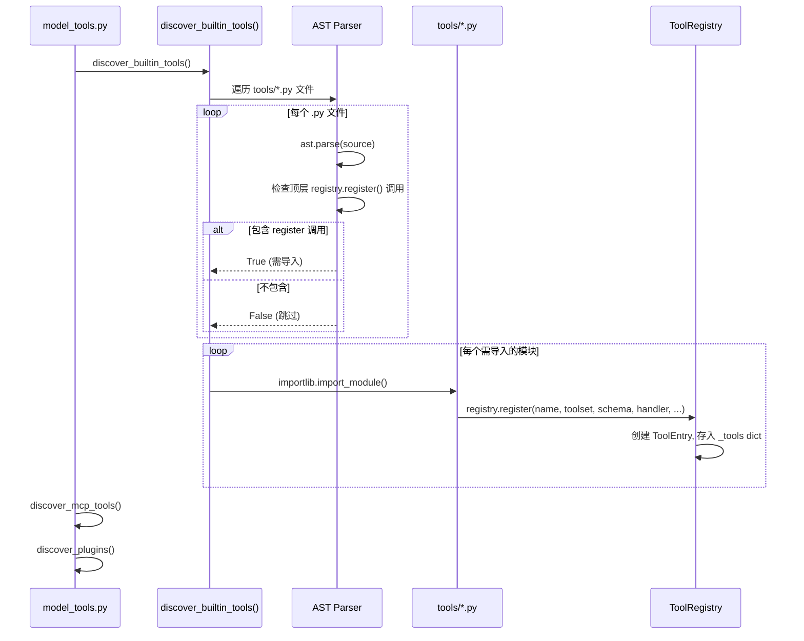
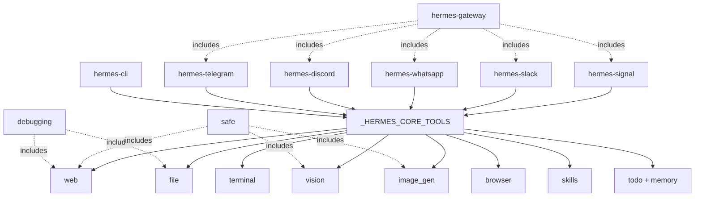

# Ch11 工具注册表设计 — 研究笔记

## 1. 核心设计概览

Hermes Agent 的工具系统采用 **中央注册表 (Central Registry)** 模式：每个工具文件在 **模块导入时** 调用 `registry.register()` 自注册其 schema、handler 和元数据。`model_tools.py` 作为编排层，触发发现、查询注册表、向 LLM 提供 tool definitions。

三层架构：
```
tools/registry.py   → 注册表核心（无外部依赖，循环安全）
tools/*.py           → 每个工具文件，import 时自注册
model_tools.py       → 编排层：触发 discover，提供公共 API
```

## 2. ToolEntry 数据结构

`ToolEntry` 使用 `__slots__` 优化内存占用，每个实例只存储 10 个固定字段：

```python
# tools/registry.py:76-97
class ToolEntry:
    """Metadata for a single registered tool."""

    __slots__ = (
        "name", "toolset", "schema", "handler", "check_fn",
        "requires_env", "is_async", "description", "emoji",
        "max_result_size_chars",
    )
```

### 字段说明

| 字段 | 类型 | 用途 |
|------|------|------|
| `name` | `str` | 工具唯一名称，如 `"terminal"`, `"read_file"` |
| `toolset` | `str` | 所属 toolset 名称，如 `"file"`, `"terminal"`, `"mcp-myserver"` |
| `schema` | `dict` | OpenAI function calling format 的 JSON Schema |
| `handler` | `Callable` | 实际执行函数，接收 `(args, **kwargs)` |
| `check_fn` | `Callable` | 可用性检查函数，返回 bool；None 表示始终可用 |
| `requires_env` | `list` | 所需环境变量列表，如 `["OPENAI_API_KEY"]` |
| `is_async` | `bool` | handler 是否为 async 函数 |
| `description` | `str` | 工具描述文本 |
| `emoji` | `str` | UI 显示用 emoji，如 `"💻"`, `"📖"` |
| `max_result_size_chars` | `int\|float\|None` | 结果大小限制，`float('inf')` 表示无限制 |

### 为什么用 `__slots__`？

- **内存节省**：每个 ToolEntry 不需要 `__dict__`，在注册 50+ 工具时显著节省内存
- **属性访问速度**：slot 访问比 dict 查找快约 35%
- **防止拼写错误**：无法动态添加未声明的属性

## 3. Registry 单例模式与 API

### 单例创建

```python
# tools/registry.py:437
registry = ToolRegistry()  # 模块级单例
```

不使用 `__new__` 或 metaclass 的经典单例，而是通过 **模块级变量** 实现。所有消费者通过 `from tools.registry import registry` 获取同一实例。

### 线程安全设计

```python
# tools/registry.py:103-110
class ToolRegistry:
    def __init__(self):
        self._tools: Dict[str, ToolEntry] = {}
        self._toolset_checks: Dict[str, Callable] = {}
        self._toolset_aliases: Dict[str, str] = {}
        self._lock = threading.RLock()  # 可重入锁
```

关键设计：使用 `RLock`（可重入锁）而非普通 `Lock`。原因：MCP 动态刷新可能在持锁时触发嵌套调用。

### Snapshot 机制

```python
# tools/registry.py:112-123
def _snapshot_state(self) -> tuple[List[ToolEntry], Dict[str, Callable]]:
    """Return a coherent snapshot of registry entries and toolset checks."""
    with self._lock:
        return list(self._tools.values()), dict(self._toolset_checks)
```

**关键模式**：读操作先获取 snapshot（浅拷贝），然后在 snapshot 上迭代，避免持锁期间执行可能耗时的 check_fn。这是 **Copy-on-Read** 模式，保证读者看到一致状态，同时不阻塞写者。

### 核心 API 总览

| 方法 | 用途 |
|------|------|
| `register()` | 注册工具（模块导入时调用） |
| `deregister()` | 移除工具（MCP 动态刷新用） |
| `get_entry(name)` | 按名称获取 ToolEntry |
| `get_definitions(tool_names, quiet)` | 获取 OpenAI 格式 schema（带 check_fn 过滤） |
| `dispatch(name, args, **kwargs)` | 执行工具 handler |
| `get_schema(name)` | 获取原始 schema（不检查可用性） |
| `get_all_tool_names()` | 所有已注册工具名 |
| `get_tool_to_toolset_map()` | `{tool: toolset}` 映射 |
| `check_toolset_requirements()` | 检查所有 toolset 的可用性 |
| `get_available_toolsets()` | UI 展示用 toolset 元数据 |
| `register_toolset_alias()` | 注册 toolset 别名（MCP 用） |
| `is_toolset_available(toolset)` | 单个 toolset 可用性检查 |
| `get_max_result_size(name)` | 获取结果大小限制 |

## 4. AST 自发现机制

这是最精巧的设计之一 —— 使用 **AST 静态分析** 在不执行代码的情况下判断哪些模块包含工具注册：

```python
# tools/registry.py:28-53
def _is_registry_register_call(node: ast.AST) -> bool:
    """Return True when *node* is a ``registry.register(...)`` call expression."""
    if not isinstance(node, ast.Expr) or not isinstance(node.value, ast.Call):
        return False
    func = node.value.func
    return (
        isinstance(func, ast.Attribute)
        and func.attr == "register"
        and isinstance(func.value, ast.Name)
        and func.value.id == "registry"
    )

def _module_registers_tools(module_path: Path) -> bool:
    """只检查模块顶层语句，忽略函数内部的 register 调用"""
    try:
        source = module_path.read_text(encoding="utf-8")
        tree = ast.parse(source, filename=str(module_path))
    except (OSError, SyntaxError):
        return False
    return any(_is_registry_register_call(stmt) for stmt in tree.body)
```

### discover_builtin_tools() 流程

```python
# tools/registry.py:56-73
def discover_builtin_tools(tools_dir=None) -> List[str]:
    tools_path = Path(tools_dir) if tools_dir else Path(__file__).resolve().parent
    module_names = [
        f"tools.{path.stem}"
        for path in sorted(tools_path.glob("*.py"))
        if path.name not in {"__init__.py", "registry.py", "mcp_tool.py"}
        and _module_registers_tools(path)  # AST 预筛选
    ]
    imported = []
    for mod_name in module_names:
        try:
            importlib.import_module(mod_name)  # 执行模块，触发 register()
            imported.append(mod_name)
        except Exception as e:
            logger.warning("Could not import tool module %s: %s", mod_name, e)
    return imported
```

### 设计亮点

1. **排除文件**：`__init__.py`、`registry.py`（自身）、`mcp_tool.py`（MCP 有独立发现路径）
2. **AST 预筛选**：避免导入不含注册调用的辅助模块（如 `approval.py`, `process_registry.py`），减少不必要的副作用
3. **只检查顶层**：`tree.body` 只看模块级语句，忽略函数内部调用 —— 区分 "工具定义文件" 和 "辅助模块"
4. **sorted()**：确保发现顺序确定性，不依赖文件系统遍历顺序
5. **容错**：单个模块导入失败不影响其他模块

## 5. Import Chain 与循环依赖避免

```
tools/registry.py  (无任何项目内导入)
       ↑
tools/*.py  (import from tools.registry at module level)
       ↑
model_tools.py  (imports tools.registry + 所有 tool modules)
       ↑
run_agent.py, cli.py, batch_runner.py
```

**核心规则**：`registry.py` 不导入任何工具文件或 `model_tools.py`。这保证了:
- 工具文件可以安全地在模块级调用 `registry.register()`
- `model_tools.py` 作为唯一的"发现触发点"

**延迟导入**：`dispatch()` 中需要 `_run_async` 时使用延迟导入：
```python
# tools/registry.py:304
if entry.is_async:
    from model_tools import _run_async  # 延迟导入避免循环
    return _run_async(entry.handler(args, **kwargs))
```

## 6. Toolset 分组系统

### 静态定义（toolsets.py）

```python
# toolsets.py:31-63
_HERMES_CORE_TOOLS = [
    "web_search", "web_extract",
    "terminal", "process",
    "read_file", "write_file", "patch", "search_files",
    "vision_analyze", "image_generate",
    "skills_list", "skill_view", "skill_manage",
    "browser_navigate", "browser_snapshot", "browser_click",
    # ... 共 ~30 个工具
    "execute_code", "delegate_task",
    "cronjob", "send_message",
    "ha_list_entities", "ha_get_state", "ha_list_services", "ha_call_service",
]
```

### Toolset 结构

每个 toolset 包含三个字段：
```python
TOOLSETS = {
    "web": {
        "description": "Web research and content extraction tools",
        "tools": ["web_search", "web_extract"],
        "includes": []     # 可组合其他 toolset
    },
    "debugging": {
        "tools": ["terminal", "process"],
        "includes": ["web", "file"]  # 复合 toolset！
    },
}
```

### Toolset 分类

| 类别 | 示例 | 特点 |
|------|------|------|
| 基础叶子节点 | `web`, `file`, `terminal`, `vision` | `includes: []` |
| 复合节点 | `debugging`, `safe` | 通过 `includes` 组合其他 toolset |
| 平台节点 | `hermes-cli`, `hermes-telegram`, `hermes-discord` | 引用 `_HERMES_CORE_TOOLS` |
| 超级节点 | `hermes-gateway` | 通过 `includes` 包含所有平台 |
| 特殊节点 | `hermes-acp`, `hermes-api-server` | 自定义列表（去掉 clarify 等 UI 工具） |
| 动态节点 | `mcp-*` | 由 MCP 发现动态创建 |

### 递归解析

```python
# toolsets.py:447-497
def resolve_toolset(name, visited=None):
    if name in {"all", "*"}:  # 特殊通配
        # 解析所有 toolset
    if name in visited:       # 环检测 / 钻石依赖去重
        return []
    visited.add(name)
    toolset = get_toolset(name)
    tools = set(toolset.get("tools", []))
    for included_name in toolset.get("includes", []):
        tools.update(resolve_toolset(included_name, visited))
    return sorted(tools)
```

### Plugin/MCP 动态 Toolset

```python
# toolsets.py:519-533
def _get_plugin_toolset_names() -> Set[str]:
    """获取 registry 中存在但 TOOLSETS 字典中不存在的 toolset"""
    from tools.registry import registry
    return {
        toolset_name
        for toolset_name in registry.get_registered_toolset_names()
        if toolset_name not in TOOLSETS
    }
```

MCP 工具通过 `register_toolset_alias()` 注册友好别名：
```python
# tools/mcp_tool.py:1925
registry.register_toolset_alias(name, toolset_name)
# 例：别名 "github" → canonical "mcp-github"
```

## 7. 工具可用性检查

### check_fn 机制

每个工具可以注册一个 `check_fn`，返回 `False` 时工具不会出现在 schema 中：

```python
# tools/registry.py:125-133
def _evaluate_toolset_check(self, toolset, check):
    if not check:
        return True  # 无 check = 始终可用
    try:
        return bool(check())
    except Exception:
        logger.debug("Toolset %s check raised; marking unavailable", toolset)
        return False  # 异常 = 不可用（而非崩溃）
```

### check_fn 缓存优化

`get_definitions()` 中对相同 `check_fn` 只调用一次：

```python
# tools/registry.py:265-281
check_results: Dict[Callable, bool] = {}
for name in sorted(tool_names):
    entry = entries_by_name.get(name)
    if entry.check_fn:
        if entry.check_fn not in check_results:  # 缓存！
            check_results[entry.check_fn] = bool(entry.check_fn())
        if not check_results[entry.check_fn]:
            continue
```

**优化意义**：同一 toolset 的多个工具共享同一个 `check_fn`（如 file toolset 的 4 个工具），只需调用一次。

### requires_env

仅用于 **UI 展示**（告诉用户缺少哪些环境变量），不用于实际检查。实际检查由 `check_fn` 负责。

## 8. Schema 收集与过滤 (get_tool_definitions)

`model_tools.py` 中的 `get_tool_definitions()` 是 schema 的最终出口：

```
┌─────────────────────────────────────────────────┐
│  get_tool_definitions(enabled, disabled, quiet) │
│  1. 解析 toolset → tool name set                │
│  2. registry.get_definitions(names) 过滤        │
│  3. 动态 schema 修改:                            │
│     - execute_code: 重写可用 sandbox 工具列表    │
│     - browser_navigate: 移除不可用工具交叉引用    │
│  4. 返回 OpenAI format [{type: function, ...}]   │
└─────────────────────────────────────────────────┘
```

### 三种模式

```python
# model_tools.py:217-255
if enabled_toolsets is not None:
    # 白名单模式：只包含指定 toolset
    for toolset_name in enabled_toolsets:
        tools_to_include.update(resolve_toolset(toolset_name))

elif disabled_toolsets:
    # 黑名单模式：包含所有，排除指定
    for ts_name in get_all_toolsets():
        tools_to_include.update(resolve_toolset(ts_name))
    for toolset_name in disabled_toolsets:
        tools_to_include.difference_update(resolve_toolset(toolset_name))

else:
    # 全量模式：包含所有 toolset
    for ts_name in get_all_toolsets():
        tools_to_include.update(resolve_toolset(ts_name))
```

## 9. 动态 Schema 修改（跨工具引用）

这是防止 LLM 幻觉的精巧设计：

### execute_code schema 动态重建

```python
# model_tools.py:276-283
if "execute_code" in available_tool_names:
    from tools.code_execution_tool import SANDBOX_ALLOWED_TOOLS, build_execute_code_schema
    sandbox_enabled = SANDBOX_ALLOWED_TOOLS & available_tool_names
    dynamic_schema = build_execute_code_schema(sandbox_enabled)
    # 替换 filtered_tools 中的 execute_code schema
```

**问题**：`execute_code` 的 schema description 列出了 sandbox 中可用的工具（如 "web_search is available"）。如果 web_search 实际不可用（API key 缺失/toolset 被禁），LLM 会幻觉调用。

**解决**：根据 `available_tool_names`（已通过 check_fn 过滤后的集合）动态重建 schema。

### browser_navigate 交叉引用清理

```python
# model_tools.py:289-303
if "browser_navigate" in available_tool_names:
    web_tools_available = {"web_search", "web_extract"} & available_tool_names
    if not web_tools_available:
        # 从 description 中移除 "prefer web_search or web_extract" 文本
        desc = desc.replace(
            " For simple information retrieval, prefer web_search or web_extract (faster, cheaper).",
            "",
        )
```

## 10. 工具调度 (dispatch & handle_function_call)

### registry.dispatch()

```python
# tools/registry.py:292-309
def dispatch(self, name, args, **kwargs):
    entry = self.get_entry(name)
    if not entry:
        return json.dumps({"error": f"Unknown tool: {name}"})
    try:
        if entry.is_async:
            from model_tools import _run_async
            return _run_async(entry.handler(args, **kwargs))
        return entry.handler(args, **kwargs)
    except Exception as e:
        logger.exception("Tool %s dispatch error: %s", name, e)
        return json.dumps({"error": f"Tool execution failed: {type(e).__name__}: {e}"})
```

### handle_function_call() 完整流程

```python
# model_tools.py:421-533
def handle_function_call(function_name, function_args, task_id=None, ...):
    # 1. 参数类型强制转换 (coerce_tool_args)
    function_args = coerce_tool_args(function_name, function_args)
    
    # 2. Agent-loop 工具短路
    if function_name in _AGENT_LOOP_TOOLS:  # todo, memory, session_search, delegate_task
        return json.dumps({"error": "must be handled by agent loop"})
    
    # 3. Plugin pre_tool_call hook（可阻止执行）
    block_message = get_pre_tool_call_block_message(...)
    
    # 4. Read-loop tracker 通知
    if function_name not in _READ_SEARCH_TOOLS:
        notify_other_tool_call(task_id)
    
    # 5. 实际 dispatch
    result = registry.dispatch(function_name, function_args, task_id=task_id, ...)
    
    # 6. Plugin post_tool_call hook
    invoke_hook("post_tool_call", tool_name=function_name, result=result, ...)
    
    return result
```

### 参数类型强制转换

```python
# model_tools.py:334-370
def coerce_tool_args(tool_name, args):
    """LLM 经常返回 "42" 而不是 42, "true" 而不是 true"""
    schema = registry.get_schema(tool_name)
    properties = schema.get("parameters", {}).get("properties")
    for key, value in args.items():
        if isinstance(value, str):
            prop_schema = properties.get(key)
            expected = prop_schema.get("type")
            args[key] = _coerce_value(value, expected)
    return args
```

支持 `integer`, `number`, `boolean`, 以及 union types `["integer", "string"]`。

## 11. 错误包装

### 双层错误保护

1. **registry.dispatch()**：捕获 handler 异常 → `{"error": "Tool execution failed: TypeError: ..."}`
2. **handle_function_call()**：捕获整个流程异常 → `{"error": "Error executing terminal: ..."}`

### 辅助函数

```python
# tools/registry.py:456-482
def tool_error(message, **extra) -> str:
    """标准化错误格式"""
    return json.dumps({"error": str(message)}, ensure_ascii=False)

def tool_result(data=None, **kwargs) -> str:
    """标准化结果格式"""
    return json.dumps(data or kwargs, ensure_ascii=False)
```

消除了工具文件中数百处 `json.dumps({"error": msg})` 的样板代码。

## 12. 注册防护与 MCP 特殊处理

### 注册冲突处理

```python
# tools/registry.py:191-213
def register(self, name, toolset, schema, handler, ...):
    existing = self._tools.get(name)
    if existing and existing.toolset != toolset:
        both_mcp = (
            existing.toolset.startswith("mcp-")
            and toolset.startswith("mcp-")
        )
        if both_mcp:
            # MCP-to-MCP 覆写允许（server refresh / 不同 MCP server 同名工具）
            logger.debug(...)
        else:
            # 拒绝：防止 plugin/MCP 覆盖内置工具
            logger.error("Tool registration REJECTED: ...")
            return
```

### deregister() 清理逻辑

```python
# tools/registry.py:229-252
def deregister(self, name):
    entry = self._tools.pop(name, None)
    # 如果 toolset 中没有其他工具了，清理 check 和 alias
    toolset_still_exists = any(e.toolset == entry.toolset for e in self._tools.values())
    if not toolset_still_exists:
        self._toolset_checks.pop(entry.toolset, None)
        self._toolset_aliases = {
            alias: target for alias, target in self._toolset_aliases.items()
            if target != entry.toolset
        }
```

用于 MCP `notifications/tools/list_changed` 事件的 nuke-and-repave 策略。

## 13. 注册示例

### 内置工具注册（file_tools.py）

```python
# tools/file_tools.py:796-799
registry.register(name="read_file", toolset="file", schema=READ_FILE_SCHEMA,
    handler=_handle_read_file, check_fn=_check_file_reqs, emoji="📖",
    max_result_size_chars=float('inf'))
registry.register(name="write_file", toolset="file", schema=WRITE_FILE_SCHEMA,
    handler=_handle_write_file, check_fn=_check_file_reqs, emoji="✍️",
    max_result_size_chars=100_000)
```

### MCP 动态注册（mcp_tool.py）

```python
# tools/mcp_tool.py:1877-1885
registry.register(
    name=tool_name_prefixed,      # 添加前缀避免冲突
    toolset=toolset_name,          # "mcp-{server_name}"
    schema=schema,
    handler=_make_tool_handler(name, mcp_tool.name, server.tool_timeout),
    check_fn=_make_check_fn(name), # 闭包：检查 MCP server 连接
    is_async=False,
    description=schema["description"],
)
registry.register_toolset_alias(name, toolset_name)  # 友好别名
```

## 14. Mermaid 架构图

### 工具发现与注册流程



### 工具调度数据流

```mermaid
flowchart TB
    LLM[LLM Response<br/>tool_call] --> HFC[handle_function_call]
    HFC --> COERCE[coerce_tool_args<br/>类型强制转换]
    COERCE --> AGENT{Agent-loop<br/>工具?}
    AGENT -->|todo/memory/...| STUB[返回 stub error<br/>由 agent loop 处理]
    AGENT -->|普通工具| HOOK[pre_tool_call hook]
    HOOK -->|blocked| BLOCK[返回 block error]
    HOOK -->|allowed| DISPATCH[registry.dispatch]
    DISPATCH --> ENTRY{ToolEntry<br/>存在?}
    ENTRY -->|No| ERR[返回 unknown tool error]
    ENTRY -->|Yes| ASYNC{is_async?}
    ASYNC -->|Yes| BRIDGE[_run_async bridge]
    ASYNC -->|No| EXEC[handler(args)]
    BRIDGE --> EXEC
    EXEC -->|Success| RESULT[JSON result string]
    EXEC -->|Exception| WRAP[包装为 JSON error]
    RESULT --> POST[post_tool_call hook]
    WRAP --> POST
```

### Toolset 层级关系



## 15. 设计模式总结

| 模式 | 应用位置 | 说明 |
|------|----------|------|
| **Service Locator / Registry** | `ToolRegistry` | 中央注册表，按名称查找 handler 和 schema |
| **Self-Registration** | 各 `tools/*.py` | 模块导入时自动注册，零配置 |
| **AST Pre-screening** | `_module_registers_tools()` | 不执行代码即判断是否需要导入 |
| **Copy-on-Read (Snapshot)** | `_snapshot_state()` | 读操作获取一致快照，避免持锁迭代 |
| **Module Singleton** | `registry = ToolRegistry()` | 模块级变量实现单例 |
| **Lazy Import** | `dispatch()` 中导入 `_run_async` | 打破循环依赖 |
| **Guard Clause** | `register()` 冲突检测 | 防止 MCP/plugin 覆盖内置工具 |
| **Nuke-and-Repave** | `deregister()` + MCP refresh | 移除旧工具后重新注册 |
| **Composite Pattern** | Toolset `includes` | toolset 可包含其他 toolset |
| **Strategy Pattern** | `check_fn` | 每个 toolset 可注入不同的可用性检查策略 |
| **Adapter Pattern** | `_run_async` | 统一同步/异步 handler 接口 |
| **Template Method** | `tool_error()` / `tool_result()` | 标准化 handler 返回格式 |
| **Flyweight** | `__slots__` on ToolEntry | 减少大量工具对象的内存开销 |
| **Dynamic Schema Rewriting** | `get_tool_definitions()` | 根据运行时可用性修改 schema 内容 |

## 16. 关键发现与设计亮点

1. **AST 发现是零成本抽象**：通过静态分析避免导入不含工具的模块，比遍历所有模块再过滤更高效
2. **Schema 是真理之源**：所有 handler、check_fn、元数据都与 schema 一起注册，不存在分散的映射表
3. **防幻觉 schema 重写**：`execute_code` 和 `browser_navigate` 的动态 schema 修改防止 LLM 调用不可用工具
4. **参数自动修正**：`coerce_tool_args` 处理 LLM 常见的类型错误（"42" → 42），提高鲁棒性
5. **`_HERMES_CORE_TOOLS` 单一定义**：所有平台共享同一列表，修改一处即同步到 CLI、Telegram、Discord 等全部平台
6. **MCP 冲突保护**：内置工具不可被 MCP/plugin 覆盖，但 MCP-to-MCP 覆写允许（server refresh 场景）
7. **Backward Compatibility Layer**：`model_tools.py` 维护 `TOOL_TO_TOOLSET_MAP` 和 `TOOLSET_REQUIREMENTS` 常量，向旧代码提供兼容接口
