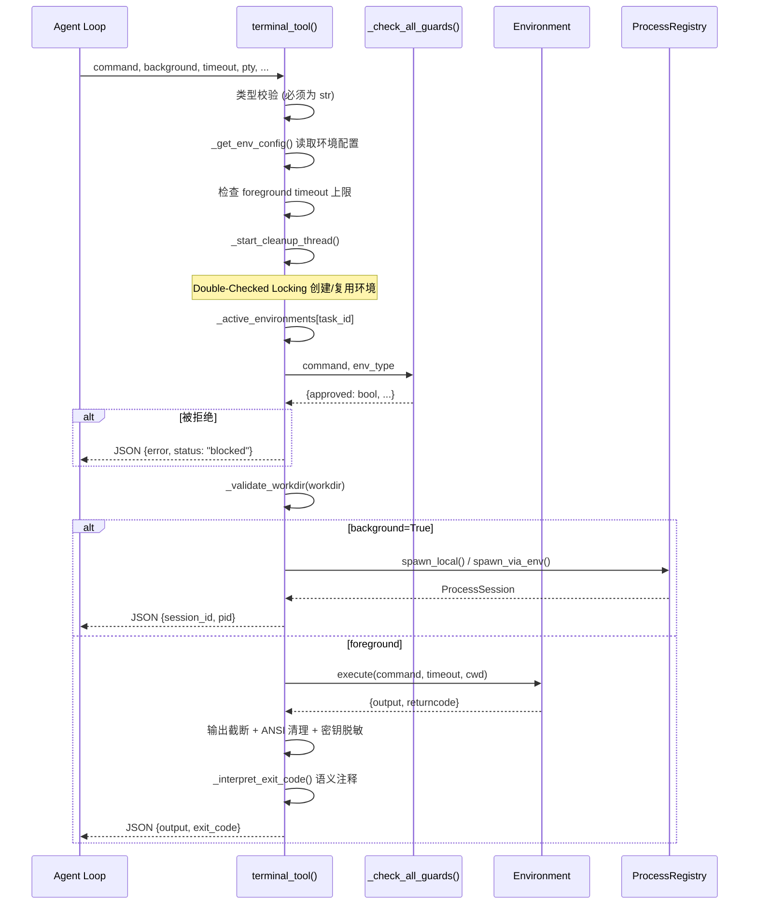
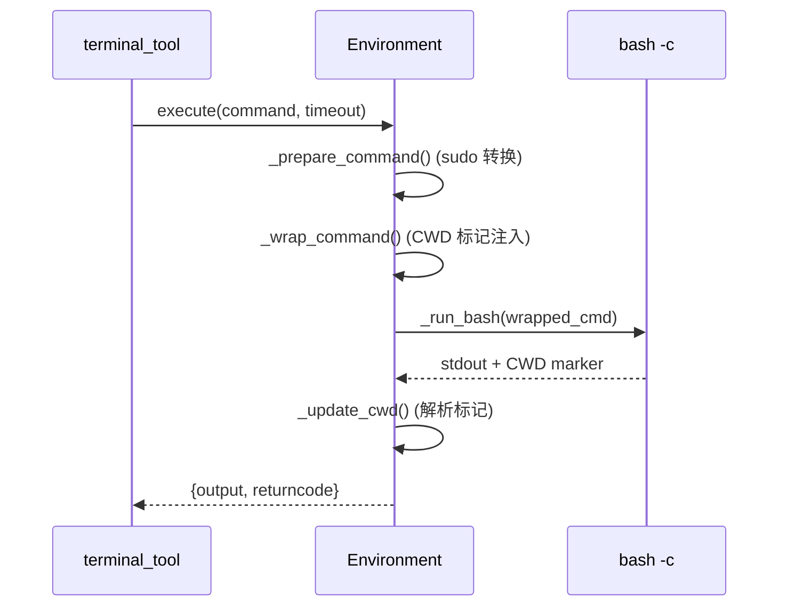
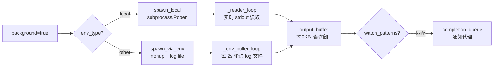
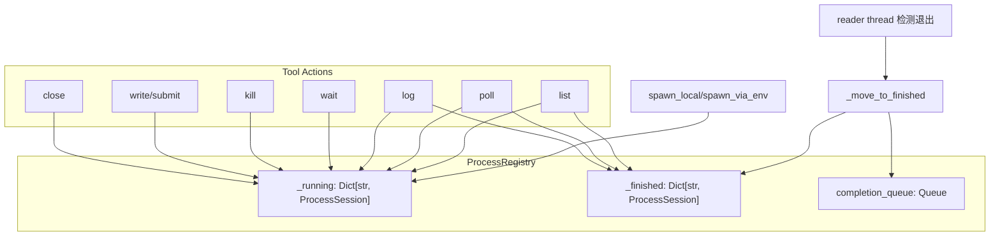
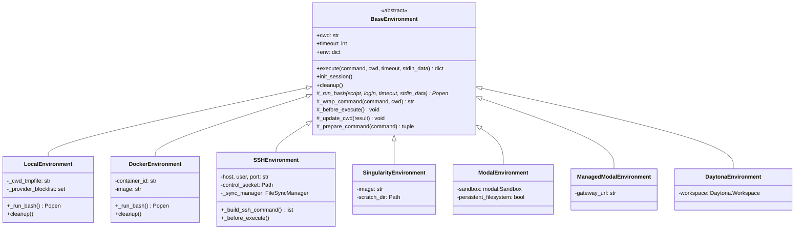

# Ch12 终端工具深度剖析

## 12.1 架构总览

Terminal 工具是 Hermes Agent 中最复杂的工具之一，包含 ~74KB 的主文件 (`terminal_tool.py`)，并通过插件式后端架构支持六种执行环境。整体分为三层：

```
┌─────────────────────────────────────────────────────────┐
│  Tool Schema Layer (terminal_tool.py:1683-1749)         │
│  TERMINAL_SCHEMA + _handle_terminal → registry.register │
├─────────────────────────────────────────────────────────┤
│  Orchestration Layer (terminal_tool.py:1105-1527)       │
│  terminal_tool() — 安全检查、环境管理、前台/后台调度    │
├─────────────────────────────────────────────────────────┤
│  Environment Layer (tools/environments/)                │
│  BaseEnvironment → Local | Docker | Singularity |       │
│                    Modal | ManagedModal | SSH | Daytona  │
└─────────────────────────────────────────────────────────┘
```

### 关键设计模式

| 模式 | 位置 | 说明 |
|------|------|------|
| **Strategy Pattern** | environments/ | BaseEnvironment ABC + 多种后端实现 |
| **Singleton Registry** | process_registry.py:1083 | `process_registry = ProcessRegistry()` 模块级单例 |
| **Double-Checked Locking** | terminal_tool.py:1204-1226 | 环境创建的线程安全 |
| **Observer/Watch Pattern** | process_registry.py:151-227 | watch_patterns 配合 rate limiting |
| **Template Method** | base.py:519-558 | execute() 固定流程，子类覆盖 `_run_bash`, `_before_execute` |
| **Checkpoint/Recovery** | process_registry.py:1002-1079 | JSON 序列化进程状态，crash recovery |

## 12.2 命令执行生命周期

### 完整调用链



### terminal_tool() 函数签名 (L1105-1115)

```python
def terminal_tool(
    command: str,
    background: bool = False,
    timeout: Optional[int] = None,
    task_id: Optional[str] = None,
    force: bool = False,        # 内部参数，不暴露给 model
    workdir: Optional[str] = None,
    pty: bool = False,
    notify_on_complete: bool = False,
    watch_patterns: Optional[List[str]] = None,
) -> str:   # 返回 JSON 字符串
```

### 环境配置系统 (L597-673)

`_get_env_config()` 从环境变量读取完整配置：

- `TERMINAL_ENV`: 后端类型 (local/docker/singularity/modal/daytona/ssh)
- `TERMINAL_CWD`: 工作目录（local 用 `os.getcwd()`，容器用 `/root`，SSH 用 `~`）
- `TERMINAL_TIMEOUT`: 默认超时 180s
- `TERMINAL_LIFETIME_SECONDS`: 沙箱空闲生存期 300s
- 容器资源: `TERMINAL_CONTAINER_CPU` (1), `TERMINAL_CONTAINER_MEMORY` (5120MB), `TERMINAL_CONTAINER_DISK` (51200MB)
- SSH: `TERMINAL_SSH_HOST`, `TERMINAL_SSH_USER`, `TERMINAL_SSH_PORT`, `TERMINAL_SSH_KEY`

### 前台执行的重试与超时机制 (L1433-1515)

前台命令有三次重试机会（指数退避 2/4/8 秒），timeout 错误不重试直接返回 exit_code=124。

**输出后处理管线：**
1. **截断** (L1481-1490): >50K 字符时保留 40% 头部 + 60% 尾部
2. **ANSI 清理** (L1494-1495): `strip_ansi()` 去除终端格式码
3. **密钥脱敏** (L1498-1499): `redact_sensitive_text()` 防止 API key 泄漏
4. **退出码语义** (L1501-1503): `_interpret_exit_code()` 为 grep=1, diff=1 等添加说明

### Foreground Timeout 硬上限 (L76, L1188-1195)

```python
FOREGROUND_MAX_TIMEOUT = int(os.getenv("TERMINAL_MAX_FOREGROUND_TIMEOUT", "600"))
```

模型请求超过 600s 的前台超时会被拒绝，引导使用 `background=true`。

## 12.3 安全/审批系统 (tools/approval.py)

### 三层安全检查架构

```mermaid
flowchart TD
    CMD[命令输入] --> NORM[_normalize_command_for_detection<br>ANSI 清除 + Unicode NFKC]
    NORM --> PAT{DANGEROUS_PATTERNS<br>37 条正则}
    PAT -->|匹配| TIRITH[Tirith 安全扫描<br>可选]
    PAT -->|无匹配| ALLOW[✅ 通过]
    TIRITH --> MERGE[合并所有 warnings]
    MERGE --> SESSION{已审批?<br>session/permanent}
    SESSION -->|是| ALLOW
    SESSION -->|否| MODE{approval mode}
    MODE -->|off/yolo| ALLOW
    MODE -->|smart| LLM[辅助 LLM 评估<br>_smart_approve()]
    LLM -->|APPROVE| ALLOW
    LLM -->|DENY| BLOCK[❌ 阻止]
    LLM -->|ESCALATE| PROMPT
    MODE -->|manual| PROMPT[用户审批提示]
    PROMPT -->|once| ALLOW
    PROMPT -->|session| SESS_SAVE[approve_session()]
    PROMPT -->|always| PERM_SAVE[approve_permanent()]
    PROMPT -->|deny| BLOCK
```

### 危险命令模式 (L75-138)

`DANGEROUS_PATTERNS` 包含 37 条正则，覆盖：

| 类别 | 示例模式 | 描述 |
|------|----------|------|
| 文件系统破坏 | `rm -r`, `find -delete`, `mkfs` | 递归删除、格式化 |
| 权限危险 | `chmod 777`, `chown -R root` | 全局可写、root 所有权 |
| SQL 危险 | `DROP TABLE`, `DELETE FROM` (无 WHERE) | 数据库破坏 |
| 服务管理 | `systemctl stop/restart` | 停止系统服务 |
| 远程执行 | `curl\|sh`, `python -e` | 管道执行远程脚本 |
| 自我保护 | `pkill hermes`, `hermes gateway stop` | 防止 agent 杀死自身 |
| Git 危险 | `git reset --hard`, `git push --force` | 不可逆操作 |
| 系统文件 | `> /etc/`, `tee /etc/` | 覆写系统配置 |

**反绕过措施 (L168-183):**
- ANSI escape 序列剥离 (`strip_ansi`)
- Null byte 清除
- Unicode NFKC 归一化（防止全角字符绕过）

### 审批状态管理

**四级审批范围：**
1. `once` — 仅本次执行
2. `session` — 当前会话（内存，`_session_approved: dict[str, set]`）
3. `always` — 永久（`config.yaml` 中 `command_allowlist`）
4. `yolo` — 会话级全部跳过（`_session_yolo: set[str]`）

**容器环境免检 (L601-602):**
```python
if env_type in ("docker", "singularity", "modal", "daytona"):
    return {"approved": True, "message": None}
```
沙箱环境中的命令不触发审批——因为已经在隔离环境中运行。

### Smart Approval (L534-583)

使用辅助 LLM 自动评估风险，灵感来自 OpenAI Codex 的 Smart Approvals：

```python
def _smart_approve(command: str, description: str) -> str:
    """使用辅助 LLM 评估风险。返回 'approve'/'deny'/'escalate'"""
    client, model = get_text_auxiliary_client(task="approval")
    # 给 LLM 一个 security reviewer prompt
    # temperature=0, max_tokens=16
    # 解析返回: APPROVE / DENY / ESCALATE
```

### Gateway 阻塞审批 (L219-284)

Gateway 模式使用队列机制实现同步审批：

```python
class _ApprovalEntry:
    event: threading.Event   # 阻塞直到用户响应
    data: dict               # 命令信息
    result: Optional[str]    # "once"/"session"/"always"/"deny"

# 每个 session 有独立队列，支持并发子代理
_gateway_queues: dict[str, list[_ApprovalEntry]]
```

## 12.4 前台 vs 后台执行模式

### 前台模式



关键特性：
- **Spawn-per-call**: 每个命令启动新 bash 进程
- **Session snapshot**: 首次初始化时捕获 env vars，后续命令前重放
- **CWD 持久化**: 通过 stdout marker (`_cwd_marker`) 在命令间传递工作目录
- **超时上限**: 前台最大 600s (可配置)

### 后台模式



**本地后台 (spawn_local, L286-396):**
- `subprocess.Popen` + `os.setsid` 创建新进程组
- 独立 reader thread 持续读取 stdout（4KB chunk）
- 支持 PTY 模式 (`ptyprocess.PtyProcess`)
- 环境变量设置 `PYTHONUNBUFFERED=1` 确保 Python 输出不缓冲

**非本地后台 (spawn_via_env, L398-476):**
```bash
# 生成的包装命令
mkdir -p /tmp && \
( nohup bash -lc 'actual_command' > /tmp/hermes_bg_proc_xxx.log 2>&1; \
  rc=$?; printf '%s\n' "$rc" > /tmp/hermes_bg_proc_xxx.exit ) & \
echo $! > /tmp/hermes_bg_proc_xxx.pid && cat /tmp/hermes_bg_proc_xxx.pid
```
通过三个文件实现远程进程管理：`.log` (输出), `.pid` (进程ID), `.exit` (退出码)

## 12.5 后台进程注册表 (ProcessRegistry)

### ProcessSession 数据类 (L68-103)

```python
@dataclass
class ProcessSession:
    id: str                    # "proc_xxxxxxxxxxxx" (UUID hex[:12])
    command: str               # 原始命令
    task_id: str               # 任务隔离键
    session_key: str           # Gateway session key
    pid: Optional[int]         # OS 进程 ID
    process: Optional[Popen]   # 本地 Popen 句柄
    env_ref: Any               # 环境对象引用
    exited: bool               # 是否已完成
    exit_code: Optional[int]   # 退出码
    output_buffer: str         # 滚动输出 (200KB)
    detached: bool             # crash 恢复后无管道
    pid_scope: str             # "host" 或 "sandbox"
    notify_on_complete: bool   # 完成时通知
    watch_patterns: List[str]  # 输出监控模式
    _pty: Any                  # ptyprocess 句柄
    _lock: threading.Lock      # 线程安全锁
```

### 注册表操作



### Process Tool 操作详解

| Action | 说明 | 关键逻辑 |
|--------|------|----------|
| `list` | 列出所有进程 | 合并 _running + _finished，可按 task_id 过滤 |
| `poll` | 检查状态 + 新输出 | 返回最后 2000 字符，标记消费已读 |
| `log` | 分页读取完整输出 | 支持 offset/limit 参数 |
| `wait` | 阻塞等待完成 | 支持中断检测 (`is_interrupted()`)，超时限制 |
| `kill` | 终止进程 | PTY→terminate, Popen→killpg, Env→kill PID |
| `write` | 写入 stdin (无换行) | PTY 模式写入 pty handle，Popen 写入 stdin pipe |
| `submit` | 写入 + Enter | `write_stdin(data + "\n")` |
| `close` | 关闭 stdin/EOF | PTY→sendeof(), Popen→stdin.close() |

### Watch Pattern 速率限制 (L151-227)

防止高频输出淹没通知系统：

```python
WATCH_MAX_PER_WINDOW = 8        # 每窗口最多 8 条通知
WATCH_WINDOW_SECONDS = 10       # 10 秒滚动窗口
WATCH_OVERLOAD_KILL_SECONDS = 45  # 持续过载 45s 后永久禁用
```

过载检测机制：窗口内超过限额时开始计时，连续 45 秒过载则 `_watch_disabled=True`，发送 `watch_disabled` 通知。

### Crash Recovery (L1002-1079)

```python
CHECKPOINT_PATH = get_hermes_home() / "processes.json"
```

Gateway 模式下，每次 spawn/kill 都写 checkpoint。重启后：
1. 读取 `processes.json`
2. 只恢复 `pid_scope=="host"` 的进程（sandbox PID 无意义）
3. 检查 PID 是否存活 (`os.kill(pid, 0)`)
4. 标记为 `detached=True`（无法读取输出，但可报告状态和 kill）

### 资源限制

```python
MAX_OUTPUT_CHARS = 200_000      # 200KB 滚动输出缓冲
FINISHED_TTL_SECONDS = 1800     # 完成进程保留 30 分钟
MAX_PROCESSES = 64              # 最大并发跟踪进程 (LRU 淘汰)
```

## 12.6 终端环境/后端体系

### BaseEnvironment 抽象基类 (base.py)



### Spawn-per-call 模型

**核心设计**: 每个 `execute()` 调用都启动新的 `bash` 进程。不维护长期 shell 会话。

- **Session Snapshot** (base.py): 首次 `init_session()` 捕获 `env -0` 输出，后续命令前通过 `export` 重放
- **CWD 持久化**: 每个命令末尾注入 `echo _cwd_marker $(pwd)`，从输出中提取新 CWD
- **好处**: 简单可靠，进程隔离好，每个命令独立
- **代价**: 无法保留 shell 函数、别名、局部变量

### 各后端特点对比

| 后端 | _run_bash 实现 | CWD 追踪 | 安全检查 | 文件同步 |
|------|---------------|----------|----------|----------|
| **Local** | `subprocess.Popen(shell -c)` | 临时文件 | ✅ 完整审批 | N/A (本机) |
| **Docker** | `docker exec` | in-band marker | ❌ 容器免检 | bind mount |
| **Singularity** | `singularity exec` | in-band marker | ❌ 容器免检 | bind mount |
| **SSH** | `ssh user@host bash -c` | in-band marker | ✅ 完整审批 | FileSyncManager (scp) |
| **Modal** | Modal Sandbox API | in-band marker | ❌ 容器免检 | Modal Volume |
| **ManagedModal** | HTTP→Gateway→Modal | in-band marker | ❌ 容器免检 | 通过 Gateway |
| **Daytona** | Daytona SDK | in-band marker | ❌ 容器免检 | Daytona Volume |

### LocalEnvironment 安全隔离 (local.py)

**Provider 环境变量屏蔽** — 阻止 60+ 个敏感 env vars 泄漏到子进程：

```python
_HERMES_PROVIDER_ENV_BLOCKLIST = _build_provider_env_blocklist()
# 包含: OPENAI_API_KEY, ANTHROPIC_API_KEY, TELEGRAM_TOKEN,
#        DISCORD_TOKEN, SLACK_BOT_TOKEN, AWS_SECRET_ACCESS_KEY, ...
```

**进程组管理**: `os.setsid()` 创建新进程组，cleanup 时发送 `SIGTERM` 到整组，5 秒后 `SIGKILL`。

### SSHEnvironment 连接复用

```python
# ControlMaster 连接持久化
cmd.extend(["-o", "ControlPath=path/to/socket"])
cmd.extend(["-o", "ControlMaster=auto"])
cmd.extend(["-o", "ControlPersist=300"])  # 300 秒保持
```

SSH 后端使用 `FileSyncManager` 同步 `~/.hermes` 配置到远程机器。

### Docker 安全加固 (docker.py:1-5)

```
cap-drop ALL, no-new-privileges, PID limits
```

## 12.7 PTY 模式

PTY (Pseudo-Terminal) 模式用于需要终端交互的工具（如 Codex, Claude Code, Python REPL）。

### 实现路径 (process_registry.py:314-354)

```python
if use_pty:
    from ptyprocess import PtyProcess
    pty_proc = PtyProcess.spawn(
        [user_shell, "-lic", command],
        cwd=session.cwd,
        env=pty_env,
        dimensions=(30, 120),  # 30行 x 120列
    )
    session._pty = pty_proc
    # 启动 _pty_reader_loop 线程
```

### PTY vs Pipe 对比

| 特性 | PTY 模式 | Pipe 模式 (默认) |
|------|----------|------------------|
| 交互式 | ✅ 支持 stdin 交互 | ✅ 支持但行为不同 |
| 颜色/格式 | ✅ 完整终端 | ❌ 无终端 |
| 进程行为 | isatty()=True | isatty()=False |
| stdin | write/submit 通过 pty handle | write/submit 通过 pipe |
| EOF | sendeof() | stdin.close() |
| 回退 | ptyprocess 不可用时自动降级 | 默认模式 |

### 特殊命令检测 (L1090-1102)

```python
def _command_requires_pipe_stdin(command: str) -> bool:
    """gh auth login --with-token 需要 pipe stdin"""
    normalized = " ".join(command.lower().split())
    return normalized.startswith("gh auth login") and "--with-token" in normalized
```

某些命令在 PTY 下行为异常（等待 TTY 输入而非 pipe EOF），自动禁用 PTY。

## 12.8 Sudo 处理系统

### sudo 命令重写 (L383-498)

当检测到 `sudo` 命令且 `SUDO_PASSWORD` 可用时：

```python
# 原始命令
sudo apt install python3

# 重写为
sudo -S -p '' apt install python3
# -S: 从 stdin 读取密码
# -p '': 不输出密码提示
```

**密码来源优先级：**
1. `SUDO_PASSWORD` 环境变量
2. `_cached_sudo_password` 会话缓存
3. 交互式提示（仅 `HERMES_INTERACTIVE=1`，45 秒超时）

## 12.9 环境生命周期管理

### 环境缓存与清理

```python
_active_environments: Dict[str, Any] = {}  # task_id → Environment
_last_activity: Dict[str, float] = {}       # task_id → timestamp
```

**清理线程** (L876-911): 每 60 秒运行一次，清理超过 `lifetime_seconds` (默认 300s) 未活动的环境。

**关键细节：**
- 有活跃后台进程的沙箱不会被清理 (L822-824)
- 清理在锁外执行（Modal/Docker 可能耗时 10-15s）
- `atexit` 注册 `_atexit_cleanup()` 确保进程退出时全部清理

### Per-Task 环境覆盖 (L541-577)

用于 RL 训练环境 (Atropos) 为特定 task_id 指定自定义镜像：

```python
def register_task_env_overrides(task_id: str, overrides: Dict[str, Any]):
    """覆盖: modal_image, docker_image, cwd"""
    _task_env_overrides[task_id] = overrides
```

## 12.10 工具注册 (L1681-1749)

### Terminal Tool Schema

```python
TERMINAL_SCHEMA = {
    "name": "terminal",
    "description": TERMINAL_TOOL_DESCRIPTION,  # 500+ 字符的引导性描述
    "parameters": {
        "properties": {
            "command": {"type": "string"},
            "background": {"type": "boolean", "default": False},
            "timeout": {"type": "integer", "minimum": 1},
            "workdir": {"type": "string"},
            "pty": {"type": "boolean", "default": False},
            "notify_on_complete": {"type": "boolean", "default": False},
            "watch_patterns": {"type": "array", "items": {"type": "string"}},
        },
        "required": ["command"]
    }
}

registry.register(
    name="terminal", toolset="terminal",
    schema=TERMINAL_SCHEMA, handler=_handle_terminal,
    check_fn=check_terminal_requirements,
    emoji="💻",
    max_result_size_chars=100_000,
)
```

### Process Tool Schema

```python
PROCESS_SCHEMA = {
    "name": "process",
    "parameters": {
        "properties": {
            "action": {"enum": ["list","poll","log","wait","kill","write","submit","close"]},
            "session_id": {"type": "string"},
            "data": {"type": "string"},
            "timeout": {"type": "integer", "minimum": 1},
            "offset": {"type": "integer"},
            "limit": {"type": "integer", "minimum": 1},
        },
        "required": ["action"]
    }
}

registry.register(
    name="process", toolset="terminal",
    schema=PROCESS_SCHEMA, handler=_handle_process,
    emoji="⚙️",
)
```

**TERMINAL_TOOL_DESCRIPTION** (L512-529) 包含明确的工具使用指南，引导 LLM：
- ❌ 不要用 cat/head/tail 读文件
- ❌ 不要用 grep/find 搜索
- ❌ 不要用 sed/awk 编辑
- ❌ 不要用 echo 创建文件
- ✅ 用于 builds, installs, git, processes, scripts, network

## 12.11 退出码语义注释 (L1026-1087)

智能解读非零退出码，避免 agent 浪费回合：

```python
semantics = {
    "grep":  {1: "No matches found (not an error)"},
    "diff":  {1: "Files differ (expected, not an error)"},
    "test":  {1: "Condition evaluated to false"},
    "curl":  {6: "Could not resolve host", 28: "Operation timed out"},
    "git":   {1: "Non-zero exit (often normal)"},
}
```

## 12.12 全局中断支持 (L50-55)

```python
from tools.interrupt import is_interrupted, _interrupt_event
```

当用户发送新消息时，`_interrupt_event` 被设置。Terminal tool 和 ProcessRegistry.wait() 都会检查此事件，立即终止长时间运行的命令或等待。

## 12.13 关键设计洞察

### 1. 安全性分层

安全检查在 **编排层** 而非 **环境层** 执行，这意味着：
- 所有后端共享同一套检查逻辑
- 容器后端可以直接豁免（已经沙箱化）
- 审批状态与后端无关，按 session 管理

### 2. 输出管理的务实主义

50KB 前台截断 + 200KB 后台缓冲 + ANSI 清理 + 密钥脱敏，形成一个完整的输出净化管线。头/尾保留策略（40/60 分割）基于观察：错误信息常出现在开头，最新进展在末尾。

### 3. 后台进程的两种模式

本地 spawn 有完整的 stdout pipe，支持实时读取和 stdin 交互。非本地 spawn 通过 log 文件轮询实现，功能受限但保证命令在正确的沙箱上下文中运行。这是可用性与正确性的平衡。

### 4. Workdir 注入防护 (L150-175)

```python
_WORKDIR_SAFE_RE = re.compile(r'^[A-Za-z0-9/_\-.~ +@=,]+$')
```

使用 **allowlist** 而非 denylist 验证 workdir 参数，防止通过 workdir 进行 shell 注入。这是比正则 denylist 更安全的方法。
