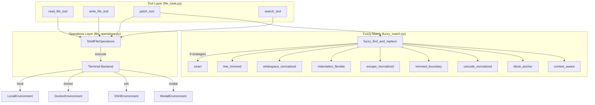
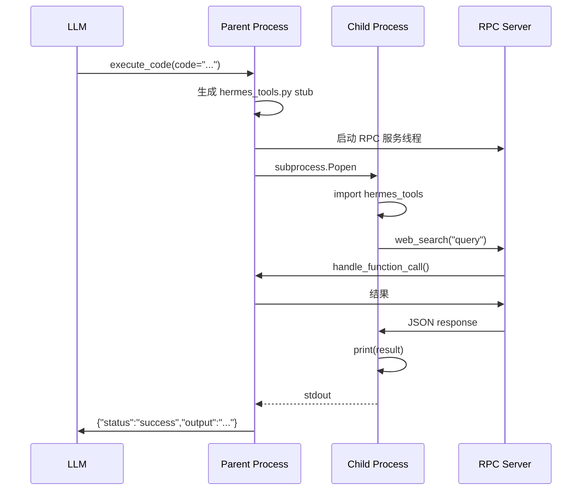
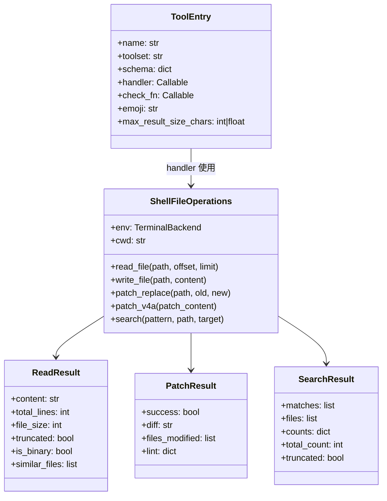

# Ch13 文件与代码工具 — 研究笔记

## 1. 架构总览

Hermes Agent 的文件与代码工具体系由三层构成：

1. **Tool Layer** (`tools/file_tools.py`, `tools/code_execution_tool.py`) — 面向 LLM 的高层接口，负责参数校验、安全检查、结果格式化
2. **Operations Layer** (`tools/file_operations.py`) — 通过 shell 命令实现的跨后端文件操作（`ShellFileOperations`）
3. **Fuzzy Match Layer** (`tools/fuzzy_match.py`) — 9 策略模糊匹配引擎

所有工具通过 `tools/registry.py` 的 `registry.register()` 统一注册，遵循统一的 handler 签名和 JSON 返回格式。



## 2. read_file 工具

### 2.1 核心功能

**文件**: `tools/file_tools.py:282-449`, `tools/file_operations.py:468-555`

```python
# file_tools.py:282
def read_file_tool(path: str, offset: int = 1, limit: int = 500, task_id: str = "default") -> str:
```

**关键特性**:

| 特性 | 实现 | 代码位置 |
|------|------|----------|
| 分页 (Pagination) | `sed -n '{offset},{end_line}p'` | file_operations.py:528-529 |
| 行号 (Line Numbers) | `{i:6d}\|{line}` 格式化 | file_operations.py:400-409 |
| 二进制检测 | 扩展名 + 内容分析 (30% 非打印字符) | file_operations.py:377-393 |
| 字符数上限 | 100K chars (≈25-35K tokens) | file_tools.py:28, 374 |
| 设备路径拦截 | `/dev/zero`, `/dev/random` 等 | file_tools.py:62-90 |
| 敏感文件拦截 | Hermes 内部缓存路径 | file_tools.py:311-328 |
| 去重 (Dedup) | mtime 比较避免重复读 | file_tools.py:330-357 |
| 循环检测 | 连续读同一区域 ≥3 次警告, ≥4 次拦截 | file_tools.py:429-445 |
| 相似文件建议 | 基于文件名评分 (0-100) | file_operations.py:557-607 |
| 敏感信息脱敏 | `redact_sensitive_text()` | file_tools.py:389-391 |
| 大文件提示 | >512KB 文件推荐使用 offset/limit | file_tools.py:395-402 |

### 2.2 安全防护链

```mermaid
flowchart TD
    A[read_file_tool 调用] --> B{设备路径?}
    B -->|是| B1[拦截: /dev/zero 等]
    B -->|否| C{二进制扩展名?}
    C -->|是| C1[拦截: 建议用 vision_analyze]
    C -->|否| D{Hermes 内部路径?}
    D -->|是| D1[拦截: 防止 prompt injection]
    D -->|否| E{Dedup 命中?}
    E -->|是| E1[返回 "文件未变更" stub]
    E -->|否| F[执行读取]
    F --> G{字符数 > 100K?}
    G -->|是| G1[拒绝: 要求缩小范围]
    G -->|否| H[redact 敏感信息]
    H --> I{连续读取次数?}
    I -->|≥4| I1[拦截: 打破循环]
    I -->|≥3| I2[返回带警告的结果]
    I -->|<3| I3[正常返回]
```

### 2.3 Dedup 机制

去重机制通过 `_read_tracker` 字典按 task_id 跟踪：

```python
# file_tools.py:133-149
# Per task_id:
#   "dedup": dict mapping (resolved_path, offset, limit) → mtime float
#   "read_timestamps": dict mapping resolved_path → mtime float
```

- **Context compression 后重置**: `reset_file_dedup()` 清空 dedup 缓存，因为原始内容已被摘要化 (file_tools.py:454-473)
- **其他工具调用重置连续计数**: `notify_other_tool_call()` 防止误判 (file_tools.py:476-489)

## 3. write_file 工具

### 3.1 核心功能

**文件**: `tools/file_tools.py:541-562`, `tools/file_operations.py:665-717`

```python
# file_tools.py:541
def write_file_tool(path: str, content: str, task_id: str = "default") -> str:
```

**关键特性**:

| 特性 | 实现 | 代码位置 |
|------|------|----------|
| 完全覆写 | `cat > {path}` via stdin pipe | file_operations.py:699-700 |
| 自动创建目录 | `mkdir -p` parent 目录 | file_operations.py:691-695 |
| 敏感路径保护 | `/etc/`, `/boot/` 等 | file_tools.py:95-118 |
| Staleness 检测 | 与上次 read 的 mtime 比较 | file_tools.py:510-538 |
| stdin 管道传输 | 绕过 OS ARG_MAX 限制 | file_operations.py:669-670 |

### 3.2 Staleness 检测

```python
# file_tools.py:510-538
def _check_file_staleness(filepath: str, task_id: str) -> str | None:
    """如果文件在 agent 最后一次 read 后被修改，返回警告"""
    # 比较 read_timestamps 中存储的 mtime 与当前 mtime
```

这个机制保护了并发编辑场景：如果文件在 read 和 write 之间被外部修改，会在 write 结果中附加 `_warning`，但 **不阻止写入** — 这是故意设计，避免误拦截合法操作。

### 3.3 敏感路径拦截

```python
# file_tools.py:95-99
_SENSITIVE_PATH_PREFIXES = (
    "/etc/", "/boot/", "/usr/lib/systemd/",
    "/private/etc/", "/private/var/",
)
_SENSITIVE_EXACT_PATHS = {"/var/run/docker.sock", "/run/docker.sock"}
```

注意：同时检查 `os.path.realpath` (解析符号链接后) 和 `os.path.normpath` (规范化但不解析)，**双重防护** 防止通过符号链接绕过。

## 4. search_files 工具

### 4.1 核心功能

**文件**: `tools/file_tools.py:622-687`, `tools/file_operations.py:850-1216`

两种搜索模式：

| 模式 | target 参数 | 底层命令 | 功能 |
|------|-------------|----------|------|
| Content 搜索 | `"content"` | `rg` / `grep` | 文件内容正则搜索 |
| File 搜索 | `"files"` | `rg --files` / `find` | 按文件名 glob 查找 |

### 4.2 Ripgrep 后端

Content 搜索 (`_search_with_rg`, file_operations.py:1022-1119):

```python
cmd_parts = ["rg", "--line-number", "--no-heading", "--with-filename"]
```

**三种输出模式**:
- `content`: 匹配行 + 行号 + 文件路径 (默认)
- `files_only`: 仅返回匹配的文件路径 (`-l`)
- `count`: 每文件匹配计数 (`-c`)

File 搜索 (`_search_files_rg`, file_operations.py:962-1003):
- 优先使用 `rg --files --sortr=modified` (rg 13+ 支持按修改时间排序)
- 自动回退到不排序的 `rg --files`
- 最终 fallback 到 `find` 命令

### 4.3 搜索结果解析

Windows 兼容的正则解析器处理 rg/grep 输出：

```python
# file_operations.py:1085-1086
_match_re = re.compile(r'^([A-Za-z]:)?(.*?):(\d+):(.*)$')  # 匹配行
_ctx_re = re.compile(r'^([A-Za-z]:)?(.*?)-(\d+)-(.*)$')    # 上下文行
```

- 每行内容截断到 500 字符 (`m.group(4)[:500]`)
- 支持上下文行 (context lines)：`-C N` 参数

### 4.4 反循环机制

与 read_file 共享 `_read_tracker`，搜索 key 包含更多维度：

```python
# file_tools.py:631-639
search_key = (
    "search", pattern, target, str(path),
    file_glob or "", limit, offset,
)
```

## 5. patch 工具

### 5.1 两种编辑模式

**文件**: `tools/file_tools.py:565-619`, `tools/file_operations.py:723-812`

| 模式 | 参数 | 功能 |
|------|------|------|
| Replace | `path`, `old_string`, `new_string` | 单文件查找替换 |
| V4A Patch | `patch` (多文件 patch 字符串) | 批量多文件编辑 |

### 5.2 9 策略模糊匹配

**文件**: `tools/fuzzy_match.py`

受 OpenCode 启发的 9 策略匹配链，按从精确到模糊的顺序尝试：

```python
# fuzzy_match.py:73-83
strategies = [
    ("exact", _strategy_exact),                    # 1. 精确字符串匹配
    ("line_trimmed", _strategy_line_trimmed),       # 2. 行级别去除前后空白
    ("whitespace_normalized", _strategy_whitespace_normalized),  # 3. 多空格/tab 折叠
    ("indentation_flexible", _strategy_indentation_flexible),    # 4. 完全忽略缩进
    ("escape_normalized", _strategy_escape_normalized),          # 5. 转义字符规范化
    ("trimmed_boundary", _strategy_trimmed_boundary),            # 6. 首尾行空白修剪
    ("unicode_normalized", _strategy_unicode_normalized),        # 7. Unicode 规范化
    ("block_anchor", _strategy_block_anchor),       # 8. 首尾行锚定 + 中间相似度
    ("context_aware", _strategy_context_aware),     # 9. 50% 行相似度阈值
]
```

**核心设计理念**: LLM 生成的代码经常有细微的空白/缩进/引号差异，逐级放宽匹配条件解决这些变体问题。

**Unicode 规范化映射** (fuzzy_match.py:36-41):
```python
UNICODE_MAP = {
    "\u201c": '"', "\u201d": '"',   # smart double quotes → "
    "\u2018": "'", "\u2019": "'",   # smart single quotes → '
    "\u2014": "--", "\u2013": "-",  # em/en dashes
    "\u2026": "...", "\u00a0": " ", # ellipsis, non-breaking space
}
```

### 5.3 替换应用

```python
# fuzzy_match.py:104-124
def _apply_replacements(content, matches, new_string):
    # 从后往前替换，保持前面位置不变
    sorted_matches = sorted(matches, key=lambda x: x[0], reverse=True)
    for start, end in sorted_matches:
        result = result[:start] + new_string + result[end:]
```

### 5.4 V4A Patch 格式

```
*** Begin Patch
*** Update File: path/to/file.py
@@ context hint @@
 context line
-removed line
+added line
*** Add File: new_file.py
+new content
*** Delete File: old_file.py
*** End Patch
```

V4A patch 由 `tools/patch_parser.py` 解析，支持三种操作：Update/Add/Delete。

### 5.5 自动语法检查 (Lint)

```python
# file_operations.py:814-844
def _check_lint(self, path: str) -> LintResult:
    ext = os.path.splitext(path)[1].lower()
    if ext not in LINTERS:
        return LintResult(skipped=True)
    linter_cmd = LINTERS[ext]
    # 检查 linter 是否可用
    if not self._has_command(base_cmd):
        return LintResult(skipped=True)
    # 运行 linter，timeout=30s
    result = self._exec(cmd, timeout=30)
```

每次 patch 后自动运行语法检查，返回 lint 结果供 LLM 自行修复。

### 5.6 Patch 失败提示

```python
# file_tools.py:615-616
if result_dict.get("error") and "Could not find" in str(result_dict["error"]):
    result_json += "\n\n[Hint: old_string not found. Use read_file to verify ...]"
```

## 6. execute_code 代码沙箱

### 6.1 架构概述

**文件**: `tools/code_execution_tool.py` (1377 行)

execute_code 实现了 **Programmatic Tool Calling (PTC)** — LLM 编写 Python 脚本，通过 RPC 调用 Hermes 工具，将多步工具链压缩为单次推理轮次。



### 6.2 两种传输协议

| 特性 | UDS (Local) | File-based RPC (Remote) |
|------|-------------|------------------------|
| 传输方式 | Unix Domain Socket | 文件系统请求/响应 |
| 适用后端 | local | docker, ssh, modal, daytona |
| 连接方式 | `AF_UNIX` socket | 轮询 req_/res_ 文件 |
| 环境变量 | `HERMES_RPC_SOCKET` | `HERMES_RPC_DIR` |
| 序列化 | JSON over newline-delimited TCP | JSON 文件 + base64 传输 |

### 6.3 沙箱允许的工具

```python
# code_execution_tool.py:56-64
SANDBOX_ALLOWED_TOOLS = frozenset([
    "web_search", "web_extract",
    "read_file", "write_file", "search_files",
    "patch", "terminal",
])
```

**仅 7 个工具**，且 terminal 受限：

```python
# code_execution_tool.py:304
_TERMINAL_BLOCKED_PARAMS = {"background", "pty", "notify_on_complete", "watch_patterns"}
```

### 6.4 资源限制

```python
# code_execution_tool.py:67-69
DEFAULT_TIMEOUT = 300        # 5 分钟
DEFAULT_MAX_TOOL_CALLS = 50  # 最多 50 次工具调用
MAX_STDOUT_BYTES = 50_000    # 50 KB stdout 上限
MAX_STDERR_BYTES = 10_000    # 10 KB stderr 上限
```

### 6.5 hermes_tools.py 代码生成

`generate_hermes_tools_module()` (code_execution_tool.py:130-162) 动态生成 stub 模块：

```python
# 生成的 stub 示例
def read_file(path: str, offset: int = 1, limit: int = 500):
    """Read a file (1-indexed lines). Returns dict with "content" and "total_lines"."""
    return _call('read_file', {'path': path, 'offset': offset, 'limit': limit})
```

**内置便利函数** (嵌入 hermes_tools.py):
- `json_parse(text)` — strict=False 的 json.loads
- `shell_quote(s)` — shlex.quote 封装
- `retry(fn, max_attempts=3, delay=2)` — 指数退避重试

### 6.6 安全隔离

**环境变量过滤** (code_execution_tool.py:989-1010):

```python
_SAFE_ENV_PREFIXES = ("PATH", "HOME", "USER", "LANG", "LC_", "TERM", ...)
_SECRET_SUBSTRINGS = ("KEY", "TOKEN", "SECRET", "PASSWORD", "CREDENTIAL", ...)
```

- 仅传递安全前缀的环境变量
- 阻止包含密钥类关键词的变量
- 技能声明的 `env_passthrough` 例外

**输出安全** (code_execution_tool.py:1155-1167):
- ANSI escape 序列剥离 (`strip_ansi`)
- 敏感信息脱敏 (`redact_sensitive_text`)

### 6.7 stdout Head+Tail 截断策略

```python
# code_execution_tool.py:1048-1049
_STDOUT_HEAD_BYTES = int(MAX_STDOUT_BYTES * 0.4)   # 40% head (20KB)
_STDOUT_TAIL_BYTES = MAX_STDOUT_BYTES - _STDOUT_HEAD_BYTES  # 60% tail (30KB)
```

保留头部（看到开头信息）和尾部（看到最终 print 结果），中间插入截断通知。这保证了 LLM 的 `print()` 输出不会丢失。

### 6.8 进程管理

```python
# code_execution_tool.py:1030-1038
proc = subprocess.Popen(
    [sys.executable, "script.py"],
    cwd=tmpdir,
    env=child_env,
    stdout=subprocess.PIPE,
    stderr=subprocess.PIPE,
    stdin=subprocess.DEVNULL,
    preexec_fn=os.setsid,  # 创建进程组便于清理
)
```

**超时处理**: `_kill_process_group()` 先 SIGTERM，5 秒后升级到 SIGKILL。
**中断支持**: 通过 `is_interrupted()` 检查用户中断。

## 7. 工具注册模式

### 7.1 Registry 模式

所有文件工具注册在 `"file"` toolset 下：

```python
# file_tools.py:796-799
registry.register(name="read_file", toolset="file", schema=READ_FILE_SCHEMA,
    handler=_handle_read_file, check_fn=_check_file_reqs, emoji="📖",
    max_result_size_chars=float('inf'))  # read_file 无大小限制
registry.register(name="write_file", toolset="file", schema=WRITE_FILE_SCHEMA,
    handler=_handle_write_file, check_fn=_check_file_reqs, emoji="✍️",
    max_result_size_chars=100_000)
registry.register(name="patch", toolset="file", schema=PATCH_SCHEMA,
    handler=_handle_patch, check_fn=_check_file_reqs, emoji="🔧",
    max_result_size_chars=100_000)
registry.register(name="search_files", toolset="file", schema=SEARCH_FILES_SCHEMA,
    handler=_handle_search_files, check_fn=_check_file_reqs, emoji="🔎",
    max_result_size_chars=100_000)
```

execute_code 注册在独立的 `"code_execution"` toolset：

```python
# code_execution_tool.py:1366-1377
registry.register(
    name="execute_code", toolset="code_execution",
    schema=EXECUTE_CODE_SCHEMA,
    handler=lambda args, **kw: execute_code(
        code=args.get("code", ""),
        task_id=kw.get("task_id"),
        enabled_tools=kw.get("enabled_tools")),
    check_fn=check_sandbox_requirements,  # POSIX only
    emoji="🐍",
    max_result_size_chars=100_000,
)
```

### 7.2 Handler 签名约定

所有 handler 函数签名: `(args: dict, **kwargs) -> str`

```python
# file_tools.py:767-769
def _handle_read_file(args, **kw):
    tid = kw.get("task_id") or "default"
    return read_file_tool(path=args.get("path", ""), ...)
```

kwargs 传递 `task_id`, `enabled_tools` 等元数据。

### 7.3 max_result_size_chars 特殊值

| 工具 | max_result_size_chars | 说明 |
|------|----------------------|------|
| read_file | `float('inf')` | 不截断 (已有 100K 字符内置限制) |
| write_file | 100,000 | |
| patch | 100,000 | |
| search_files | 100,000 | |
| execute_code | 100,000 | |

## 8. ShellFileOperations 跨后端设计

### 8.1 统一接口

```python
# file_operations.py:322-328
class ShellFileOperations(FileOperations):
    """File operations implemented via shell commands.
    Works with ANY terminal backend that has execute(command, cwd) method.
    This includes local, docker, singularity, ssh, modal, and daytona environments."""
```

核心设计: 所有操作通过 `self.env.execute(command, cwd)` 执行 shell 命令，适配任何终端后端。

### 8.2 环境获取与缓存

```python
# file_tools.py:152-270
def _get_file_ops(task_id="default") -> ShellFileOperations:
    """Get or create ShellFileOperations for a terminal environment."""
    # 快速路径: 缓存命中
    # 慢速路径: 复用 terminal_tool 的环境创建逻辑
```

重要设计: 文件工具与终端工具 **共享同一个环境实例** — 双重检查锁 (DCL) 模式避免重复创建容器/连接。

## 9. 错误处理与 Edge Cases

### 9.1 统一错误格式

```python
# registry.py:456-467
def tool_error(message, **extra) -> str:
    result = {"error": str(message)}
    if extra: result.update(extra)
    return json.dumps(result, ensure_ascii=False)
```

### 9.2 关键 Edge Cases

| 场景 | 处理方式 | 位置 |
|------|----------|------|
| macOS UDS 路径过长 | 使用 `/tmp` 而非 `/var/folders/...` | code_execution_tool.py:947 |
| ARG_MAX 限制 | stdin pipe 替代命令行参数 | file_operations.py:699-700 |
| BSD find 兼容 | 检测 `-printf` 失败后 fallback | file_operations.py:942-945 |
| rg 版本差异 | `--sortr` 失败后 retry 无排序版 | file_operations.py:988-995 |
| Windows 路径 | regex 处理 drive letter (C:\\) | file_operations.py:1085-1086 |
| 环境被清理 | 文件操作缓存失效重新创建 | file_tools.py:175-182 |
| 写保护路径 | 双重检查 realpath + normpath | file_tools.py:102-118 |

### 9.3 预期异常处理

```python
# file_tools.py:121-127
def _is_expected_write_exception(exc: Exception) -> bool:
    """Return True for expected write denials that should not hit error logs."""
    if isinstance(exc, PermissionError): return True
    if isinstance(exc, OSError) and exc.errno in _EXPECTED_WRITE_ERRNOS: return True
```

区分"预期的权限拒绝"和"意外的系统错误"，避免日志噪音。

## 10. 设计模式总结

### 10.1 识别到的模式

| 模式 | 应用 | 位置 |
|------|------|------|
| **Strategy Pattern** | 9 策略模糊匹配链 | fuzzy_match.py:73-83 |
| **Singleton + Cache** | _file_ops_cache per task_id | file_tools.py:130-131 |
| **Double-Checked Locking** | _get_file_ops 环境创建 | file_tools.py:186-269 |
| **Adapter Pattern** | ShellFileOperations 适配不同后端 | file_operations.py:322-328 |
| **Code Generation** | hermes_tools.py stub 动态生成 | code_execution_tool.py:130-162 |
| **Bridge Pattern** | UDS / File-based RPC 两种传输 | code_execution_tool.py:207-296 |
| **Pipeline Filter** | 安全检查链 (device→binary→internal→dedup→size) | file_tools.py:288-396 |
| **Head+Tail Buffer** | stdout 截断保留首尾 | code_execution_tool.py:1048-1098 |
| **Registry Pattern** | 统一工具注册 + schema | registry.py:176-228 |

### 10.2 架构洞察

1. **Shell 命令抽象**: 所有文件操作通过 shell 命令执行，不直接使用 Python 文件 I/O。这使得操作可以无缝跨越 local/docker/ssh/modal 后端。

2. **Context Window 保护**: 多层机制保护 context window — 100K 字符上限、dedup、循环检测、大文件提示。

3. **沙箱隔离哲学**: execute_code 通过 RPC 间接调用工具，子进程无法直接访问 API 密钥或 agent 内部状态。

4. **渐进式容错**: fuzzy_match 的 9 策略链体现了对 LLM 输出不确定性的深入理解 — 从精确匹配逐渐放宽到模糊匹配，平衡准确性和鲁棒性。

## 11. 关键数据结构



## 12. execute_code Schema 动态生成

```python
# code_execution_tool.py:1294-1356
def build_execute_code_schema(enabled_sandbox_tools=None):
    """Build the execute_code schema with description listing only enabled tools."""
```

Schema 的 description 根据当前启用的工具 **动态生成** — 如果 web 工具被禁用，description 中不会提及 `web_search`，避免 LLM 尝试调用不存在的工具。

## 13. 文件相关的配置项

| 配置键 | 默认值 | 说明 |
|--------|--------|------|
| `file_read_max_chars` | 100,000 | 单次读取字符上限 |
| `code_execution.timeout` | 300 | 沙箱超时秒数 |
| `code_execution.max_tool_calls` | 50 | 沙箱最大工具调用次数 |
