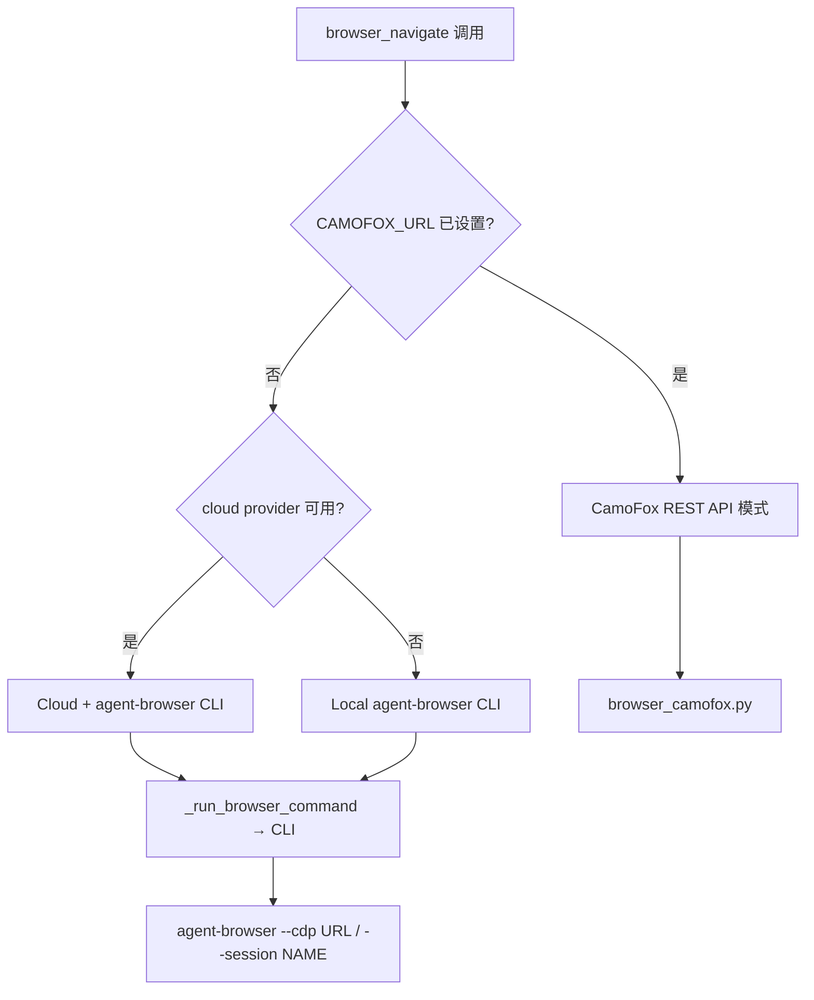
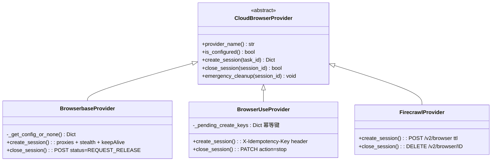
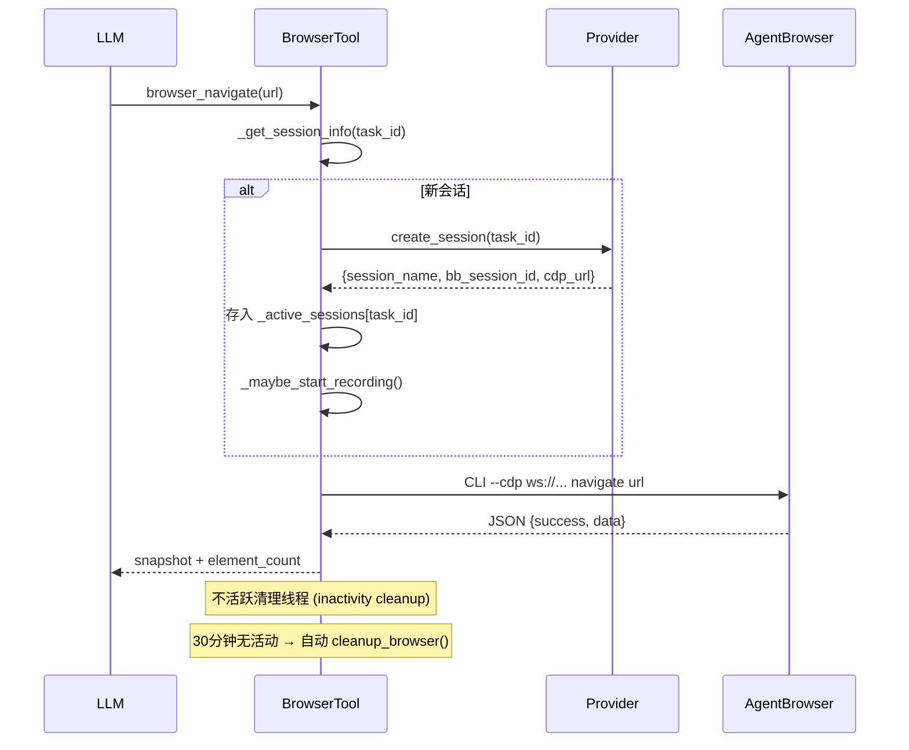
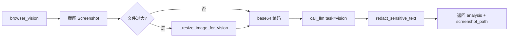
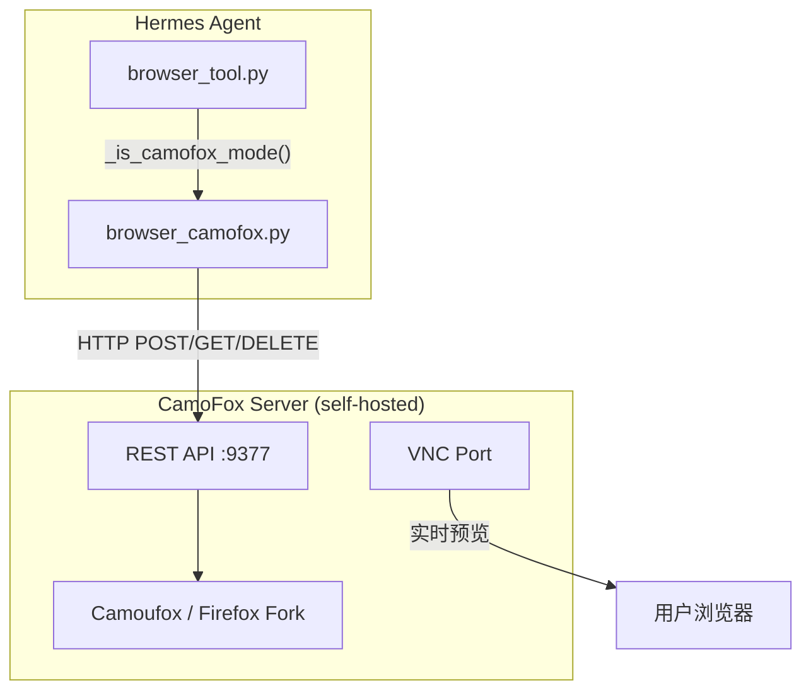
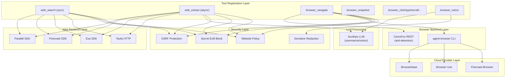

# 第14章 · Web 与浏览器工具

Hermes Agent 的 Web 能力分为两大子系统：**Web 搜索/提取**（search & extract, 轻量 API 调用）和**浏览器自动化**（browser automation, 完整浏览器控制）。两个子系统各自拥有多后端（multi-backend）架构和独立的工具注册（tool registry）入口。

---

## 14.1 Web 搜索/提取子系统 (`web_tools.py`)

### 14.1.1 四后端抽象 (Four Backend Abstraction)

`web_tools.py` 支持四种搜索后端，通过 `config.yaml → web.backend` 或环境变量自动检测进行选择：

| 后端 (Backend) | API Key 环境变量 | 搜索 | 提取 | 爬取 | 特色 |
|---|---|---|---|---|---|
| **Parallel** | `PARALLEL_API_KEY` | ✅ 三模式(`fast`/`one-shot`/`agentic`) | ✅ 异步 `full_content` → `excerpts` fallback | ❌ | SDK `Parallel` / `AsyncParallel` |
| **Firecrawl** | `FIRECRAWL_API_KEY` / `FIRECRAWL_API_URL` | ✅ | ✅ `scrape` → formats | ✅ | 支持 Nous 网关(tool-gateway) |
| **Exa** | `EXA_API_KEY` | ✅ `highlights` | ✅ `get_contents(text=True)` | ❌ | 设置 `x-exa-integration` header |
| **Tavily** | `TAVILY_API_KEY` | ✅ body auth(`api_key` in JSON) | ✅ `/extract` | ✅ `/crawl` | 直接 `httpx.post` 无 SDK |

**后端选择流程** — `_get_backend()`:

```
config.yaml web.backend (explicit) →
  fallback: highest-priority env key detected
    priority order: firecrawl > parallel > tavily > exa
  default: "firecrawl" (backward compat)
```

### 14.1.2 Firecrawl 客户端与 Nous 网关

Firecrawl 后端有特殊的双路径初始化（dual-path initialization）：

```python
def _get_firecrawl_client():
    # Path 1: Direct config (FIRECRAWL_API_KEY / FIRECRAWL_API_URL)
    direct_config = _get_direct_firecrawl_config()
    if direct_config:
        kwargs, cache_key = direct_config
    else:
        # Path 2: Nous managed tool-gateway (subscriber-only)
        managed = resolve_managed_tool_gateway("firecrawl", ...)
        kwargs = {"api_key": managed.nous_user_token, "api_url": managed.gateway_origin}
    
    # Client caching with config-based invalidation
    if _firecrawl_client and _firecrawl_client_config == client_config:
        return _firecrawl_client
    return Firecrawl(**kwargs)
```

**设计模式**：客户端缓存 + 配置指纹比对（cache key = `(mode, url, api_key)` tuple），热切换时自动重建。

### 14.1.3 搜索结果归一化 (Result Normalization)

每个后端返回不同格式的响应，统一映射到标准结构：

```json
{
  "success": true,
  "data": {
    "web": [
      {"title": "...", "url": "...", "description": "...", "position": 1}
    ]
  }
}
```

关键归一化函数：
- `_normalize_tavily_search_results()` — `results[].content` → `description`
- `_extract_web_search_results()` — 处理 Firecrawl SDK/gateway 多种响应形态（`data.web`, `data.results`, `web`, `results`）
- `_to_plain_object()` — Pydantic model → dict 降级

### 14.1.4 LLM 内容压缩流水线 (Content Compression Pipeline)

`web_extract_tool` 提取内容后通过 `process_content_with_llm()` 进行智能压缩：

```
              ┌──────────────┐
    raw       │  Size Check  │
    content ──│ >2M: refuse  │
              │ >500k: chunk │
              │ <5k: skip    │
              └──────┬───────┘
                     │
         ┌───────────┴───────────┐
         │ Normal (<500k)        │ Large (>500k)
         │                       │
    ┌────▼────┐          ┌───────▼────────┐
    │ Single  │          │  Chunk (100k)  │
    │ LLM     │          │  → parallel    │
    │ Call    │          │    summarize   │
    └────┬────┘          └───────┬────────┘
         │                       │
         │               ┌───────▼────────┐
         │               │   Synthesize   │
         │               │   summaries    │
         │               └───────┬────────┘
         │                       │
    ┌────▼───────────────────────▼────┐
    │  Output cap: 5000 chars        │
    │  Fallback: truncated raw on err│
    └────────────────────────────────┘
```

**阈值常量 (Threshold Constants)**:
- `MAX_CONTENT_SIZE = 2_000_000` (2M chars → 拒绝)
- `CHUNK_THRESHOLD = 500_000` (500k chars → 分块处理)
- `CHUNK_SIZE = 100_000` (100k/chunk)
- `MAX_OUTPUT_SIZE = 5000` (hard cap)
- `DEFAULT_MIN_LENGTH_FOR_SUMMARIZATION = 5000` (低于此不压缩)

**辅助模型解析** — `_resolve_web_extract_auxiliary()`:
- 读取 `get_async_text_auxiliary_client("web_extract")` 获取 client + model
- 检测 Nous Portal → 添加 `extra_body: {tags: ["product=hermes-agent"]}`
- 环境变量覆盖: `AUXILIARY_WEB_EXTRACT_MODEL`

**错误恢复**：LLM 失败时 fallback 到截断原始内容（前 5000 chars），而不是返回无用的错误消息。

### 14.1.5 安全防护层 (Security Layers)

1. **Secret exfiltration** — URL 和 URL-decoded 版本检查 `_PREFIX_RE`（API key 前缀正则）
2. **SSRF protection** — `is_safe_url()` 过滤私有/内网 URL
3. **Website policy** — `check_website_access()` 基于配置的域名白/黑名单
4. **Post-redirect check** — Firecrawl scrape 后检查 `metadata.sourceURL`（最终跳转URL）
5. **Base64 image cleaning** — `clean_base64_images()` 删除 inline base64 图片减少 token 消耗
6. **Interrupt check** — 每个后端入口调用 `is_interrupted()` 支持取消

### 14.1.6 工具注册 (Tool Registration)

```python
# web_search — 同步 (sync), max_result_size_chars=100_000
registry.register(
    name="web_search", toolset="web",
    handler=lambda args, **kw: web_search_tool(args.get("query", ""), limit=5),
    check_fn=check_web_api_key,
    max_result_size_chars=100_000,
)

# web_extract — 异步 (is_async=True), URLs capped at 5
registry.register(
    name="web_extract", toolset="web",
    handler=lambda args, **kw: web_extract_tool(args.get("urls", [])[:5], "markdown"),
    is_async=True,
    max_result_size_chars=100_000,
)

# web_crawl_tool — 已实现但未注册 (NOT registered in registry)
```

**注意**：`web_crawl_tool` 支持 Tavily（`limit=20`, `extract_depth`）和 Firecrawl（`/crawl` endpoint），但没有在 registry 中注册，因此不会暴露给 LLM 调用。

---

## 14.2 浏览器自动化子系统 (`browser_tool.py`)

### 14.2.1 双模式架构 (Dual-Mode Architecture)

浏览器工具运行在两种互斥模式之一：



### 14.2.2 Cloud Provider 抽象层



**Provider 选择链** — `_get_cloud_provider()`:

```
config["browser"]["cloud_provider"] (explicit name) →
  _PROVIDER_REGISTRY lookup →
  fallback 1: BrowserUse (if configured) →
  fallback 2: Browserbase (if configured) →
  None (local mode)

config == "local" → return None immediately
```

### 14.2.3 三大 Provider 对比

| Provider | 认证方式 | 创建会话 | 关闭会话 | 紧急清理 | 特色功能 |
|---|---|---|---|---|---|
| **Browserbase** | `BROWSERBASE_API_KEY` + `PROJECT_ID` | `POST /v1/sessions` | `POST status=REQUEST_RELEASE` | 同 close, timeout=5s | proxies, advancedStealth, keepAlive; 402降级 |
| **Browser Use** | `BROWSER_USE_API_KEY` 或 Nous 网关 | `POST /browsers` | `PATCH action=stop` | 同 close, timeout=5s | 幂等键(idempotency key), managed mode TTL |
| **Firecrawl** | `FIRECRAWL_API_KEY` | `POST /v2/browser` | `DELETE /v2/browser/ID` | 同 close, timeout=5s | TTL 会话(默认 300s), 最简实现 |

**Browserbase 402 降级** (Graceful Degradation):
```
create_session(proxies=true, keepAlive=true)
  → 402? retry without keepAlive
  → 402? retry without proxies
```

**Browser Use 幂等键** (Idempotency Key):
- `_get_or_create_pending_create_key(task_id)` — 生成 `browser-use-session-create:{uuid}` 发送为 `X-Idempotency-Key`
- 409 "already in progress" → 保留 key 不清除
- 5xx → 保留 key 供重试
- 成功或其他错误 → 清除 key

### 14.2.4 会话管理与生命周期 (Session Lifecycle)



**会话信息存储**：
- `_active_sessions: Dict[task_id, session_info]` — 线程安全 with `_cleanup_lock`
- `_session_last_activity: Dict[task_id, float]` — 最后活动时间戳
- 双重检查锁定模式 (double-check locking) in `_get_session_info()`

**会话命名规则**：
- 本地模式: `h_{uuid[:10]}`
- CDP 直连: `cdp_{uuid[:10]}`
- 云模式: `hermes_{task_id}_{uuid[:8]}`

### 14.2.5 `_run_browser_command()` — CLI 适配器

核心的 CLI 执行层，构建并运行 `agent-browser` 子进程：

```python
def _run_browser_command(task_id, command, args, timeout=None):
    session_info = _get_session_info(task_id)
    cmd = [agent_browser_path, command, *args]
    
    if session_info["cdp_url"]:      # Cloud mode
        cmd += ["--cdp", session_info["cdp_url"]]
    else:                             # Local mode
        cmd += ["--session", session_info["session_name"]]
    
    # Socket dir per task for isolation
    socket_dir = f"{tmpdir}/agent-browser-{session_name}"
    env["AGENT_BROWSER_SOCKET_DIR"] = socket_dir
    
    result = subprocess.run(cmd, capture_output=True, timeout=timeout)
    return json.loads(result.stdout)
```

### 14.2.6 `browser_navigate()` 安全层

导航是最复杂的工具函数，包含多层安全检查：

```
URL 输入
  ↓
① Secret exfiltration 检查 — _PREFIX_RE on url + unquote(url)
  ↓
② SSRF pre-navigation 检查 (仅云模式) — is_safe_url()
  ↓
③ Website policy 检查 — check_website_access()
  ↓
④ 实际导航 (camofox 或 agent-browser)
  ↓
⑤ SSRF post-redirect 检查 — 重定向后检查最终 URL
   → 若阻断: navigate("about:blank") 清除内容
  ↓
⑥ Bot 检测 — title 匹配: "access denied", "captcha", "cloudflare", "just a moment"
```

### 14.2.7 Snapshot 智能压缩

导航和 snapshot 工具返回页面的无障碍树(accessibility tree)，超大页面自动处理：

- `SNAPSHOT_SUMMARIZE_THRESHOLD` (8000 chars) — 触发压缩/截断
- `_extract_relevant_content(snapshot, user_task)` — 用辅助 LLM 提取相关内容（先 `redact_sensitive_text()`）
- `_truncate_snapshot(snapshot)` — 简单截断 fallback

### 14.2.8 10 个注册工具 (Registered Tools)

| # | 工具名 | Emoji | 参数 | 说明 |
|---|---|---|---|---|
| 1 | `browser_navigate` | 🌐 | `url` | 导航到 URL，自动返回 snapshot |
| 2 | `browser_snapshot` | 📸 | `full?` | 获取页面无障碍树快照 |
| 3 | `browser_click` | 👆 | `ref` | 按引用 ID 点击元素 |
| 4 | `browser_type` | ⌨️ | `ref, text` | 在输入框中输入文本 |
| 5 | `browser_scroll` | 📜 | `direction` | 上/下滚动页面 |
| 6 | `browser_back` | ◀️ | (无) | 浏览器返回 |
| 7 | `browser_press` | ⌨️ | `key` | 按下键盘键 |
| 8 | `browser_get_images` | 🖼️ | (无) | 获取页面所有图片列表 |
| 9 | `browser_vision` | 👁️ | `question, annotate?` | 截图 + Vision AI 分析 |
| 10 | `browser_console` | 🖥️ | `clear?, expression?` | 控制台日志 / JS 执行 |

所有工具共享 `check_fn=check_browser_requirements`，通过 `_BROWSER_SCHEMA_MAP` 映射 schema。

### 14.2.9 Vision 工具流程



特色：
- 可配置 vision 超时: `auxiliary.vision.timeout` (默认 120s)
- 截图持久保存到 `browser_screenshots/`，24小时自动清理
- `annotate=True` 时叠加 `[N]` 标签，N 对应 ref `@eN`
- 失败时仍保留截图文件（用户可通过 `MEDIA:<path>` 分享）

### 14.2.10 录制功能 (Session Recording)

`config.yaml → browser.record_sessions` 启用时：
- `_maybe_start_recording()` — 在首次导航时启动 `.webm` 录制到 `browser_recordings/`
- `_maybe_stop_recording()` — 会话关闭时停止录制
- `_cleanup_old_recordings(max_age_hours=72)` — 自动清理旧录制文件

---

## 14.3 CamoFox 反检测浏览器 (`browser_camofox.py`)

### 14.3.1 架构概述

CamoFox 是一个自托管的 Node.js 服务，封装了 Camoufox（Firefox 的 C++ 指纹欺骗分支）。它通过 REST API 提供与 `browser_tool.py` 一一映射的操作。

**启用方式**：设置 `CAMOFOX_URL=http://localhost:9377`



### 14.3.2 会话管理 (Session Management)

CamoFox 使用基于 `userId` + `tabId` 的会话模型：

```python
_sessions: Dict[str, Dict[str, Any]] = {}
# 每个 task_id → {"user_id": str, "tab_id": str|None, "session_key": str, "managed": bool}
```

**两种身份模式**：

| 模式 | 配置 | userId 生成 | 持久性 |
|---|---|---|---|
| 临时 (Ephemeral) | 默认 | `hermes_{random_uuid[:10]}` | 任务结束销毁 |
| 托管持久 (Managed) | `browser.camofox.managed_persistence=true` | `hermes_{uuid5(profile_path)[:10]}` | 跨任务保留 |

**确定性身份** (`browser_camofox_state.py`):
```python
def get_camofox_identity(task_id):
    scope_root = str(get_camofox_state_dir())  # ~/.hermes/browser_auth/camofox
    user_digest = uuid5(NAMESPACE_URL, f"camofox-user:{scope_root}").hex[:10]
    session_digest = uuid5(NAMESPACE_URL, f"camofox-session:{scope_root}:{task_id}").hex[:16]
    return {"user_id": f"hermes_{user_digest}", "session_key": f"task_{session_digest}"}
```

### 14.3.3 REST API 映射

| 浏览器操作 | HTTP 方法 | 端点 | 说明 |
|---|---|---|---|
| 健康检查 | `GET` | `/health` | 返回 `vncPort` (缓存) |
| 创建标签 | `POST` | `/tabs` | `userId` + `sessionKey` + `url` |
| 导航 | `POST` | `/tabs/{tabId}/navigate` | `url` 参数 |
| 快照 | `GET` | `/tabs/{tabId}/snapshot` | 无障碍树 |
| 点击 | `POST` | `/tabs/{tabId}/click` | `ref` 参数 |
| 输入 | `POST` | `/tabs/{tabId}/type` | `ref` + `text` |
| 滚动 | `POST` | `/tabs/{tabId}/scroll` | `direction` |
| 后退 | `POST` | `/tabs/{tabId}/back` | |
| 按键 | `POST` | `/tabs/{tabId}/press` | `key` |
| 截图 | `GET` | `/tabs/{tabId}/screenshot` | 返回二进制 PNG |
| 关闭会话 | `DELETE` | `/sessions/{userId}` | |

### 14.3.4 VNC 实时预览

CamoFox 服务可选暴露 VNC 端口，Hermes 在首次 `/health` 调用时自动发现并缓存：

```python
_vnc_url: Optional[str] = None
_vnc_url_checked = False  # 全进程只探测一次

def check_camofox_available():
    resp = requests.get(f"{url}/health")
    vnc_port = resp.json().get("vncPort")  # e.g. 5900
    _vnc_url = f"http://{host}:{vnc_port}"
```

导航成功后在返回结果中附带 `vnc_url` 和 `vnc_hint`，便于用户实时观看浏览器操作。

### 14.3.5 软清理 vs 硬清理

```python
def cleanup_browser(task_id):
    if _is_camofox_mode():
        # 先尝试软清理（托管持久模式）
        if not camofox_soft_cleanup(task_id):  # managed → True, 只清内存
            camofox_close(task_id)              # ephemeral → DELETE /sessions/
```

**软清理** (`camofox_soft_cleanup`): 仅释放内存中的 `_sessions` 条目，保留服务端 browser profile（包含 cookies 等）。

**硬清理** (`camofox_close`): 调用 `DELETE /sessions/{userId}` 销毁服务端会话。即使 HTTP 失败也返回 `success=True`（best-effort）。

### 14.3.6 功能限制

CamoFox 后端的已知限制：
- **控制台日志不可用** — `camofox_console()` 返回空列表 + 提示信息
- **图片列表基于 snapshot 解析** — 从无障碍树文本中用正则提取 `img "alt"` 条目，非原生 API
- **快照大小限制** — `_SNAPSHOT_MAX_CHARS = 80_000` 分页
- **JS 执行有条件** — 如果 camofox 服务不支持（404/405/501），优雅降级为友好错误

---

## 14.4 整体架构图



---

## 14.5 设计模式与最佳实践

### 14.5.1 策略模式 (Strategy Pattern)
Web 后端和 Browser Provider 均使用策略模式：通过配置选择具体实现，上层代码不关心底层 API 差异。

### 14.5.2 惰性初始化 (Lazy Initialization)
所有客户端（Firecrawl, Parallel, Exa, cloud provider）均采用 `_client = None` + 首次使用时创建的模式，避免启动时不必要的网络调用和依赖加载。

### 14.5.3 优雅降级 (Graceful Degradation)
- Browserbase 402 → 移除付费功能重试
- LLM 压缩失败 → 截断原始内容
- CamoFox console 不支持 → 返回空 + 提示
- Vision 截图过大 → 自动缩放重试

### 14.5.4 多层防御 (Defense in Depth)
安全检查在不同阶段重复执行：请求前 SSRF 检查 + 重定向后再次检查；URL 明文 + URL-decoded 双重 secret 检查。

### 14.5.5 线程安全 (Thread Safety)
- `_cleanup_lock` 保护 `_active_sessions` 和 `_session_last_activity`
- `_sessions_lock` 保护 CamoFox 会话映射
- `_pending_create_keys_lock` 保护 Browser Use 幂等键
- 双重检查锁定模式用于 `_get_session_info()`

### 14.5.6 资源清理 (Resource Cleanup)
- 不活跃超时（inactivity timeout）→ 自动清理
- `atexit.register()` → 进程退出清理
- `emergency_cleanup()` → signal handler 安全清理
- 截图/录制文件自动老化删除（24h / 72h）

---

## 14.6 调试支持

### Web Tools
```bash
WEB_TOOLS_DEBUG=true  # 启用 DebugSession
# 输出: ./logs/web_tools_debug_{session_id}.json
# 记录: 每次 tool call 的参数、结果数量、压缩指标、最终响应大小
```

### Browser Tools
```python
check_browser_requirements()  # 检查 CLI + provider credentials
# __main__ block 打印: mode, requirements, available tools
```

### Web Tools Diagnostics
```python
check_web_tools()  # 检查: backend availability, auxiliary model, debug mode
```

---

## 14.7 关键常量速查

| 常量 | 值 | 文件 | 用途 |
|---|---|---|---|
| `MAX_CONTENT_SIZE` | 2,000,000 | web_tools.py | 拒绝处理阈值 |
| `CHUNK_THRESHOLD` | 500,000 | web_tools.py | 分块处理阈值 |
| `CHUNK_SIZE` | 100,000 | web_tools.py | 每块大小 |
| `MAX_OUTPUT_SIZE` | 5,000 | web_tools.py | 输出硬限制 |
| `max_result_size_chars` | 100,000 | registry | 工具返回值上限 |
| `_SNAPSHOT_MAX_CHARS` | 80,000 | browser_camofox.py | CamoFox 快照分页 |
| `SNAPSHOT_SUMMARIZE_THRESHOLD` | 8,000 | browser_tool.py | 快照压缩触发 |
| `_DEFAULT_TIMEOUT` | 30 | browser_camofox.py | HTTP 请求超时 |
| `vision_timeout` | 120 | browser_tool.py | Vision LLM 超时 |
| Inactivity timeout | 30 min | browser_tool.py | 自动清理阈值 |
| Screenshot max age | 24h | browser_tool.py | 自动删除 |
| Recording max age | 72h | browser_tool.py | 自动删除 |
| Firecrawl TTL | 300s | firecrawl.py | 会话存活时间 |

---

## 14.8 待讨论问题

1. `web_crawl_tool` 为何不注册到 registry？可能是功能未稳定或出于安全考虑（爬取整个站点的资源消耗）。
2. CamoFox `camofox_get_images()` 使用正则解析无障碍树——是否有更可靠的方式？
3. Browserbase 的 `bb_session_id` 命名是"历史遗留"(`legacy key name`)，所有 provider 共用此字段名。
4. Browser Use 的幂等键机制防止了网络超时导致的重复会话创建，但当前仅在 `managed_mode` 下启用。
