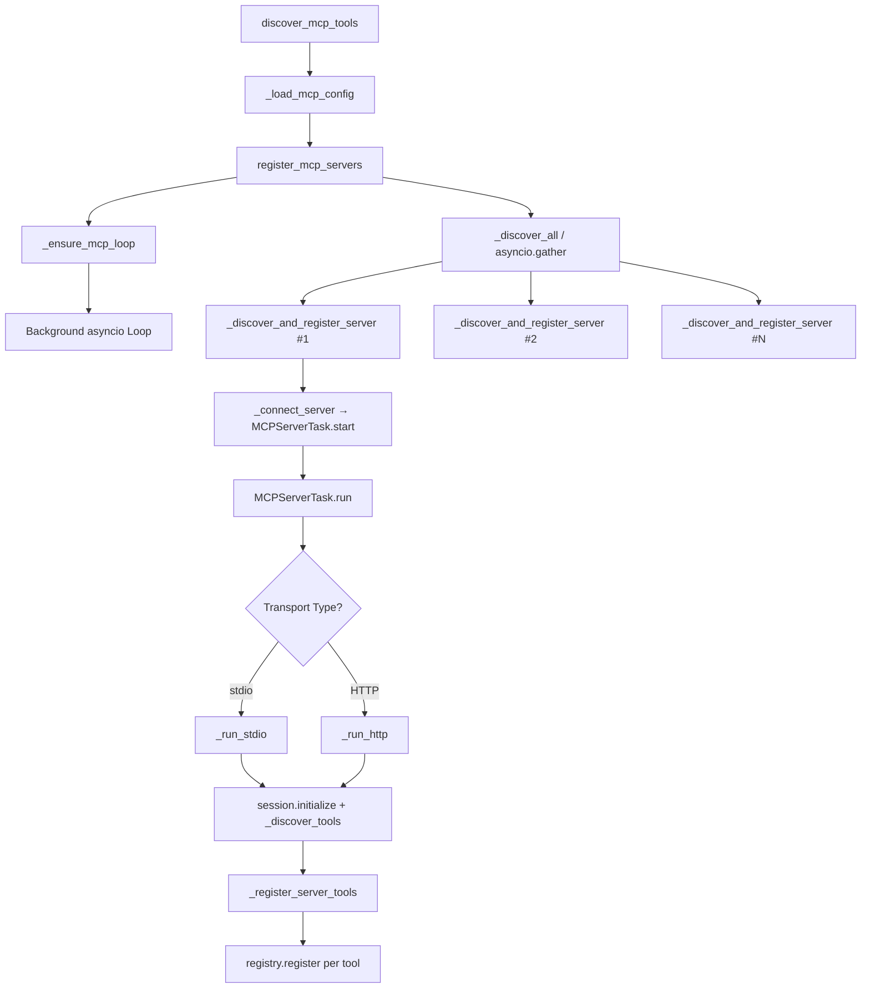
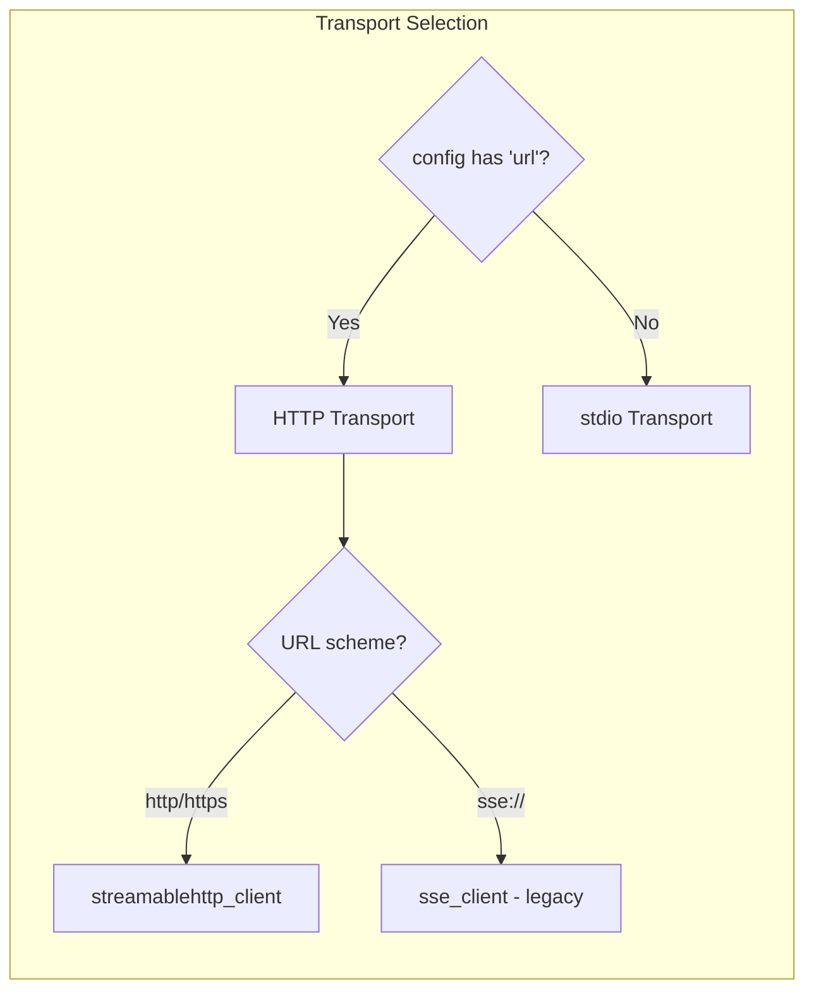
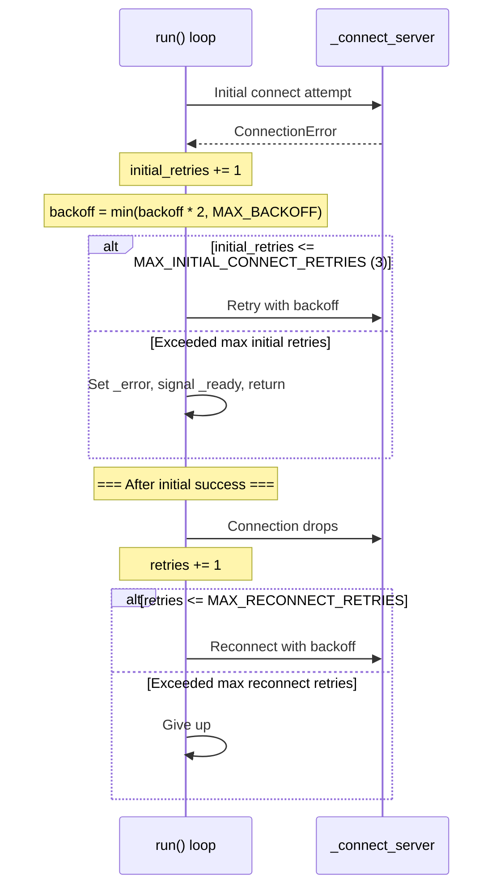
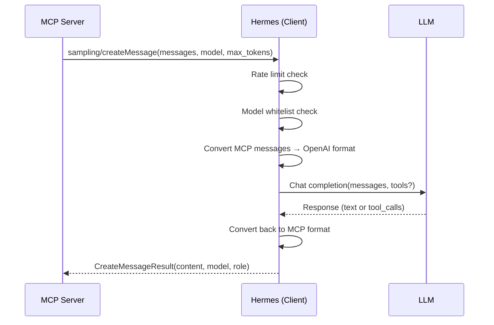
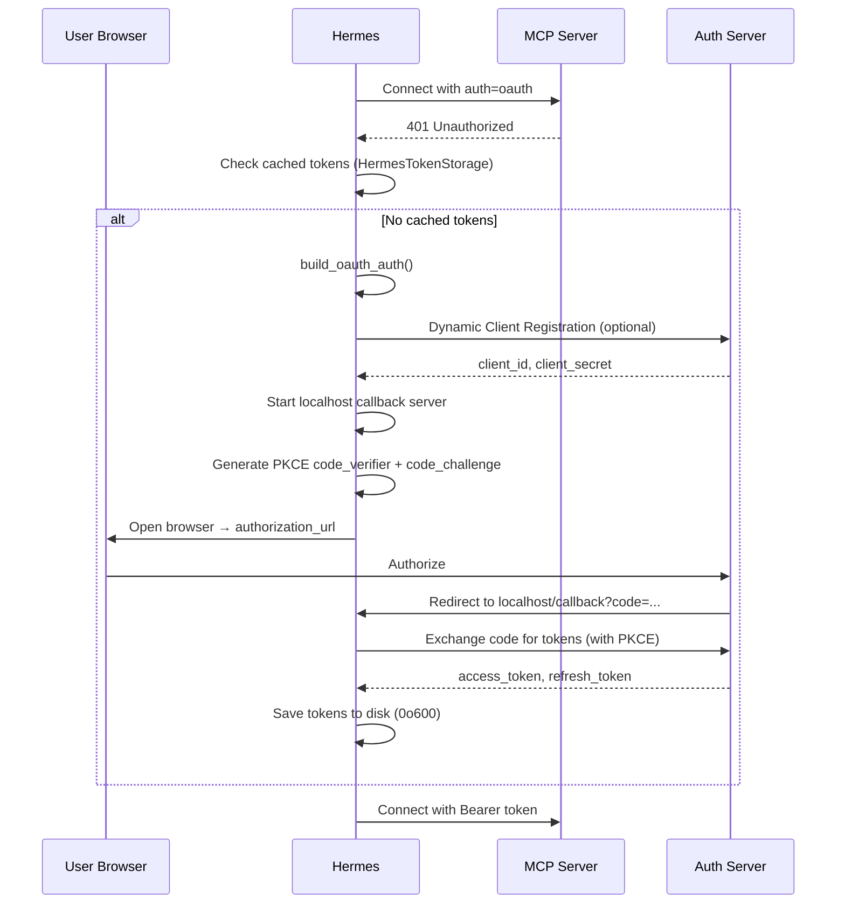
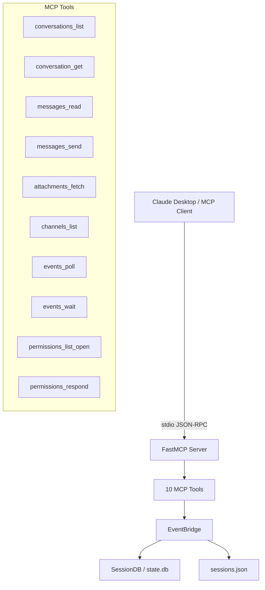
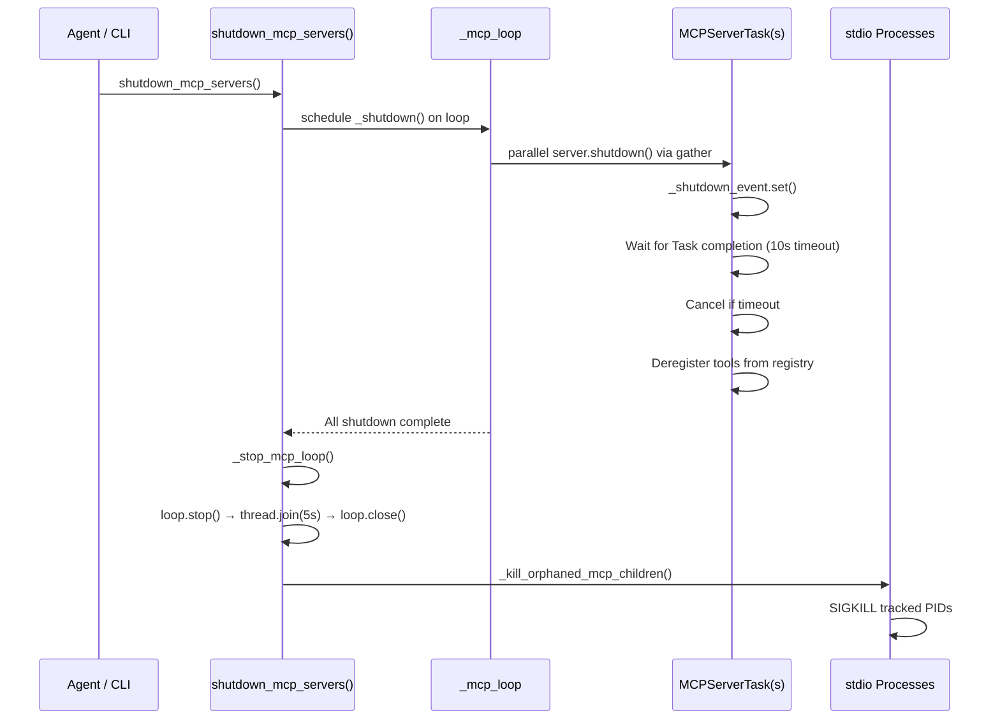

# 第15章 MCP 协议实现

## 15.1 概述：双向 MCP/ACP 架构

Hermes 对 Model Context Protocol (MCP) 的实现是**双向的**（bidirectional）：

1. **MCP 客户端 (Client)**：Hermes 作为 MCP 客户端连接到外部 MCP 服务器，发现并调用它们的工具、资源和提示 —— 文件 `tools/mcp_tool.py`（2273 行，核心模块）
2. **MCP 服务端 (Server)**：Hermes 通过 `hermes mcp serve` 将自身暴露为 MCP 服务器，让 Claude Desktop 等外部客户端操控 Hermes 的会话 —— 文件 `mcp_serve.py`（867 行）
3. **ACP 适配器 (ACP Adapter)**：Hermes 实现了 Agent Communication Protocol，让 VS Code / Zed / JetBrains 等 IDE 将 Hermes 作为内嵌编程助手 —— 目录 `acp_adapter/`（7 个文件）

```
                    ┌─────────────────────────────────┐
                    │          Hermes Agent            │
                    │                                  │
  MCP Client ──────►│  tools/mcp_tool.py               │
  (外部 MCP 服务器) │  tools/mcp_oauth.py              │
                    │                                  │
  MCP Server ◄──────│  mcp_serve.py                    │
  (Claude Desktop)  │  EventBridge → SessionDB         │
                    │                                  │
  ACP Server ◄──────│  acp_adapter/                    │
  (VS Code/Zed)    │  HermesACPAgent                   │
                    └─────────────────────────────────┘
```

---

## 15.2 MCP 客户端实现 (`mcp_tool.py`)

### 15.2.1 总体架构

`mcp_tool.py` 是 Hermes 中最大的单文件模块之一（2273 行），实现完整的 MCP 客户端生命周期：



**关键设计模式**：

| 模式 | 实现 |
|------|------|
| **专用事件循环 (Dedicated Event Loop)** | `_mcp_loop` 运行在 `_mcp_thread` 守护线程上，所有 MCP 操作都通过 `_run_on_mcp_loop()` 调度 |
| **每服务器独立 Task (Per-Server Task)** | `MCPServerTask` 为每个 MCP 服务器创建独立的 `asyncio.Task`，确保 anyio cancel-scope 一致性 |
| **并行发现 (Parallel Discovery)** | `asyncio.gather()` 并行连接所有服务器，120 秒总超时 |
| **工厂函数 + 闭包 (Factory + Closure)** | `_make_tool_handler()` / `_make_check_fn()` 用闭包绑定 server_name/tool_name |
| **幂等注册 (Idempotent Registration)** | `register_mcp_servers()` 跳过已连接的服务器 |

### 15.2.2 MCPServerTask 类

`MCPServerTask` 是 MCP 客户端的核心抽象，每个实例管理一个 MCP 服务器连接的完整生命周期：

```python
class MCPServerTask:
    """Manages a single MCP server in a dedicated asyncio Task."""
    __slots__ = (
        "name", "session", "tool_timeout",
        "_tools", "_task", "_ready", "_shutdown_event", "_error",
        "_config", "_sampling", "_auth_type", "_registered_tool_names",
    )
```

**`__slots__` 优化**：使用 `__slots__` 而非 `__dict__`，减少内存占用 — 当连接多个 MCP 服务器时显著有效。

**生命周期方法**：

| 方法 | 说明 |
|------|------|
| `start(config)` | 创建后台 Task 并 `await _ready` 信号 |
| `run(config)` | 长生命周期协程：连接 → 发现工具 → 等待关闭；含自动重连 |
| `_run_stdio(config)` | stdio 传输：`stdio_client()` + `_build_safe_env()` |
| `_run_http(config)` | HTTP 传输：`streamablehttp_client()` + OAuth 支持 |
| `_discover_tools()` | `session.list_tools()` 获取工具列表 |
| `shutdown()` | 信号退出 → `wait_for(10s)` → 超时则 cancel → 注销工具 |

### 15.2.3 三种传输方式 (Transport)



#### stdio 传输

```python
async def _run_stdio(self, config: dict):
    cmd = config["command"]
    args = config.get("args", [])
    env = _build_safe_env(config.get("env", {}))
    
    # OSV malware check before launching
    malware_msg = check_package_for_malware(cmd, args)
    if malware_msg:
        raise RuntimeError(malware_msg)
    
    # PID tracking for orphan cleanup
    before_pids = _snapshot_child_pids()
    async with stdio_client(server_params) as (read, write):
        after_pids = _snapshot_child_pids()
        new_pids = after_pids - before_pids
        with _lock:
            _stdio_pids.update(new_pids)
        
        async with ClientSession(read, write, **sampling_kwargs) as session:
            await session.initialize()
            # ...
```

**安全措施**：
- **`_build_safe_env()`**：仅传递白名单环境变量（`_SAFE_ENV_KEYS`），防止泄露敏感信息
- **`check_package_for_malware()`**：通过 OSV API 检查 npx/uvx 包是否有已知恶意软件
- **PID 跟踪**：`_snapshot_child_pids()` + `_stdio_pids` 确保孤儿进程可被清理

#### HTTP 传输

```python
async def _run_http(self, config: dict):
    url = config["url"]
    headers = dict(config.get("headers", {}))
    
    # Bearer token auth
    if self._auth_type == "bearer":
        token = config.get("token") or config.get("bearer_token", "")
        headers.setdefault("Authorization", f"Bearer {token}")
    
    # OAuth auth
    _oauth_auth = None
    if self._auth_type == "oauth":
        _oauth_auth = build_oauth_auth(self.name, url, config.get("oauth"))
    
    # Try streamablehttp first, fallback to SSE
    async with streamablehttp_client(url, headers=headers, auth=_oauth_auth) as (...):
        async with ClientSession(read, write, **sampling_kwargs) as session:
            await session.initialize()
```

### 15.2.4 自动重连与指数退避 (Reconnection with Exponential Backoff)

`MCPServerTask.run()` 包含两层重连逻辑：



常量：
- `_MAX_INITIAL_CONNECT_RETRIES = 3`
- `_MAX_RECONNECT_RETRIES`（从代码推断，类似值）
- `_MAX_BACKOFF_SECONDS`：指数退避上限
- 退避公式：`backoff = min(backoff * 2, _MAX_BACKOFF_SECONDS)`，初始 1.0 秒

### 15.2.5 工具注册流程

每个 MCP 服务器的工具通过 `_register_server_tools()` 注入 Hermes 的全局工具注册表：

```mermaid
graph TB
    A[_register_server_tools] --> B[Parse include/exclude filters]
    B --> C{For each MCP tool}
    C --> D[_should_register? include/exclude]
    D -->|No| C
    D -->|Yes| E[_scan_mcp_description - injection check]
    E --> F[_convert_mcp_schema]
    F --> G[Name: mcp_{server}_{tool}]
    G --> H{Collision with built-in?}
    H -->|Yes| I[Skip - preserve built-in]
    H -->|No| J[registry.register]
    J --> K[handler = _make_tool_handler]
    J --> L[check_fn = _make_check_fn]
    C --> M[Register utility tools]
    M --> N[list_resources, read_resource, list_prompts, get_prompt]
```

**工具命名约定**：`mcp_{sanitized_server_name}_{sanitized_tool_name}`

名称清理函数 `sanitize_mcp_name_component()` 将所有非 `[A-Za-z0-9_]` 字符替换为 `_`，确保与所有 LLM provider 的 function calling 兼容。

**过滤规则**（匹配 issue #690 规范）：
- `tools.include`：白名单 — 仅注册列出的工具
- `tools.exclude`：黑名单 — 排除列出的工具
- `include` 优先级高于 `exclude`
- 均未设置 → 注册所有工具（向后兼容默认）

### 15.2.6 工具调用处理器

`_make_tool_handler()` 返回一个同步闭包，通过 `_run_on_mcp_loop()` 在 MCP 事件循环上调度异步调用：

```python
def _make_tool_handler(server_name, tool_name, tool_timeout):
    def _handler(args: dict, **kwargs) -> str:
        # 1. Get server from _servers dict (thread-safe)
        # 2. Create async _call() coroutine:
        #    result = await server.session.call_tool(tool_name, arguments=args)
        # 3. Handle isError → sanitize error text
        # 4. Handle content blocks → join text
        # 5. Handle structuredContent → JSON merge
        # 6. Schedule via _run_on_mcp_loop(_call(), timeout=tool_timeout)
        # 7. Catch InterruptedError → _interrupted_call_result()
    return _handler
```

**`_run_on_mcp_loop()` 中断感知调度**：

```python
def _run_on_mcp_loop(coro, timeout=30):
    future = asyncio.run_coroutine_threadsafe(coro, _mcp_loop)
    while True:
        if is_interrupted():      # 用户发送新消息
            future.cancel()
            raise InterruptedError("User sent a new message")
        try:
            return future.result(timeout=0.1)  # 100ms poll
        except TimeoutError:
            continue
```

此设计允许代理线程在 MCP 调用期间响应用户中断，而非无限阻塞。

---

## 15.3 安全机制 (Security)

### 15.3.1 环境变量过滤 (`_build_safe_env`)

stdio MCP 服务器作为子进程运行，`_build_safe_env()` 仅传递白名单变量：

```python
_SAFE_ENV_KEYS = {
    "PATH", "HOME", "USER", "SHELL", "LANG", "LC_ALL",
    "TERM", "TMPDIR", "TMP", "TEMP", "XDG_*",
    "NODE_PATH", "PYTHONPATH", ...
}
```

用户通过 `config.env` 传入的变量合并到安全集中，但不包括主进程的 API 密钥等。

### 15.3.2 凭据清理 (`_sanitize_error`)

```python
_CREDENTIAL_PATTERN = re.compile(
    r"(ghp_\S+|sk-\S+|Bearer\s+\S+|token=\S+|key=\S+|API_KEY=\S+|password=\S+|secret=\S+)",
    re.IGNORECASE,
)
```

所有返回给 LLM 的错误消息都经过此正则过滤，防止 API 密钥泄露到上下文中。

### 15.3.3 提示注入检测 (`_scan_mcp_description`)

10 种注入模式扫描工具描述：

```python
_MCP_INJECTION_PATTERNS = [
    "ignore previous instructions",
    "you are now",            # identity override
    "your task is now",       # task override
    "system prompt",          # system prompt injection
    "<|system|>",             # role tag injection
    "do not mention",         # concealment
    "curl ", "wget ",         # network commands
    "base64", "exec(", "import os",  # code execution
]
```

**策略**：仅 **警告**，不阻止注册。这是有意的设计 — 避免误报阻断合法工具。

### 15.3.4 OSV 恶意软件检查 (`osv_check.py`)

在 stdio 启动 npx/uvx 包之前，调用 Google 的 OSV API 检查 MAL-* advisory：

```python
def check_package_for_malware(command, args) -> Optional[str]:
    ecosystem = _infer_ecosystem(command)  # npm/PyPI
    package, version = _parse_package_from_args(args, ecosystem)
    malware = _query_osv(package, ecosystem, version)
    # Fail-open: network errors → allow
```

- 仅检查 **恶意软件** (MAL-*)，忽略常规 CVE
- **Fail-open**：网络错误不阻止启动
- 灵感来自 Block/goose 的扩展恶意软件检查

---

## 15.4 Sampling 支持 (`SamplingHandler`)

MCP 规范允许服务器通过 `sampling/createMessage` 请求客户端代为调用 LLM：



**治理机制**：

```python
class SamplingHandler:
    def __init__(self, server_name, config):
        self._rate_limit = config.get("rate_limit", 10)    # requests/min
        self._model_whitelist = config.get("models", [])     # allowed models
        self._max_tokens_cap = config.get("max_tokens", 4096)
        self.metrics = {"requests": 0, "tokens_used": 0, "errors": 0}
```

- **速率限制**：每分钟最大请求数（滑动窗口）
- **模型白名单**：服务器只能使用预批准的模型
- **Token 上限**：`max_tokens` 硬限制
- **指标追踪**：requests / tokens_used / errors

---

## 15.5 OAuth 2.1 认证 (`mcp_oauth.py`)

### 15.5.1 OAuth 流程



### 15.5.2 HermesTokenStorage

持久化 OAuth 状态到磁盘：

```
HERMES_HOME/mcp-tokens/
├── server_name.json          ← OAuthToken (access_token, refresh_token, ...)
└── server_name.client.json   ← OAuthClientInformationFull (client_id, ...)
```

```python
class HermesTokenStorage:
    async def get_tokens(self) -> OAuthToken | None
    async def set_tokens(self, tokens: OAuthToken) -> None
    async def get_client_info(self) -> OAuthClientInformationFull | None
    async def set_client_info(self, info) -> None
    def remove(self) -> None          # 清除所有 OAuth 状态
    def has_cached_tokens(self) -> bool
```

**安全**：文件权限 `0o600`（仅所有者可读写），通过原子写入（tmp → rename）防止部分写入。

### 15.5.3 非交互环境处理

```python
def _is_interactive() -> bool:
    return sys.stdin.isatty()

def _can_open_browser() -> bool:
    # SSH → False
    # macOS/Windows → True
    # Linux: 需要 DISPLAY 或 WAYLAND_DISPLAY
```

非交互环境（CI/Docker/SSH）但有缓存 token → 正常使用。
无缓存 token → 打印警告，建议先在交互环境完成首次授权。

### 15.5.4 OAuthClientProvider

`build_oauth_auth()` 构建 MCP SDK 的 `OAuthClientProvider`（httpx.Auth 子类），自动处理：
- **Discovery**：发现授权服务器端点
- **Dynamic Client Registration**：动态客户端注册（如果没有预注册 client_id）
- **PKCE**：Proof Key for Code Exchange
- **Token Exchange**：授权码换 token
- **Token Refresh**：自动刷新过期 token
- **Step-up Authorization**：权限提升

配置示例：
```yaml
mcp_servers:
  my_server:
    url: "https://mcp.example.com/mcp"
    auth: oauth
    oauth:
      client_id: "pre-registered-id"     # 可选，跳过动态注册
      client_secret: "secret"            # 仅 confidential 客户端
      scope: "read write"               # 默认使用服务器提供的
      redirect_port: 0                  # 0 = 自动选择空闲端口
      client_name: "My Custom Client"   # 默认 "Hermes Agent"
```

---

## 15.6 MCP 服务端模式 (`mcp_serve.py`)

### 15.6.1 架构

`hermes mcp serve` 将 Hermes 暴露为 MCP 服务器（stdio 传输），让 Claude Desktop 等客户端可以读写 Hermes 管理的消息会话：



### 15.6.2 EventBridge

`EventBridge` 是 MCP 服务器的核心组件，在后台线程轮询 SessionDB 变更：

```python
class EventBridge:
    POLL_INTERVAL = 0.2   # 200ms
    QUEUE_LIMIT = 1000    # 最大事件队列长度
    
    def _poll_once(self, db):
        # 1. mtime check on sessions.json (~1μs)
        # 2. mtime check on state.db
        # 3. If nothing changed → return (skip work)
        # 4. Scan sessions for new messages
        # 5. Enqueue QueueEvent for each new message
```

**性能优化**：
- **mtime 检查**（~1μs）跳过未变更的文件 — 200ms 轮询几乎零成本
- `_cached_sessions_index` 缓存 sessions.json 内容
- `_last_poll_timestamps` 按会话跟踪最后可见时间戳

**事件类型**：
- `message`：新用户/助手消息
- `approval_requested`：权限审批请求
- `approval_resolved`：审批已处理

### 15.6.3 长轮询 (Long Polling)

`events_wait` 实现长轮询，阻塞直到新事件或超时（最长 5 分钟）：

```python
def wait_for_event(self, after_cursor, session_key, timeout_ms):
    deadline = time.monotonic() + (timeout_ms / 1000.0)
    while time.monotonic() < deadline:
        # Check queue for matching events
        # If found → return immediately
        # Otherwise → self._new_event.wait(timeout=min(remaining, POLL_INTERVAL))
    return None  # timeout
```

---

## 15.7 ACP 适配器 (`acp_adapter/`)

### 15.7.1 整体架构

ACP (Agent Communication Protocol) 让 IDE 以标准方式与 AI 代理通信：

```mermaid
graph TB
    A[VS Code / Zed / JetBrains] -->|ACP Protocol / stdio| B[HermesACPAgent]
    B --> C[SessionManager]
    C --> D[AIAgent instances]
    D --> E[LLM Providers]
    D --> F[Tool Registry]
    
    B --> G[Slash Commands]
    G --> G1[/model]
    G --> G2[/tools]
    G --> G3[/context]
    G --> G4[/reset]
    G --> G5[/compact]
    
    B --> H[MCP Server Registration]
    H --> I[_register_session_mcp_servers]
    I --> J[Convert ACP MCP specs → Hermes config]
```

### 15.7.2 HermesACPAgent

继承 `acp.Agent`，核心类实现 ACP 协议的所有生命周期方法：

```python
class HermesACPAgent(acp.Agent):
    # 初始化
    async def initialize(self) -> InitializeResponse
    async def authenticate(self, auth_info) -> AuthResult
    
    # 会话管理
    async def new_session(self, params) -> Session
    async def load_session(self, session_id) -> Session
    async def resume_session(self, session_id) -> Session
    async def fork_session(self, session_id) -> Session
    async def list_sessions() -> List[Session]
    
    # 消息处理
    async def prompt(self, session_id, message) -> Response
    
    # Capabilities advertised:
    # - load_session=True
    # - fork=True, list=True, resume=True
```

### 15.7.3 SessionManager

线程安全的会话管理器，支持持久化：

```python
class SessionManager:
    def create_session(cwd) -> SessionState
    def get_session(session_id) -> SessionState | None
    def list_sessions() -> List[SessionState]
    def save_session(session_id) → persist to SessionDB
    def restore_session(session_id) → load from SessionDB
    def expire_old_sessions() → cleanup by TTL
```

`SessionState` 数据类：
```python
@dataclass
class SessionState:
    session_id: str
    agent: AIAgent
    cwd: str
    model: str
    history: List[Dict]
    cancel_event: threading.Event
```

### 15.7.4 回调工厂 (`events.py`)

将 AIAgent 事件桥接到 ACP 协议：

```python
# 所有回调使用 asyncio.run_coroutine_threadsafe 跨线程调度
def make_tool_progress_cb(session_id, event_sink)    # 工具进度
def make_thinking_cb(session_id, event_sink)          # 思考过程
def make_step_cb(session_id, event_sink)              # 步骤更新
def make_message_cb(session_id, event_sink)           # 消息流
```

### 15.7.5 权限桥接 (`permissions.py`)

```python
def make_approval_callback(session_id, acp_agent):
    """Bridge ACP permission requests to Hermes approval system."""
    async def _callback(tool_name, args, context):
        # Send ACP permission request to IDE
        # Wait up to 60 seconds for user response
        # Auto-deny on timeout
        return approved
    return _callback
```

### 15.7.6 工具类型映射 (`tools.py`)

```python
TOOL_KIND_MAP = {
    "read_file": "file_read",
    "write_file": "file_write",
    "terminal": "terminal",
    "search_files": "search",
    "web_search": "web_search",
    # ... more mappings
}
```

将 Hermes 内部工具名映射到 ACP 的标准工具类型（`ToolKind`），IDE 据此显示合适的图标和 UI。

---

## 15.8 配置管理 (`hermes_cli/mcp_config.py`)

CLI 命令管理 MCP 服务器配置：

```bash
hermes mcp add <name> --command <cmd> --args <args>  # 添加 stdio 服务器
hermes mcp add <name> --url <url>                     # 添加 HTTP 服务器
hermes mcp remove <name>                              # 移除服务器
hermes mcp list                                       # 列出所有服务器
hermes mcp test [name]                                # 探测并测试连接
hermes mcp configure                                  # 交互式配置
```

`_probe_server()` 临时连接并列出工具，用于验证配置正确性。

---

## 15.9 模块级状态管理

```python
# mcp_tool.py 全局状态
_servers: Dict[str, MCPServerTask] = {}   # 活跃服务器连接
_mcp_loop: Optional[asyncio.AbstractEventLoop] = None  # 后台事件循环
_mcp_thread: Optional[threading.Thread] = None          # 守护线程
_lock = threading.Lock()                                 # 保护上述状态
_stdio_pids: set = set()                                 # stdio 子进程 PID
```

**线程安全**：所有对 `_servers`, `_mcp_loop`, `_stdio_pids` 的访问都通过 `_lock` 保护。

**异常处理器**：
```python
def _mcp_loop_exception_handler(loop, context):
    exc = context.get("exception")
    if isinstance(exc, RuntimeError) and "Event loop is closed" in str(exc):
        return  # 抑制关闭时的良性竞态
    loop.default_exception_handler(context)
```

---

## 15.10 关闭与清理



**三层清理保障**：
1. **正常退出**：`_shutdown_event.set()` → Task 退出 `async with` → SDK 清理传输
2. **超时取消**：10 秒后 `task.cancel()` 强制退出
3. **孤儿进程清理**：`_kill_orphaned_mcp_children()` 对 `_stdio_pids` 中残存的 PID 发送 SIGKILL

---

## 15.11 Copilot ACP 客户端 (`copilot_acp_client.py`)

一个特殊的 OpenAI 兼容 shim，将请求转发给 `copilot --acp` 子进程：

```python
ACP_MARKER_BASE_URL = "acp://copilot"  # 特殊标记 URL

# Tool call extraction from text responses:
_TOOL_CALL_BLOCK_RE   # XML <tool_call>...</tool_call> 格式
_TOOL_CALL_JSON_RE    # 裸 JSON 回退格式
```

**工作流**：
1. 将 OpenAI 格式的 messages + tools 编码为结构化文本 prompt
2. 通过 `copilot --acp` 子进程发送
3. 从文本响应中解析 tool_call（XML 块或裸 JSON）
4. 转换回 OpenAI 格式返回

---

## 15.12 设计模式总结

| 设计模式 | 位置 | 说明 |
|----------|------|------|
| **专用事件循环 (Dedicated Event Loop)** | `mcp_tool.py` | 独立的 asyncio 循环隔离 MCP I/O |
| **工厂闭包 (Factory Closure)** | `_make_tool_handler()` 等 | 闭包捕获 server/tool 名称 |
| **策略模式 (Strategy)** | Transport (stdio/HTTP/SSE) | 运行时选择传输方式 |
| **桥接模式 (Bridge)** | `EventBridge`, `events.py` | 跨线程/协议桥接 |
| **幂等操作 (Idempotent)** | `register_mcp_servers()` | 重复调用安全 |
| **Fail-open** | OSV check, `_scan_mcp_description` | 安全检查失败不阻止功能 |
| **原子写入 (Atomic Write)** | `_write_json()` | tmp → rename 防止部分写入 |
| **指数退避 (Exponential Backoff)** | `MCPServerTask.run()` | 连接失败重试策略 |
| **观察者模式 (Observer)** | ACP callbacks | 事件回调通知 IDE |
| **代理模式 (Proxy)** | `SamplingHandler` | 代理 LLM 调用并加治理 |
| **防腐层 (Anti-corruption Layer)** | `_convert_mcp_schema` | MCP schema → Hermes schema |
| **看门人 (Gatekeeper)** | `_build_safe_env`, `_sanitize_error` | 安全边界过滤 |

---

## 15.13 配置环境变量插值

```python
def _interpolate_env_vars(value):
    """Recursively resolve ${VAR} placeholders from os.environ."""
    return re.sub(r"\$\{([^}]+)\}", _replace, value)
```

支持 `${ENV_VAR}` 语法在配置文件中引用环境变量，递归处理 dict / list / str。加载 `~/.hermes/.env` 确保 dotenv 变量可用。

---

## 15.14 关键数据流

### 工具调用完整路径

```
User prompt
  → LLM: function_call(mcp_server_toolname, args)
    → _make_tool_handler._handler(args)
      → _run_on_mcp_loop(async _call(), timeout)
        → server.session.call_tool(tool_name, arguments=args)
          → [MCP JSON-RPC over stdio/HTTP]
            → MCP Server processes tool
          ← CallToolResult(content, isError, structuredContent)
        ← json.dumps({"result": text}) or {"error": sanitized}
      ← result string
    ← tool_result added to conversation
  → LLM: next turn with tool result
```

### MCP 服务器启动完整路径

```
Agent.__init__
  → ToolManager.discover_tools()
    → discover_mcp_tools()
      → _load_mcp_config()          # 读 config.yaml
      → register_mcp_servers(cfg)
        → _ensure_mcp_loop()        # 启动后台线程 + 事件循环
        → _run_on_mcp_loop(_discover_all(), 120s)
          → asyncio.gather(...)     # 并行连接
            → _discover_and_register_server(name, cfg)
              → MCPServerTask(name).start(cfg)
                → .run(cfg) as background Task
                  → _run_stdio(cfg) or _run_http(cfg)
                    → session.initialize()
                    → _discover_tools() → list_tools()
                    → _ready.set()      # 信号已就绪
              → _register_server_tools()
                → registry.register() per tool
```
