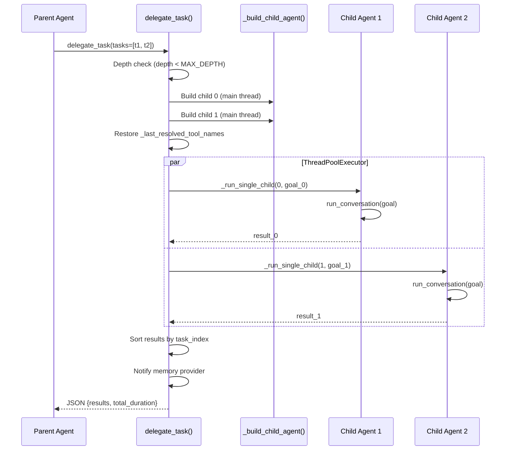
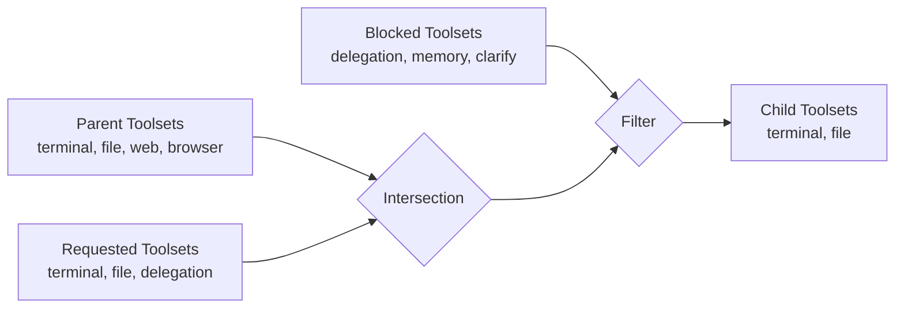
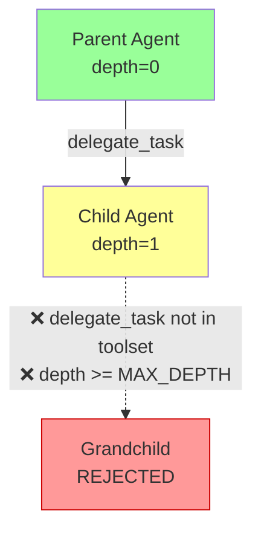
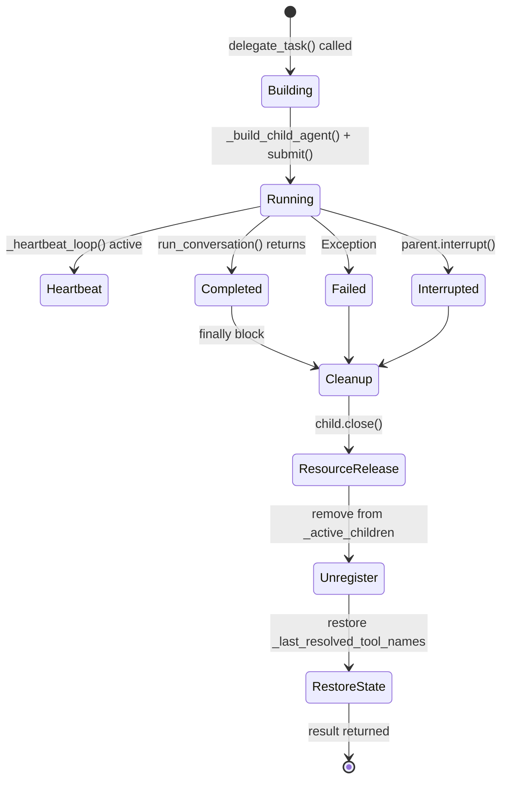

# Ch16 子智能体委托 (Subagent Delegation)

## 1. 架构概览 (Architecture Overview)

Hermes 的子智能体委托系统（`delegate_task`）允许父 agent 产生（spawn）独立的子 agent 来执行隔离任务。这是 Hermes 实现复杂任务分解和并行执行的核心机制。

### 1.1 设计目标

| 目标 | 实现方式 |
|------|---------|
| **Context 隔离** (Context Isolation) | 子 agent 拥有全新的 conversation history，不继承父 agent 的对话 |
| **Toolset 限制** (Toolset Restriction) | 黑名单机制 `DELEGATE_BLOCKED_TOOLS` + 父工具集交集约束 |
| **批量并行** (Batch Parallel) | `ThreadPoolExecutor` 支持多 task 并发执行 |
| **递归防护** (Recursion Prevention) | `MAX_DEPTH = 2` 限制嵌套层级 |
| **透明性** (Transparency) | 父 agent 只看到 delegation call 和最终 summary，不看到中间步骤 |

### 1.2 核心数据流

```
Parent Agent
  ├─ 调用 delegate_task(goal=..., tasks=[...])
  ├─ _build_child_agent() × N  (主线程构建)
  ├─ ThreadPoolExecutor.submit(_run_single_child) × N
  │   ├─ child.run_conversation(goal)   ← 每个子 agent 独立循环
  │   ├─ heartbeat_thread → parent._touch_activity()
  │   └─ return {status, summary, tool_trace, tokens, duration}
  ├─ results.sort(key=task_index)       ← 结果按输入顺序排列
  └─ return JSON {results: [...], total_duration_seconds: ...}
```



## 2. Context 隔离 (Context Isolation)

### 2.1 子 agent 得到的全新环境

每个子 agent 创建时获得：

```python
child = AIAgent(
    # 全新的 system prompt（不是父 agent 的 prompt）
    ephemeral_system_prompt=child_prompt,
    # 独立的 task_id → 独立的终端会话和文件缓存
    # (由 run_conversation 内部生成)
    # 不加载上下文文件
    skip_context_files=True,
    # 不加载 MEMORY.md
    skip_memory=True,
    # 无用户交互能力
    clarify_callback=None,
    # 静默模式
    quiet_mode=True,
    # 独立的迭代预算
    iteration_budget=None,  # fresh budget per subagent
)
```

### 2.2 System Prompt 构建

`_build_child_system_prompt()` 构建一个聚焦的 prompt：

```python
def _build_child_system_prompt(goal, context=None, *, workspace_path=None):
    parts = [
        "You are a focused subagent working on a specific delegated task.",
        "",
        f"YOUR TASK:\n{goal}",
    ]
    if context:
        parts.append(f"\nCONTEXT:\n{context}")
    if workspace_path:
        parts.append(f"\nWORKSPACE PATH:\n{workspace_path}\n...")
    parts.append(
        "\nComplete this task... When finished, provide a clear, concise summary..."
    )
    return "\n".join(parts)
```

### 2.3 Workspace Path Hint

`_resolve_workspace_hint()` 从多个来源尝试解析工作目录，避免子 agent 猜测 `/workspace/...` 这种容器路径：

```python
candidates = [
    os.getenv("TERMINAL_CWD"),
    parent_agent._subdirectory_hints.working_dir,
    parent_agent.terminal_cwd,
    parent_agent.cwd,
]
# 只注入绝对路径且目录存在的候选
```

### 2.4 信息隔离的保证

父 agent 的 context 只看到：
- **发送**: delegation call 的 tool_call 消息
- **接收**: JSON 结果（summary + metadata）

**永远不会看到**的：
- 子 agent 的中间 tool calls
- 子 agent 的 reasoning / thinking
- 子 agent 的完整 conversation history

这通过 `context_compressor.py` 进一步强化——当压缩上下文时，delegate_task 结果会被摘要化：

```python
# agent/context_compressor.py
if tool_name == "delegate_task":
    goal = args.get("goal", "")[:57]
    return f"[delegate_task] '{goal}' ({content_len:,} chars result)"
```

## 3. Toolset 限制 (Toolset Restrictions)

### 3.1 全局黑名单 (Blocked Tools)

```python
DELEGATE_BLOCKED_TOOLS = frozenset([
    "delegate_task",   # 防止递归委托
    "clarify",         # 子 agent 不能与用户交互
    "memory",          # 不能写入共享 MEMORY.md
    "send_message",    # 不能触发跨平台副作用
    "execute_code",    # 子 agent 应该逐步推理，不应写脚本
])
```

### 3.2 Toolset 级别的过滤

```python
_EXCLUDED_TOOLSET_NAMES = frozenset({
    "debugging", "safe", "delegation", "moa", "rl"
})

def _strip_blocked_tools(toolsets):
    blocked_toolset_names = {
        "delegation", "clarify", "memory", "code_execution",
    }
    return [t for t in toolsets if t not in blocked_toolset_names]
```

### 3.3 父工具集交集约束 (Intersection Constraint)

关键安全原则：**子 agent 不能获得父 agent 没有的工具**。

```python
if toolsets:
    # 与父 agent 的 toolset 取交集
    child_toolsets = _strip_blocked_tools(
        [t for t in toolsets if t in parent_toolsets]
    )
elif parent_enabled is not None:
    child_toolsets = _strip_blocked_tools(parent_enabled)
else:
    child_toolsets = _strip_blocked_tools(sorted(parent_toolsets))
```



### 3.4 DEFAULT_TOOLSETS

子 agent 的默认工具集：

```python
DEFAULT_TOOLSETS = ["terminal", "file", "web"]
```

## 4. 批量并行执行 (Batch Parallel Execution)

### 4.1 两种模式

| 模式 | 输入参数 | 执行方式 |
|------|---------|---------|
| **单任务** (Single) | `goal` + optional `context`, `toolsets` | 直接调用，无线程池开销 |
| **批量** (Batch) | `tasks` 数组 `[{goal, context, toolsets}, ...]` | `ThreadPoolExecutor` 并行 |

### 4.2 并发控制

```python
_DEFAULT_MAX_CONCURRENT_CHILDREN = 3
MAX_DEPTH = 2  # parent(0) -> child(1) -> grandchild rejected(2)

def _get_max_concurrent_children():
    # 优先级: config.yaml > DELEGATION_MAX_CONCURRENT_CHILDREN env > default(3)
    cfg = _load_config()
    val = cfg.get("max_concurrent_children")
    ...
```

### 4.3 双层防护：delegate_task 内部 + run_agent 外部

**内部防护** (`delegate_task()`):
```python
if len(tasks) > max_children:
    return tool_error(f"Too many tasks: {len(tasks)} provided...")
```

**外部防护** (`run_agent.py._cap_delegate_task_calls()`):
```python
@staticmethod
def _cap_delegate_task_calls(tool_calls):
    """模型可能在一次 turn 中发出多个独立的 delegate_task 调用。
    截断超出的部分，保留所有非 delegate 调用。"""
    delegate_count = sum(1 for tc in tool_calls
                         if tc.function.name == "delegate_task")
    if delegate_count <= max_children:
        return tool_calls
    # 截断超出的 delegate_task 调用
```

### 4.4 并行执行流程

```python
# 单任务 — 无线程池
if n_tasks == 1:
    result = _run_single_child(0, task["goal"], child, parent_agent)

# 批量 — ThreadPoolExecutor
else:
    with ThreadPoolExecutor(max_workers=max_children) as executor:
        futures = {}
        for i, t, child in children:
            future = executor.submit(_run_single_child, ...)
            futures[future] = i
        
        for future in as_completed(futures):
            entry = future.result()
            results.append(entry)
            # 更新进度显示
```

### 4.5 进度显示 (Progress Display)

子 agent 的工具调用通过 callback 链中继到父 agent 的显示：

```python
def _build_child_progress_callback(task_index, parent_agent, task_count=1):
    """两条显示路径:
      CLI:     在父 agent 的 spinner 上方打印树形视图
      Gateway: 批量工具名并中继到父 agent 的 progress callback
    """
    prefix = f"[{task_index + 1}] " if task_count > 1 else ""
    
    def _callback(event_type, tool_name=None, preview=None, args=None, **kwargs):
        if spinner:
            line = f" {prefix}├─ {emoji} {tool_name}"
            spinner.print_above(line)
        if parent_cb:
            _batch.append(tool_name)
            if len(_batch) >= _BATCH_SIZE:  # 5
                parent_cb("subagent_progress", f"🔀 {prefix}{summary}")
                _batch.clear()
```

CLI 显示效果示例：
```
(◕‿◕) 🔀 2 tasks remaining
 [1] ├─ 🔍 search_files  "error handler"
 [1] ├─ 📄 read_file  "src/main.py"
 [2] ├─ 🌐 web_search  "Python async patterns"
 ✓ [1/2] Fix error handling  (12.3s)
 [2] ├─ 📝 write_file  "notes.md"
 ✓ [2/2] Research async patterns  (8.7s)
```

## 5. MAX_DEPTH 递归防护 (Recursion Prevention)

### 5.1 深度计数机制

```python
MAX_DEPTH = 2  # parent(0) → child(1) → grandchild rejected(2)

# delegate_task() 入口检查
depth = getattr(parent_agent, '_delegate_depth', 0)
if depth >= MAX_DEPTH:
    return json.dumps({
        "error": f"Delegation depth limit reached ({MAX_DEPTH}). "
                 "Subagents cannot spawn further subagents."
    })

# _build_child_agent() 中递增
child._delegate_depth = getattr(parent_agent, '_delegate_depth', 0) + 1
```

### 5.2 多重防护

| 层级 | 防护机制 | 位置 |
|------|---------|------|
| **工具黑名单** | `"delegate_task"` 在 `DELEGATE_BLOCKED_TOOLS` 中 | delegate_tool.py L33 |
| **Toolset 过滤** | `"delegation"` 在 `_strip_blocked_tools` 排除列表中 | delegate_tool.py L152-155 |
| **深度检查** | `depth >= MAX_DEPTH` 返回错误 | delegate_tool.py L646-653 |
| **运行时** | 子 agent 的 `enabled_toolsets` 不包含 `delegation` | _build_child_agent() |

实际上，层级 1 的工具黑名单就已经让子 agent 无法调用 `delegate_task`，深度检查是额外的安全网。



## 6. 全局状态保存与恢复 (Global State Save/Restore)

### 6.1 `_last_resolved_tool_names` 问题

`model_tools._last_resolved_tool_names` 是一个进程级全局变量，记录最后解析的工具名列表。`AIAgent()` 构造函数调用 `get_tool_definitions()` 时会覆盖此全局变量。

当父 agent 构建子 agent 时，子 agent 的工具集（更小）会覆盖此全局变量，导致父 agent 后续操作（如 `execute_code`）看到错误的工具列表。

### 6.2 保存/恢复协议

```python
# delegate_task() 中 — 构建前保存
_parent_tool_names = list(_model_tools._last_resolved_tool_names)

try:
    for i, t in enumerate(task_list):
        child = _build_child_agent(...)
        # 每个 child 记住父 agent 的工具名
        child._delegate_saved_tool_names = _parent_tool_names
finally:
    # 权威恢复：即使构建失败也恢复
    _model_tools._last_resolved_tool_names = _parent_tool_names
```

```python
# _run_single_child() finally 块 — 执行后恢复
finally:
    saved_tool_names = getattr(child, "_delegate_saved_tool_names", None)
    if isinstance(saved_tool_names, list):
        model_tools._last_resolved_tool_names = list(saved_tool_names)
```

这是一个典型的 **Save-Restore Pattern**，解决了全局可变状态（Global Mutable State）在并发环境下的问题。

## 7. ACP 子进程传输 (ACP Subprocess Transport)

### 7.1 概念

ACP (Agent Communication Protocol) 允许子 agent 使用完全不同的 agent 运行时。例如，Hermes 父 agent 可以产生一个 Claude Code 子 agent：

```python
delegate_task(
    goal="Review this PR",
    acp_command="claude",      # 使用 Claude Code CLI
    acp_args=["--acp", "--stdio", "--model", "claude-opus-4-6"]
)
```

### 7.2 实现

```python
# _build_child_agent() 中
effective_acp_command = override_acp_command or getattr(parent_agent, "acp_command", None)
effective_acp_args = list(override_acp_args or getattr(parent_agent, "acp_args", []) or [])

child = AIAgent(
    acp_command=effective_acp_command,
    acp_args=effective_acp_args,
    ...
)
```

每个 task 也支持独立的 ACP 覆盖：
```python
# Schema 中
"acp_command": {"type": "string", "description": "Per-task ACP command override..."},
"acp_args": {"type": "array", ...},
```

## 8. 子 Agent 生命周期 (Child Agent Lifecycle)

### 8.1 完整生命周期



### 8.2 心跳机制 (Heartbeat)

```python
_HEARTBEAT_INTERVAL = 30  # 秒

def _heartbeat_loop():
    """定期将子 agent 活动传播到父 agent，
    防止 gateway 的不活动超时机制误杀父 agent。"""
    while not _heartbeat_stop.wait(_HEARTBEAT_INTERVAL):
        child_summary = child.get_activity_summary()
        desc = f"delegate_task: subagent running {child_tool} (iteration {child_iter}/{child_max})"
        parent_agent._touch_activity(desc)
```

### 8.3 中断传播 (Interrupt Propagation)

```python
# run_agent.py AIAgent.interrupt()
def interrupt(self, message=None):
    self._interrupt_requested = True
    _set_interrupt(True, self._execution_thread_id)
    # 传播到所有运行中的子 agent
    with self._active_children_lock:
        children_copy = list(self._active_children)
    for child in children_copy:
        child.interrupt(message)  # 递归传播
```

```python
# _build_child_agent() — 注册子 agent
if hasattr(parent_agent, '_active_children'):
    with parent_agent._active_children_lock:
        parent_agent._active_children.append(child)

# _run_single_child() finally — 注销子 agent
parent_agent._active_children.remove(child)
```

### 8.4 资源清理 (Resource Cleanup)

`_run_single_child()` 的 finally 块执行完整的资源清理：

1. **停止心跳线程**: `_heartbeat_stop.set()`
2. **释放凭证租约**: `child_pool.release_lease(leased_cred_id)`
3. **恢复全局工具名**: `model_tools._last_resolved_tool_names = saved`
4. **从中断追踪中移除**: `parent_agent._active_children.remove(child)`
5. **关闭子 agent 资源**: `child.close()` — 终端沙箱、浏览器守护进程、后台进程、httpx 客户端

## 9. 凭证管理 (Credential Management)

### 9.1 凭证解析优先级

```python
# _resolve_delegation_credentials()
# 优先级:
# 1. delegation.base_url (直接 OpenAI 兼容端点)
# 2. delegation.provider (通过 runtime provider 系统解析完整凭证)
# 3. 无配置 → 从父 agent 继承
```

### 9.2 凭证池共享

```python
def _resolve_child_credential_pool(effective_provider, parent_agent):
    """
    规则:
    1. 与父 agent 相同 provider → 共享父 agent 的 pool（同步 cooldown）
    2. 不同 provider → 加载该 provider 自己的 pool
    3. 无 pool → 使用固定凭证
    """
```

### 9.3 Reasoning 配置继承

```python
# delegation.reasoning_effort 可以覆盖
delegation_effort = delegation_cfg.get("reasoning_effort")
if delegation_effort:
    child_reasoning = parse_reasoning_effort(delegation_effort)
else:
    child_reasoning = parent_reasoning  # 继承
```

## 10. 结果结构 (Result Structure)

### 10.1 单条结果

```json
{
    "task_index": 0,
    "status": "completed",          // "completed" | "failed" | "error" | "interrupted"
    "summary": "子 agent 的最终文本响应",
    "api_calls": 12,
    "duration_seconds": 15.3,
    "model": "anthropic/claude-opus-4-20250514",
    "exit_reason": "completed",     // "completed" | "max_iterations" | "interrupted"
    "tokens": {"input": 45000, "output": 3200},
    "tool_trace": [
        {"tool": "search_files", "args_bytes": 42, "result_bytes": 1500, "status": "ok"},
        {"tool": "read_file", "args_bytes": 35, "result_bytes": 8000, "status": "ok"}
    ]
}
```

### 10.2 整体返回

```json
{
    "results": [...],
    "total_duration_seconds": 18.7
}
```

### 10.3 Memory Provider 通知

```python
# 通知父 agent 的 memory provider
for entry in results:
    parent_agent._memory_manager.on_delegation(
        task=task_goal,
        result=entry.get("summary", ""),
        child_session_id=child.session_id,
    )
```

## 11. 配置体系 (Configuration)

### 11.1 config.yaml 中的 delegation 块

```yaml
delegation:
  model: "anthropic/claude-sonnet-4-20250514"    # 子 agent 可用更便宜的模型
  provider: "openrouter"
  max_iterations: 50                              # 每个子 agent 的迭代上限
  max_concurrent_children: 3                      # 最大并发子 agent 数
  reasoning_effort: "low"                         # 子 agent 的 reasoning 级别
  default_toolsets: ["terminal", "file", "web"]   # 默认工具集
  base_url: ""                                    # 直接端点覆盖
  api_key: ""                                     # 端点 API key
```

### 11.2 配置加载优先级

```python
def _load_config():
    # 1. CLI_CONFIG (运行时)
    from cli import CLI_CONFIG
    cfg = CLI_CONFIG.get("delegation", {})
    
    # 2. persistent config (hermes_cli/config.py)
    from hermes_cli.config import load_config
    return load_config().get("delegation", {})
```

## 12. Schema 设计 (Function-Calling Schema)

### 12.1 Schema 核心特点

- **互斥参数**: `goal`（单任务）或 `tasks`（批量），运行时验证
- **无 maxItems**: tasks 数组不在 schema 中限制上限，通过运行时 `max_concurrent_children` 配置
- **详细的使用指南**: schema description 包含何时使用、何时不使用的建议
- **ACP 支持**: `acp_command` + `acp_args` 参数支持跨 agent 运行时

### 12.2 工具注册

```python
registry.register(
    name="delegate_task",
    toolset="delegation",
    schema=DELEGATE_TASK_SCHEMA,
    handler=lambda args, **kw: delegate_task(
        goal=args.get("goal"),
        context=args.get("context"),
        toolsets=args.get("toolsets"),
        tasks=args.get("tasks"),
        max_iterations=args.get("max_iterations"),
        acp_command=args.get("acp_command"),
        acp_args=args.get("acp_args"),
        parent_agent=kw.get("parent_agent"),
    ),
    check_fn=check_delegate_requirements,
    emoji="🔀",
)
```

## 13. 线程安全 (Thread Safety)

### 13.1 关键同步点

| 资源 | 同步机制 | 位置 |
|------|---------|------|
| `_active_children` | `threading.Lock` (`_active_children_lock`) | run_agent.py L762 |
| `IterationBudget` | 内部 `threading.Lock` | run_agent.py L188 |
| `_last_resolved_tool_names` | 保存/恢复协议 + try/finally | delegate_tool.py L706-729 |
| 子 agent 构建 | **主线程构建**，仅执行在工作线程 | delegate_tool.py L708 |
| `_SafeWriter` | 包装 stdout/stderr 防止 I/O 异常 | run_agent.py L113-167 |

### 13.2 _SafeWriter

当子 agent 在 ThreadPoolExecutor 线程中运行时，共享的 stdout 句柄可能在线程拆除和清理之间关闭，抛出 `ValueError: I/O operation on closed file`。`_SafeWriter` 包装 stdout/stderr 静默捕获此异常。

## 14. 迭代预算 (Iteration Budget)

### 14.1 独立预算

每个子 agent 获得独立的 `IterationBudget`：

```python
child = AIAgent(
    max_iterations=effective_max_iter,  # delegation.max_iterations (default: 50)
    iteration_budget=None,              # 创建全新的 budget
)
```

这意味着父 agent + N 个子 agent 的总迭代次数可以超过父 agent 的 `max_iterations`。

### 14.2 历史演化

根据 release notes：
- v0.2.0: 共享迭代预算（父+子共用）
- v0.5.0: 修复为独立预算（#3004），避免子 agent 过早耗尽预算

## 15. 设计模式总结 (Design Patterns)

| 模式 | 应用 |
|------|------|
| **Fork-Join** | 父 agent fork 多个子 agent，join 等待所有完成 |
| **Save-Restore** | `_last_resolved_tool_names` 全局状态保存/恢复 |
| **Observer** | Memory provider 的 `on_delegation()` 回调 |
| **Builder** | `_build_child_agent()` 分步构建子 agent |
| **Heartbeat** | 定期 touch 父 agent 防止超时 |
| **Capability Intersection** | 子 agent 工具集 ⊆ 父 agent 工具集 |
| **Defense in Depth** | MAX_DEPTH + 黑名单 + toolset 过滤 三重递归防护 |
| **Credential Pool Sharing** | 同 provider 共享池，不同 provider 独立池 |

## 16. 关键源码位置索引

| 文件 | 行号 | 内容 |
|------|------|------|
| `delegate_tool.py` L32-38 | `DELEGATE_BLOCKED_TOOLS` 黑名单 |
| `delegate_tool.py` L53 | `MAX_DEPTH = 2` |
| `delegate_tool.py` L90-122 | `_build_child_system_prompt()` |
| `delegate_tool.py` L150-155 | `_strip_blocked_tools()` |
| `delegate_tool.py` L238-397 | `_build_child_agent()` 完整构建 |
| `delegate_tool.py` L399-621 | `_run_single_child()` 执行 + 清理 |
| `delegate_tool.py` L623-813 | `delegate_task()` 主入口 |
| `delegate_tool.py` L848-934 | `_resolve_delegation_credentials()` |
| `delegate_tool.py` L964-1082 | `DELEGATE_TASK_SCHEMA` |
| `run_agent.py` L760-762 | `_delegate_depth`, `_active_children` 初始化 |
| `run_agent.py` L2953-2960 | `interrupt()` 中的子 agent 中断传播 |
| `run_agent.py` L3397-3426 | `_cap_delegate_task_calls()` |
| `run_agent.py` L7407-7439 | delegate_task 的 spinner + 执行 |
| `agent/context_compressor.py` L134-138 | delegate_task 结果压缩 |
| `agent/memory_provider.py` L177-185 | `on_delegation()` observer |
| `model_tools.py` L62 | ThreadPoolExecutor 线程的 event loop 说明 |
